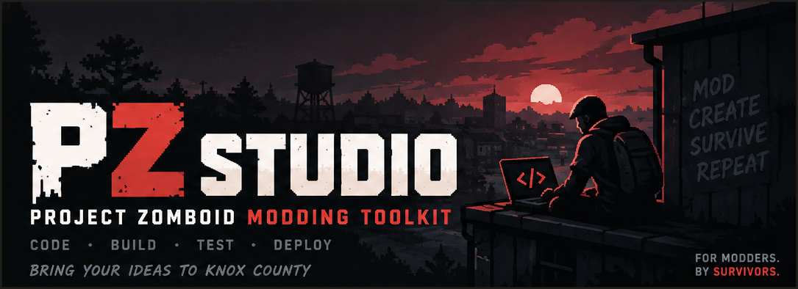

# PZ Studio



> PZ Studio — create, validate, build and live-sync
> Project Zomboid **Build 42** Lua mods from one engine.

<!-- The escapepz.pzstudio42 Marketplace listing and the escapepz/pzstudio42
     Open VSX extension must be published before the two version badges
     resolve; until then they render "unknown" / "extension not found". -->
[](https://marketplace.visualstudio.com/items?itemName=escapepz.pzstudio42)
[](https://open-vsx.org/extension/escapepz/pzstudio42)
[](https://www.npmjs.com/package/@pzstudio/cli)
[](https://projectzomboid.com/)
[](https://github.com/escapepz/pzstudio/actions/workflows/ci.yml)
[![Ask_Zread](https://img.shields.io/badge/Ask_Zread-_.svg?style=flat-square&color=00b0aa&labelColor=000000&logo=data%3Aimage%2Fsvg%2Bxml%3Bbase64%2CPHN2ZyB3aWR0aD0iMTYiIGhlaWdodD0iMTYiIHZpZXdCb3g9IjAgMCAxNiAxNiIgZmlsbD0ibm9uZSIgeG1sbnM9Imh0dHA6Ly93d3cudzMub3JnLzIwMDAvc3ZnIj4KPHBhdGggZD0iTTQuOTYxNTYgMS42MDAxSDIuMjQxNTZDMS44ODgxIDEuNjAwMSAxLjYwMTU2IDEuODg2NjQgMS42MDE1NiAyLjI0MDFWNC45NjAxQzEuNjAxNTYgNS4zMTM1NiAxLjg4ODEgNS42MDAxIDIuMjQxNTYgNS42MDAxSDQuOTYxNTZDNS4zMTUwMiA1LjYwMDEgNS42MDE1NiA1LjMxMzU2IDUuNjAxNTYgNC45NjAxVjIuMjQwMUM1LjYwMTU2IDEuODg2NjQgNS4zMTUwMiAxLjYwMDEgNC45NjE1NiAxLjYwMDFaIiBmaWxsPSIjZmZmIi8%2BCjxwYXRoIGQ9Ik00Ljk2MTU2IDEwLjM5OTlIMi4yNDE1NkMxLjg4ODEgMTAuMzk5OSAxLjYwMTU2IDEwLjY4NjQgMS42MDE1NiAxMS4wMzk5VjEzLjc1OTlDMS42MDE1NiAxNC4xMTM0IDEuODg4MSAxNC4zOTk5IDIuMjQxNTYgMTQuMzk5OUg0Ljk2MTU2QzUuMzE1MDIgMTQuMzk5OSA1LjYwMTU2IDE0LjExMzQgNS42MDE1NiAxMy43NTk5VjExLjAzOTlDNS42MDE1NiAxMC42ODY0IDUuMzE1MDIgMTAuMzk5OSA0Ljk2MTU2IDEwLjM5OTlaIiBmaWxsPSIjZmZmIi8%2BCjxwYXRoIGQ9Ik0xMy43NTg0IDEuNjAwMUgxMS4wMzg0QzEwLjY4NSAxLjYwMDEgMTAuMzk4NCAxLjg4NjY0IDEwLjM5ODQgMi4yNDAxVjQuOTYwMUMxMC4zOTg0IDUuMzEzNTYgMTAuNjg1IDUuNjAwMSAxMS4wMzg0IDUuNjAwMUgxMy43NTg0QzE0LjExMTkgNS42MDAxIDE0LjM5ODQgNS4zMTM1NiAxNC4zOTg0IDQuOTYwMVYyLjI0MDFDMTQuMzk4NCAxLjg4NjY0IDE0LjExMTkgMS42MDAxIDEzLjc1ODQgMS42MDAxWiIgZmlsbD0iI2ZmZiIvPgo8cGF0aCBkPSJNNCAxMkwxMiA0TDQgMTJaIiBmaWxsPSIjZmZmIi8%2BCjxwYXRoIGQ9Ik00IDEyTDEyIDQiIHN0cm9rZT0iI2ZmZiIgc3Ryb2tlLXdpZHRoPSIxLjUiIHN0cm9rZS1saW5lY2FwPSJyb3VuZCIvPgo8L3N2Zz4K&logoColor=ffffff)](https://zread.ai/escapepz/pzstudio)
[](https://deepwiki.com/escapepz/pzstudio)

**PZ Studio** ships two surfaces over one shared engine:

- **`pzstudio` CLI** (`@pzstudio/cli`) — scaffold, validate, build and watch
  mod projects from any terminal. Node 20+, zero-install via `npx` /
  `pnpm dlx`.
- **VS Code extension** (`pzstudio42`) — PZ Project Explorer, one-click
  Build/Clean, per-project diagnostics and Development Sync, driven by the
  same engine.

Upstream: this branch targets Build 42; the original
[Konijima/project-zomboid-studio](https://github.com/Konijima/project-zomboid-studio)
repository carries Build 41 (Legacy) support.

## Highlights

- **Project scaffolding & maintenance** — `new`, `add`, `rename`, `delete`,
  `modconfig`; `.pzstudioignore` filtering; template cache with explicit
  refresh (`pzstudio update`, `--force-update`).
- **Build 42 layouts** — `pzstudio modinfo generate` authors `mod.info`
  into `common` / `42` / branch folders; `pzBuildCompatibility` declares
  game compatibility per project and per package.
- **Dual workshop outputs** — one build produces the main workshop output
  plus an unlisted `dev_branch` output (`_dev` mod ids) for multiplayer
  testing.
- **Doctor diagnostics** — Problem/Cause/Try findings across project,
  environment, filesystem, templates, mods and build target; machine
  `--json` envelopes for `list` and `doctor`.
- **Development Sync** — `pzstudio watch` (or the extension toggle) keeps
  the workshop outputs synced as you save: files apply incrementally,
  `mod.info`/`.pzstudioignore` edits re-sync their mod, `project.json`
  edits trigger a full rebuild.
- **Localized UI** — the extension ships in 25 languages; errors are
  actionable (localized notification with **Show Details** opening the
  output channel).
- **Fail-closed safety** — destinations inside the mod source tree refuse
  to adopt content the engine cannot prove it created; `build` and `clean`
  refuse to mutate through symlink/junction routes below the configured
  output root. Logs and engine records are retained indefinitely — no
  automatic pruning.

## Install

### CLI

Zero-install on any machine with Node 20+:

```bash
npx -y @pzstudio/cli@latest new "My First Mod"
cd <path printed by the command>
npx -y @pzstudio/cli@latest doctor      # verify the setup
npx -y @pzstudio/cli@latest watch       # sync outputs while you edit
npx -y @pzstudio/cli@latest build       # build once into the configured outdir
```

`new` downloads templates from GitHub on first use — add `--offline` to
scaffold from bundled templates. pnpm users: `pnpm dlx @pzstudio/cli@latest …`
(and once per project, `pnpm approve-builds @parcel/watcher` if the watcher
needs its native build). Global and pinned installs, troubleshooting and
embedding: [`packages/cli/README.md`](packages/cli/README.md).

### VS Code extension

Install from the
[Marketplace](https://marketplace.visualstudio.com/items?itemName=escapepz.pzstudio42)
or build a VSIX locally (`pnpm --filter pzstudio42 vsce:package`). Features,
command list and every `pzstudio.*` setting:
[`packages/vscode-extension/README.md`](packages/vscode-extension/README.md).

## Documentation

| Document                                            | Contents                                                                    |
| :-------------------------------------------------- | :-------------------------------------------------------------------------- |
| [`packages/cli/README.md`](packages/cli/README.md)  | CLI install (npm/pnpm), pnpm mental models, troubleshooting, embedding API  |
| [`CLI.md`](CLI.md)                                  | Full `pzstudio` command reference (usage, flags, behavior per command)      |
| [`packages/vscode-extension/README.md`](packages/vscode-extension/README.md) | Extension guide: Explorer, DevSync, all `pzstudio.*` settings |
| [`CHANGELOG.md`](CHANGELOG.md)                      | Combined changelog for the monorepo (CLI + extension per release)           |
| [`docs/releases/`](docs/releases/)                  | Per-version release notes and the [`RELEASE.md`](docs/releases/RELEASE.md) runbook |
| [`docs/vscode-extension/`](docs/vscode-extension/)  | Behavioral spec and UI/UX audit of the extension, decision records          |
| [`AGENTS.md`](AGENTS.md)                            | Repo instructions: commands, architecture and code style for contributors   |

## Development

pnpm monorepo (Node 20+, [pnpm](https://pnpm.io/)):

| Package                            | Role                                                                      |
| :--------------------------------- | :------------------------------------------------------------------------ |
| `@pzstudio/core`                   | Browser-safe domain logic — no Node builtins (enforced by architecture tests) |
| `@pzstudio/platform` (+`-node`/`-web`) | Host-agnostic contracts (`ProjectFileSystem`, `PlatformCapabilities`, `TemplateTransport`) with Node and vscode.dev adapters |
| `@pzstudio/cli`                    | The published CLI; embeddable surface at `@pzstudio/cli/api`              |
| `pzstudio42`                       | The VS Code extension (esbuild-inlines the CLI api surface)                |

```bash
pnpm install
pnpm build            # all packages, dependency order
pnpm lint             # eslint (pnpm lint:fix to auto-fix)
pnpm format:check     # prettier
pnpm test             # unit + in-process e2e (vitest)
pnpm test:real-env    # spawns the built CLI binary
pnpm test:coverage
```

CI runs the full matrix — lint, build, unit/e2e, real-env CLI and desktop
extension tests — on Windows, Ubuntu and macOS (Vitest runs test files
sequentially on Windows). Browser-safety gates fail the build if
`@pzstudio/core` or `@pzstudio/platform` import Node builtins.

Releases follow the `0.<gameBuild>.<patch>` scheme with game compatibility
declared separately in `pzBuildCompatibility` (e.g. `"42.x"`). See
[`CHANGELOG.md`](CHANGELOG.md), the per-version notes in
[`docs/releases/`](docs/releases/), and the publish runbook
[`docs/releases/RELEASE.md`](docs/releases/RELEASE.md).
