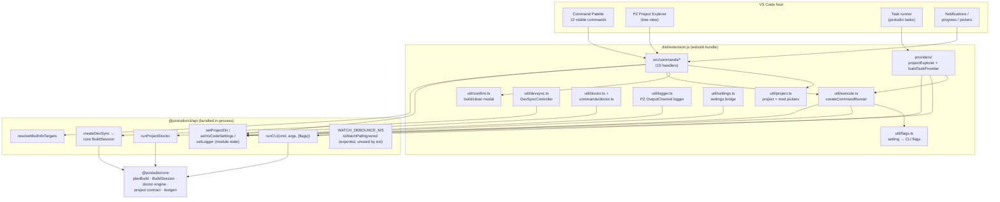

# 00 — Overview

Architecture map, the complete command inventory, the UI surfaces the
extension contributes, and the high-level user journeys.

## Architecture map

Key structural facts:

- The extension bundle **inlines the whole CLI api surface** —
  `scripts/bundle.js:8-21` bundles `src/extension.ts` with only `vscode` and
  `@parcel/watcher` external. The `@parcel/watcher` native module stays
  external because only the CLI's own `watch` command loads it, lazily, inside
  `watchCmd` (`packages/cli/src/lib/commands/watch.ts:111`) — the extension
  never invokes it (`dc15821` lesson; see
  [`01-activation-and-architecture.md`](01-activation-and-architecture.md)).
- Two command paths bypass the generic runner: **watch** (`commands/watch.ts`)
  and **doctor** (`commands/doctor.ts`) — they never call `runCLI`.
- The task provider runs `runCLI` in-process through its own
  `Pseudoterminal` (`providers/buildTaskProvider.ts`) with **no confirmation
  modal** and **no shared busy-guard** with the palette runner (UX-08).

## Command inventory

All 20 contributed commands (`package.json:336-432`). "Palette" = appears in
the Command Palette; entries in `contributes.menus.commandPalette`
(`package.json:128-161`) with `when: false` hide a command from the palette
while keeping it usable from tree menus and inline buttons.

| Command id | Palette | Menus / buttons | Handler | Project needed | Mod needed | Destructive | Confirm | Execution path |
| :--- | :--- | :--- | :--- | :--- | :--- | :--- | :--- | :--- |
| `pzstudio.new` | yes | — | `commands/new.ts:113-124` | no (creates one) | no | creates files | no (folder picker + 2 inputs) | runner → `runCLI('new')` |
| `pzstudio.newHere` | yes | — | `commands/new.ts:125-129` | no (creates one) | no | creates files | no | runner → `runCLI('new')` |
| `pzstudio.add` | yes | — | `commands/add.ts:9-34` | yes (picker first) | no (created) | creates files | no | runner → `runCLI('add')` |
| `pzstudio.build` | yes | project row inline button (`inline@1`), `package.json:62-71` | `commands/build.ts:8-37` | yes | no | overwrites output | **modal** (`confirmBeforeRun`) | runner → `runCLI('build')` |
| `pzstudio.clean` | yes | project row inline button (`inline@2`), `package.json:72-81` | `commands/clean.ts:8-37` | yes | no | deletes output | **modal** (`confirmBeforeRun`) | runner → `runCLI('clean')` |
| `pzstudio.delete` | yes | mod context menu (`3_mod`, `package.json:122-126`); mod row inline button (`inline@6`, `package.json:102-106`) | `commands/delete.ts:7-39` | yes | yes | **yes** | **modal** | runner → `runCLI('delete')` **with `--yes`** |
| `pzstudio.rename` | yes | mod context menu (`2_mod`); mod row inline button (`inline@5`) | `commands/rename.ts:7-44` | yes | yes | **yes** | **modal** (added with `91620af`) | runner → `runCLI('rename')` **with `--yes`** |
| `pzstudio.lang` | yes | — | `commands/lang.ts:6-24` | yes | yes | creates files | no | runner → `runCLI('lang')` |
| `pzstudio.update` | yes | — | `commands/update.ts:4-10` | **yes** (artificially gated — UX-03) | no | refreshes global template cache | no | runner → `runCLI('update')` |
| `pzstudio.modinfoGenerate` | yes | mod context menu (`1_mod`); mod row inline button (`inline@4`) | `commands/modinfo.ts:10-55` | yes | yes | overwrites mod.info | **modal only when a mod.info exists** (`--force`) | runner → `runCLI('modinfo generate')` |
| `pzstudio.watch` | yes | — | `commands/watch.ts:12-38` | yes (to start) | no | writes outputs | no (toggle) | **direct** → `DevSyncController` (no `runCLI`) |
| `pzstudio.doctor` | yes | project context menu (`0_project@1`, `package.json:56-61`) | `commands/doctor.ts:22-67` | yes | no | read-only | no | **direct** → `runProjectDoctor` (no `runCLI`) |
| `pzstudio.modIncluded` | hidden | mod row inline (`inline@1`) when `mod-included`/`mod-devonly` | `commands/modstate.ts:26-43` | yes | yes | config write | no | runner → `runCLI('modconfig <id> exclude')` |
| `pzstudio.modExcluded` | hidden | mod row inline (`inline@1`) when `mod-excluded` | `commands/modstate.ts:26-43` | yes | yes | config write | no | runner → `runCLI('modconfig <id> include')` |
| `pzstudio.modDevOnly` | hidden | mod row inline (`inline@2`) when `mod-devonly` | `commands/modstate.ts:26-43` | yes | yes | config write | no | runner → `runCLI('modconfig <id> include')` |
| `pzstudio.modDevOnly.dim` | hidden | mod row inline (`inline@2`) when `mod-included`/`mod-excluded` | `commands/modstate.ts:26-43` | yes | yes | config write | no | runner → `runCLI('modconfig <id> devonly')` |
| `pzstudio.modConfigure` | hidden | mod context menu (`0_mod@1`) | `commands/configure.ts:50-190` | yes | yes | config write | no | runner → `runCLI('modconfig …')` |
| `pzstudio.explorer.refresh` | hidden | view title (`navigation@3`) | `commands/explorer.ts:8-10` | no | no | no | no | direct provider refresh |
| `pzstudio.explorer.toggleFiles` | hidden | view title (`navigation@1`) when `pzstudioExplorer.showAllFiles` | `commands/explorer.ts:12-15` | no | no | no | no | direct provider toggle |
| `pzstudio.explorer.toggleFiles.hidden` | hidden | view title (`navigation@1`) when `!pzstudioExplorer.showAllFiles` | `commands/explorer.ts:16-19` | no | no | no | no | direct provider toggle |

Palette-visible set = **12 commands** (10 workflow + watch + doctor; the
hidden set is pinned by `tests/unit/projectExplorer.test.ts`
"keeps explorer-only commands out of the command palette" and
`ea3d16b` moved the block to the correct `contributes.menus.commandPalette`
path — the current manifest has no `contributes.commandPalette` key).

## Surfaces

| Surface | What the extension puts there |
| :--- | :--- |
| Command Palette | 12 commands (table above) |
| Activity bar / tree view | `pzstudio-container` → `pzstudio.projectExplorer` ("PZ Project Explorer", `package.json:19-37`) |
| Tree inline buttons | build/clean on project rows; include/exclude + dev-only + modinfo + rename + delete on mod rows |
| Tree context menus | doctor on project rows; configure/modinfo/rename/delete on mod rows (incl. `mod-missing`) |
| View title | eye/eye-closed "Toggle All/Essential Files" pair + refresh |
| Tasks | 4 tasks of type `pzstudio`: build (production/development/both), clean |
| Notifications | modal confirms (build/clean/delete/rename/modinfo-overwrite), progress (every runner command), warnings/errors |
| Output channel | `PZ Studio` channel: every embedded CLI run's data + progress + errors |
| JSON schema | `jsonValidation` for `project.json` → bundled `schemas/pzstudio.schema.json` (`package.json:183-188`) |
| Keyboard Shortcuts UI | all 20 commands are listed there even when hidden from the palette (platform behavior of `when: false`) |

There are **no keybindings, no webviews, no status-bar item, no decoration
providers** contributed.

## User journeys (as the code implements them)

1. **First project** — Command Palette → *PZ Studio: New Project* → folder
   picker (defaults: setting → last used → first workspace folder) → title →
   optional mod id → `pzstudio new <title> [modId] --path <dest>` with
   `projectDir` anchored at the destination
   (`commands/new.ts:83-106`). Cancel of the folder picker falls back to the
   default destination rather than aborting (pinned by tests; UX-14).
2. **Everyday edit** — open project files, edit; **Toggle Development Sync**
   keeps both workshop outputs fresh (see
   [`06-development-sync.md`](06-development-sync.md)).
3. **Package for the game** — inline ▶ on a project row → confirm modal
   (workshop title shown) → `pzstudio build` with flags from
   `pzstudio.build.target` (see
   [`05-build-clean-and-tasks.md`](05-build-clean-and-tasks.md)).
4. **Something is wrong** — right-click project row → *Run Diagnostics* →
   quick-pick listing findings from the shared engine, or read the `✗ n ⚠ n`
   badge in the row description
   ([`07-diagnostics.md`](07-diagnostics.md)).
5. **Manage mods** — mod rows and their context menus cover modinfo, rename,
   delete, build-state toggles and field edits (all routed through
   `pzstudio modconfig` / `modinfo` / `rename` / `delete` via the runner).
