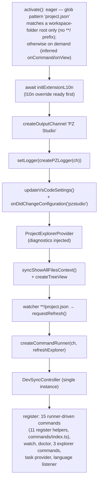

# 01 — Activation and Architecture

What happens when the extension loads, what it registers, and how the import
graph stays free of native dependencies.

## Activation events

`package.json:16-18`:

```json
"activationEvents": ["workspaceContains:project.json"]
```

`workspaceContains:project.json` is the **declared, eager** activation. The
value is a **glob pattern**, and without a `**/` prefix it matches only a
`project.json` **directly at a workspace-folder root** — when such a file
exists, the extension loads right away so the explorer and its watcher are
ready. Note the asymmetry with the extension's own discovery
(`findProjectDirs`, [`02`](02-project-and-mod-resolution.md)), which also
scans **depth-1 subfolders**: a project sitting one level below a workspace
root gets no eager activation and relies on the inferred on-demand paths
below — benign, since VS Code then activates the extension the moment its
view is opened or one of its commands runs.

It is **not** the only path. On the engine baseline (`^1.102.0`; inference
exists since VS Code 1.74) VS Code also **infers** activation events from
the contributions: every contributed command gets an implicit
`onCommand:<id>`, and the contributed view an implicit `onView:<id>`.
Consequences:

- Invoking any contributed command — the 12 palette-visible ones, or a
  hidden one via tree menus / inline buttons / the Keyboard Shortcuts UI —
  activates the extension first, then runs its handler. This works even in
  a workspace with **no** `project.json`.
- Opening the **PZ Project Explorer** view (the activity-bar container)
  activates the extension; the tree renders its *"No project found in the
  workspace."* placeholder.
- So in a project-less workspace the extension is merely **not pre-loaded**
  — the commands are still contributed and visible, and they activate the
  host on demand. Most handlers then stop at project resolution with
  `warnNoProject` ([`02`](02-project-and-mod-resolution.md)); the
  project-creating commands (`pzstudio.new`, `pzstudio.newHere`) work
  as-is. `pzstudio.update` stops at the same handler-level gate — a runner
  decision, not an activation one (UX-03).

## `activate()` wiring

`src/extension.ts:23-81`, in order:

1. **l10n override first** (`extension.ts:25`) — `initExtensionL10n(context)`
   is awaited **before** any UI string is produced so the first tree render
   already uses `pzstudio.language` (see
   [`08-configuration-and-localization.md`](08-configuration-and-localization.md)).
2. **Output channel** (`extension.ts:27`) — `vscode.window.createOutputChannel('PZ Studio')`.
3. **Logger bridge** (`extension.ts:29`) — `setLogger(createPZLogger(outputChannel))`
   installs the extension's `ILogger` into the CLI api; from here every
   embedded CLI message lands in the channel (mapping in
   [`09-embedded-cli-bridge.md`](09-embedded-cli-bridge.md)).
4. **Settings bridge** (`extension.ts:31-32`) — `updateVsCodeSettings()` pushes
   the initial `pzstudio` settings into the CLI api
   (`setVsCodeSettings(workspace, user)`), and
   `subscribeToConfigurationChanges()` re-pushes on any `pzstudio.*` change
   (`util/settings.ts:38-44`).
5. **Explorer provider** (`extension.ts:34-43`) — constructed with the
   diagnostics source injected (`runProjectDiagnostics`), the
   `pzstudioExplorer.showAllFiles` context key is published immediately
   (`syncShowAllFilesContext()`, `extension.ts:40`) so the eye/eye-closed
   title button resolves its `when` clause before the first click, then the
   tree view is created.
6. **project.json watcher** (`extension.ts:47-51`) — a
   `FileSystemWatcher` on `**/project.json` fires
   `projectExplorer.requestRefresh()` on change/create/delete (debounced,
   see [`03-project-explorer.md`](03-project-explorer.md)).
7. **Command runner** (`extension.ts:53-55`) — `createCommandRunner(outputChannel, () => projectExplorer.requestRefresh())`;
   the second argument makes **every** runner-driven command refresh the tree
   when it finishes (`util/execute.ts:78`).
8. **DevSyncController** (`extension.ts:58`) — one controller for the whole
   extension, registered as a disposable so a host teardown stops sync.
9. **Subscriptions** (`extension.ts:60-80`): output channel, dev sync, all
   generic commands (`commands/index.ts:15-32`), the watch command, the
   doctor command, the tree view, the project.json watcher, the three
   explorer commands, the `pzstudio` **task provider**, and a second
   configuration listener that re-loads the l10n bundle and repaints the tree
   when `pzstudio.language` changes (`extension.ts:74-79`).



## `deactivate()`

`extension.ts:83-87` clears the CLI api's module state: `setLogger(undefined)`,
`setProjectDir(undefined)`, `setVsCodeSettings(undefined, undefined)`. The
`DevSyncController` is stopped by normal subscription disposal
(`util/devsync.ts:79-81`).

## Context keys

Exactly one: `pzstudioExplorer.showAllFiles` (`providers/projectExplorer.ts:31`),
published by `syncShowAllFilesContext()` and toggled by
`toggleShowAllFiles()`. It drives the view-title eye/eye-closed pair
(`package.json:39-55`).

## Import graph and native/lazy-load constraints

- **Bundle**: `scripts/bundle.js` — esbuild, `format: 'cjs'`,
  `platform: 'node'`, `minify` (unless `--watch`), `sourcemap`. Externals:
  `vscode` and `@parcel/watcher` (`bundle.js:16`).
- **Native watcher isolation**: `@parcel/watcher` is required **inside**
  `watchCmd` (`packages/cli/src/lib/commands/watch.ts:111`), never at module
  top level; the extension never calls `watchCmd`, so the native binding is
  never resolved in the extension host. This is a permanent rule recorded
  after the `dc15821` crash ("module nào có dep native/host-specific thì
  KHÔNG được import top-level nếu nằm trong đường import của api surface").
- **Bundled assets**: the build copies `.template-legacy` templates from the
  repo submodule into the package (`bundle.js:31-59`) and the two JSON schemas
  into `schemas/` (`bundle.js:62-73`). `.vscodeignore` excludes sources but
  **keeps** `dist/extension.js`, `l10n/`, `package.nls*`, `schemas/`,
  `resources/` and `.template-legacy/` — the legacy templates are the
  extension's offline fallback: the embedded CLI probes
  `<bundleDir>/../.template-legacy` (`packages/cli/src/lib/templateManager.ts:222-226`),
  which resolves inside the installed extension when the cache is cold.
- **CLI dependency**: `dependencies: { "@pzstudio/cli": "workspace:*" }`
  (`package.json:486-488`); `tsconfig.json:16-18` maps `@pzstudio/cli/*` to
  `../cli/dist/*`, so the **CLI must be built before the extension** builds or
  typechecks (CI builds `pnpm --filter pzstudio42... build` in dependency
  order).

## Test coverage of activation

- `tests/unit/extBundleActivation.test.ts` loads the real `dist/extension.js`
  with a vscode stub and asserts: `activate()` completes, **every manifest
  command is registered**, tree view + task provider exist, disposables are
  pushed. This is the permanent gate for the `dc15821` class of bugs.
- `packages/vscode-extension/src/test/integration.test.ts` repeats the
  registration assertion inside a real VS Code 1.102.0 host (plus task
  definitions, refresh, a real build and the embedded `--yes` rename/delete
  contract).
