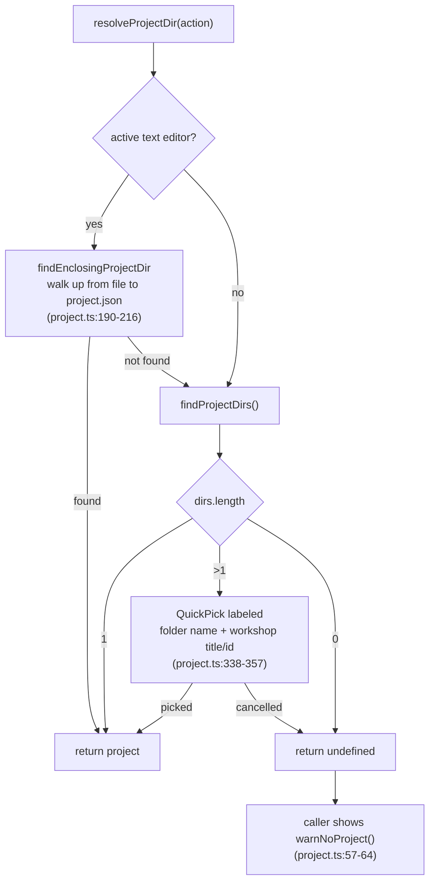
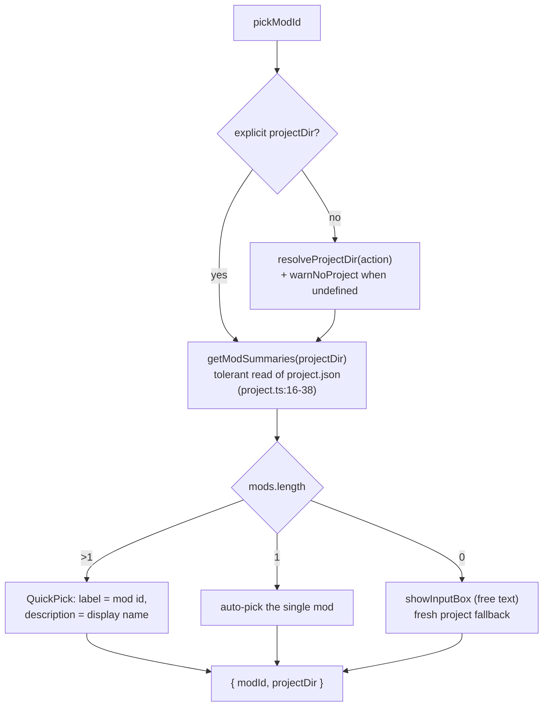

# 02 — Project and Mod Resolution

How a command decides **which project** and **which mod** it operates on.
This is the most heavily reworked UX area (picker flow `b9b6632`, issue #43
port `4b63ac9`) and the area where the current global-anchor design shows.

## Extension-side project resolution

Every entry point that has no tree context ends in
`resolveProjectDir(action)` (`util/project.ts:323-360`):

- **Discovery** (`findProjectDirs`, `util/project.ts:126-182`): every
  workspace root with `project.json` + every **depth-1 subfolder** with
  `project.json` (the layout `pzstudio new` creates). Skips dot folders,
  `node_modules`, `dist`. Limits: **10 root projects + 10 subfolder
  projects** (`PROJECT_SCAN_LIMITS`, `project.ts:111-116`); the count that
  would have exceeded the budget only sets `truncated`
  (`tests/unit/extUtilProject.test.ts` "reports truncation past the scan
  limits"). Deeper nesting is never scanned.
- **Active editor wins** (`project.ts:326-332`): the project enclosing the
  focused file is used without any UI. `findEnclosingProjectDir` walks up
  with `path.dirname` and stops at workspace roots — a file outside every
  workspace root never resolves this way.
- **Multi-root**: covered by the scan + quick-pick; picker entries show the
  workshop **title** (falling back to `id <n>`) with the full fsPath as
  detail (`project.ts:339-353`).
- **No project**: callers show `warnNoProject`
  (`"no PZ project (project.json) found in this workspace — nothing to
  {0}. Use 'PZStudio: New Project' to create one."`) instead of a raw CLI
  error.

### Tree context overrides discovery

Commands invoked from tree rows receive the tree item as their argument. The
provider attaches context in `getTreeItem`
(`providers/projectExplorer.ts:339-344` for projects, `354-364` for mods) and
`asProjectNode` / `asModNode` (`projectExplorer.ts:181-213`) read it back.
A valid tree context **skips the picker entirely** (e.g.
`commands/build.ts:14-16`, `commands/delete.ts:13-19`).

### Known resolution asymmetries (audit: UX-02, UX-03)

- `build`/`clean` resolve once for the confirm, then pass
  `projectDir: dir?.fsPath` into the runner — when the user **cancels** the
  picker (`undefined`), the runner resolves **again** (a second picker), and
  a second cancel produces the false *"no PZ project found"* warning
  (`commands/build.ts:14-34`, `util/execute.ts:40-52`).
- `update` runs through the generic runner and therefore **requires** a
  discoverable project, although the CLI command only refreshes global
  template caches and works project-less
  (`commands/update.ts:4-10` vs `packages/cli/src/lib/commands/update.ts:25-59`).

## Mod resolution

`pickModId(prompt, { projectDir?, action? })` (`util/project.ts:76-108`):

- The returned `PickedMod` **carries the project it belongs to**; callers
  pass `picked.projectDir.fsPath` through to the runner so the mod always
  runs against its own project (`commands/delete.ts:34-36`,
  `commands/configure.ts:127-132`, …).
- Mod lists are read **tolerantly** from raw JSON
  (`getModSummaries`, `project.ts:16-38`) — no schema validation, no
  migration (audit: UX-18, the extension bypasses the core project
  contract).

## CLI-side resolution (what the embedded CLI does)

The extension always resolves the project **itself** and anchors it via
`setProjectDir(fsPath)` before calling `runCLI` (`util/execute.ts:40-52`).
Inside the CLI:

- discovery starts at `discoveryStartDir()` =
  `projectRootAnchor` (`-C/--project`) ?? `externalProjectDir` (the
  extension's `setProjectDir`) ?? `process.cwd()`
  (`packages/cli/src/lib/helper.ts:206-208`);
- `findProjectRoot` walks up to the filesystem root and **fails closed**
  (`helper.ts:217-241`); `projectDir()` throws the structured
  `No pzstudio project found.` error (`helper.ts:249-259`) — under the
  extension this surfaces as a logger error notification;
- the extension **never** passes `-C/--project`; every `runCLI` call without
  a `--project` flag clears the anchor (`packages/cli/src/lib/cli.ts:139-143`),
  then the extension re-sets `externalProjectDir` for the next invocation.

### Global state inventory (API-v2 boundary candidates)

| State | Set by | Cleared by |
| :--- | :--- | :--- |
| `externalProjectDir` (`helper.ts:173-182`) | runner per command; task provider; `modinfo.ts:30`; `createDevSync` (`packages/cli/src/lib/devsync.ts:33`); `runProjectDoctor` temporarily (restores in `finally`, `packages/cli/src/lib/doctor.ts:40-41,71-73`) | `deactivate()` (`extension.ts:85`); next command |
| `vscodeWorkspaceSettings` / `vscodeUserSettings` (`helper.ts:56-65`) | `updateVsCodeSettings()` at activate + on config change | `deactivate()` (`extension.ts:86`) |
| `externalLogger` (`packages/cli/src/lib/logger.ts:14-42`) | `activate()` once | `deactivate()` (`extension.ts:84`) |
| interaction mode = `embedded` | every `runCLI` legacy-shape call (`cli.ts:78-84`) — never prompts | per invocation |

This shared module state is why the runner serializes commands (busy-guard,
`util/execute.ts:26-37`) and why the task provider's unguarded in-process
execution is risky when overlapping (audit UX-08). The planned
`createPzStudio({ projectDir, logger, settings, transport })` API would make
each of these explicit per-instance boundaries instead.
