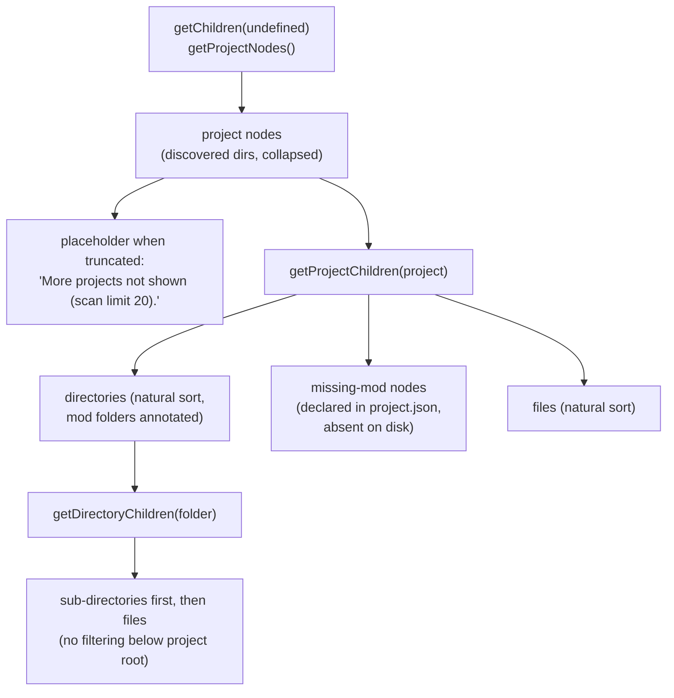
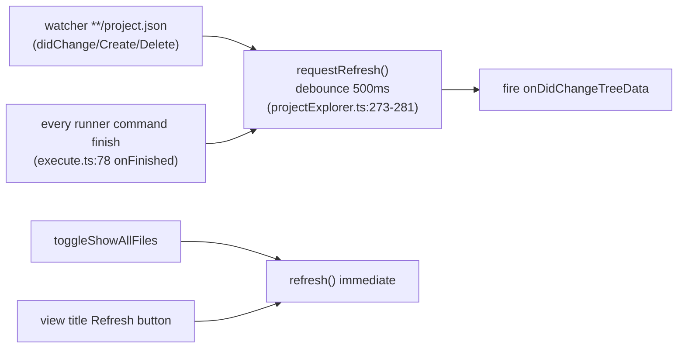

# 03 — PZ Project Explorer

The tree view `pzstudio.projectExplorer` (view container `pzstudio-container`
in the activity bar, `package.json:19-37`), implemented entirely in
`src/providers/projectExplorer.ts` over `vscode.workspace.fs` (no Node `fs`)
— one of the web-ready surfaces.

## Hierarchy

- **Root level** (`getProjectNodes`, `projectExplorer.ts:413-449`): one node
  per discovered project (same discovery as commands,
  [`02`](02-project-and-mod-resolution.md)), label = folder name, description
  = `id <workshopId> · <workshopTitle> · <diagnostics badge>` (parts joined
  with ` · `, omitted when empty). Empty workspace → placeholder
  *"No project found in the workspace."*.
- **Project children** (`getProjectChildren`, `projectExplorer.ts:451-542`):
  reads `project.json` tolerantly (`readProjectConfig`, `592-605` —
  invalid JSON → placeholder *"Failed to read project.json — check the
  file."*; unreadable folder → *"Failed to read the project folder."*).
  Dot-prefixed entries are always hidden.
- **Mod folders**: a directory whose name is a key of `project.json.mods`
  (`projectExplorer.ts:481-487`). Mods declared but missing on disk render as
  `missing-mod` nodes with description *"missing on disk"*, sorted **after**
  directories and before files (`524-541`).
- **Files**: at project root, only `project.json` and `.emmyrc.json` are
  shown unless "show all files" is on (`PROJECT_ROOT_FILES`, `projectExplorer.ts:155`;
  filter applied at `513`); **subfolders are never filtered** (`getDirectoryChildren`,
  `544-585`).

## Sorting and icons

- **Natural order** (`naturalCompare`, `projectExplorer.ts:82-97`): digit
  runs compare numerically ("9" before "10"), otherwise `localeCompare`.
- **Folder-first** in both project children and subfolders
  (`projectExplorer.ts:539-541`, `573-584`) — VS Code Explorer convention.
- **Project icon**: bundled light/dark SVG pair
  (`pzstudio-project-explorer-{light,dark}.svg`, `projectExplorer.ts:25-28`)
  — explicit colors because tree rows render file icons as-is.
- **Mod icon**: the `icon.png` of the mod's **first qualifying branch
  subfolder** — level-1 subfolders scanned in natural order, qualifying =
  contains `mod.info`; first branch that has both `mod.info` and `icon.png`
  wins and the scan stops (`resolveModFolderIcon`, `projectExplorer.ts:106-148`).
  No match → theme folder icon. Pinned by `tests/unit/projectExplorer.test.ts`
  ("resolveModFolderIcon" suite, including the user's `42`/`common` case).
- **File rows**: no `iconPath` — `resourceUri` is set so the user's file icon
  theme renders them, matching the built-in Explorer (`projectExplorer.ts:383-392`,
  commit `d0d02b4`); clicking a file row opens it (`vscode.open`).

## Mod state machine (UI)

State resolution precedence: `excludes` → `devOnly` → included
(`modBuildState`, `projectExplorer.ts:63-75`; same precedence as
`planBuild`). The state is mirrored into the row's `contextValue` and
drives both the description text and which inline buttons appear.

| State | contextValue | Description text | Inline buttons (when-clause) |
| :--- | :--- | :--- | :--- |
| included | `mod-included` | — (unremarkable default, not annotated) | $(eye) *Included in Build (click to exclude)* (`mod-included\|mod-devonly`); beaker-dim *Build Mod in dev_branch Only* (`mod-included\|mod-excluded`); modinfo $(note); rename $(edit); delete $(trash) |
| devonly | `mod-devonly` | *"dev builds only"* | $(eye) include/exclude toggle; lit $(beaker) *dev_branch-only Build (click to turn off)*; modinfo; rename; delete |
| excluded | `mod-excluded` | *"excluded from build"* | $(eye-closed) *Excluded from Build (click to include)*; beaker-dim; modinfo; rename; delete |
| missing | `mod-missing` | *"missing on disk"* | **none** (inline menu entries all require a concrete state) |

Rules pinned by the code:

- The eye button **never dims** — `$(eye)` means "this mod is in some build
  output" (included or dev-only), `$(eye-closed)` means excluded; clicking
  flips include/exclude (`commands/modstate.ts:9-22`).
- The **beaker is a two-state indicator**: lit while the mod IS dev-only
  (click turns it off), dim otherwise (click turns it on) — the dim variant
  is the bundled `beaker-dim.svg` (`f4122cf`, `2cea701`).
- Command names describe the **displayed** state; the executed `modconfig`
  action is the toggle (`commands/modstate.ts:26-43`):
  `modIncluded`→`exclude`, `modExcluded`→`include`, `modDevOnly`→`include`,
  `modDevOnly.dim`→`devonly`.

## Context menus

`contributes.menus["view/item/context"]` and `contributes.menus["view/title"]`
(`package.json:39-127`) — all scoped to `view == pzstudio.projectExplorer`:

| Group | Entries | `when` (viewItem) |
| :--- | :--- | :--- |
| `0_project@1` | Run Diagnostics | `project` |
| `0_mod@1` | Edit Mod Configuration | `^mod/` → **includes `mod-missing`** |
| `1_mod@1` | ModInfo Generate | `^mod/` |
| `2_mod@1` | Rename Mod ID | `^mod/` |
| `3_mod` | Delete Mod | `^mod/` |

So a **missing** mod can be configured / given a mod.info / renamed /
deleted from its context menu, though it has no inline buttons (audit:
UX-13). All four commands fall back to the project+mod pickers when invoked
without a tree node.

## Diagnostics badge and tooltip

`projectDiagnostics` (`projectExplorer.ts:289-324`) runs the injected
`DiagnosticsSource` for **every project node on every root rescan**:

- badge appended to the description: `✗ <errors>` and `⚠ <warnings>` —
  **infos never show in the badge** but appear in the tooltip;
- tooltip = one line per finding, ``<glyph> [<module>] <message>`` with
  glyphs `✗ / ⚠ / ·`;
- a failing diagnostics source is swallowed (`297-300`) — the tree never
  breaks because of it; a clean project simply has no badge/tooltip.

Performance note (audit UX-07): this runs the full `runProjectDoctor`
gatherer per project per rescan — every debounced refresh, every
`project.json` change, and after every command run.

## Refresh behavior

- Debounce: 500 ms (`REFRESH_DEBOUNCE_MS`, `projectExplorer.ts:10`), coalescing
  bursts; a pending timer is not reset, just ignored (first event wins the
  schedule).
- The **Development Sync** does not feed this watcher; its own watcher only
  feeds the build session (see [`06-development-sync.md`](06-development-sync.md)).
  Output changes written by sync/build therefore refresh the tree only if a
  `project.json` changed (e.g. a modconfig write) or via manual refresh.
- There is **no general file watcher** for the tree — folder contents update
  on the events above or on manual refresh; the `showAllFiles` toggle and
  language change also trigger immediate repaints
  (`projectExplorer.ts:250-254`, `extension.ts:74-79`).
