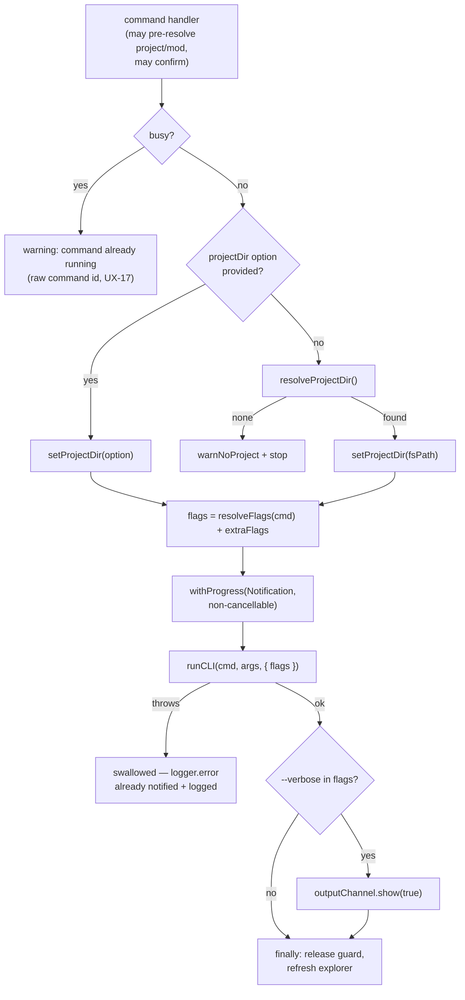
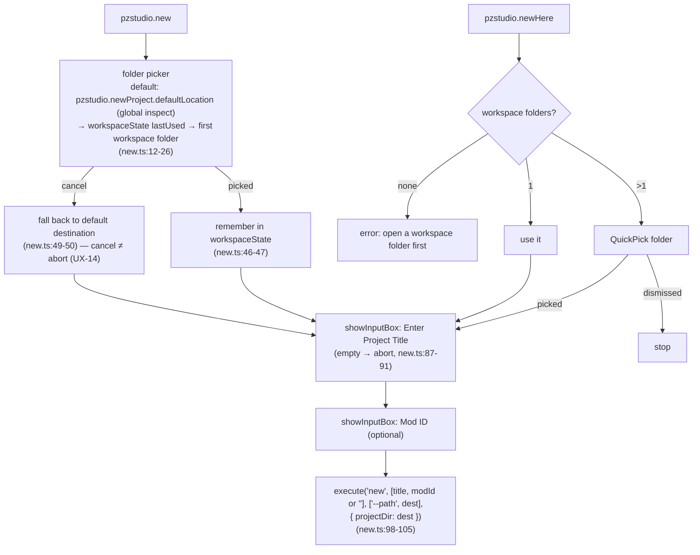
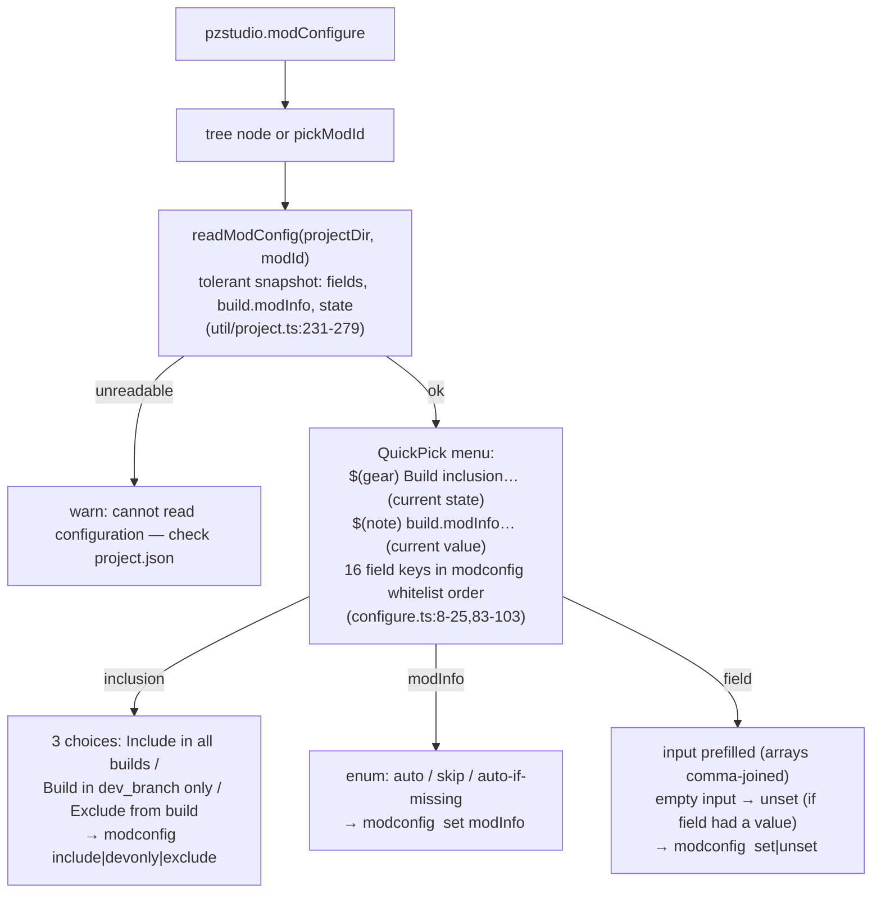

# 04 — Command Flows

Per-command flows from UI entry to embedded CLI call. The shared runner and
its contract are documented in [`02`](02-project-and-mod-resolution.md) and
[`09-embedded-cli-bridge.md`](09-embedded-cli-bridge.md); this file covers the
command-specific decisions. Build/Clean and the task provider have their own
file ([`05`](05-build-clean-and-tasks.md)); watch and doctor too
([`06`](06-development-sync.md), [`07`](07-diagnostics.md)).

## The generic runner path

Every runner-driven command ends in the same sequence
(`util/execute.ts:30-80`):

Notes pinned by code/tests:

- The busy-guard is keyed by **command id** (`util/execute.ts:28`), so two
  *different* commands can overlap (`build` while `modconfig` runs) — only a
  repeat of the same command is refused (audit UX-08).
- The progress title is `PZStudio: <command id>` (`execute.ts:61`) — the raw
  id, not the localized title (audit UX-17).
- Errors are **swallowed** in the runner (`execute.ts:67-69`): the CLI
  `logger.error` path already showed a notification and logged to the
  channel. `CliUsageError`s (usage/flag problems, embedded refusals) are
  reported the same way, exit codes are irrelevant in-process.
- The OutputChannel auto-shows **only** when `--verbose` is among the flags
  (`execute.ts:73-75`) — errors do not open the channel (audit UX-16).

## New Project / New Project Here (`commands/new.ts`)

- Empty mod id is passed as the empty string — the CLI treats it as
  "auto-generate" (pinned by `tests/unit/extCommandsNew.test.ts`).
- Anchoring the destination as `projectDir` before any project exists is
  deliberate ("no project exists yet, so the generic resolveProjectDir flow
  must be skipped", `new.ts:102-104`).
- `pzstudio.newProject.defaultLocation` is read via
  `inspect().globalValue` (`new.ts:15-17`) — it is a machine-scoped setting.

## Add Mod (`commands/add.ts`)

1. Project first (`resolveProjectDir('add a mod to')`) — abort with
   `warnNoProject` when cancelled/none (`add.ts:12-16`).
2. Mod name input (empty → abort), optional mod id (`add.ts:18-29`).
3. `execute('add', [modName, modId || ''])` with the picked project anchored.
4. Flags: `--offline` / `--force-update` when the settings say so
   (`util/flags.ts:11-18`).

## Delete Mod (`commands/delete.ts`)

1. Target: tree node (`asModNode`) → `{ modId, projectDir }`; otherwise
   `pickModId('Select mod to delete', { action: 'delete mods from' })`.
2. **Modal confirm** (non-cancelable buttons: `Yes` only):
   *"Are you sure you want to delete mod '{0}'? This cannot be undone."*
   (`delete.ts:22-30`). Dismissal aborts.
3. `execute('delete', [modId], ['--yes'], { projectDir })` (`delete.ts:34-36`)
   — the modal **is** the confirmation, so the extension forwards the
   explicit `--yes` the embedded API refuses to run without (hardening
   `91620af`; contract pinned by `tests/unit/extUtilExecute`-adjacent
   integration test "renames and deletes a mod through the api with explicit
   --yes (embedded)", `src/test/integration.test.ts:112-149`).

## Rename Mod ID (`commands/rename.ts`)

1. Target via tree node or `pickModId('Select mod to rename')`.
2. Input box for the new id — prompt states it renames **folder + project.json
   key, not the display name** (`rename.ts:22-27`).
3. **Modal confirm** *"Rename mod '{0}' to '{1}'?"* (`rename.ts:30-35`) —
   added with the embedded-consent hardening; before `91620af` rename had
   **no** confirmation.
4. `execute('rename', [modId, newName], ['--yes'], { projectDir })`.

## New Language (`commands/lang.ts`)

1. `pickModId('Select mod', { action: 'add a language to' })`.
2. Free-text language code input ("e.g. EN, FR, PTBR") — no validation in
   the extension; the CLI validates.
3. `execute('lang', [modId, language], undefined, { projectDir })`.

## ModInfo Generate (`commands/modinfo.ts`)

1. Target via tree node or `pickModId`.
2. **Direct global-anchor use**: `setProjectDir(projectDir.fsPath)` then
   `resolveModInfoTargets(modId)` + node `existsSync` to count existing
   branch `mod.info` files (`modinfo.ts:30-33`) — outside the runner, before
   any `runCLI` call (audit UX-10).
3. If any exist: **modal** *"mod.info already exists in {0} branch folder(s)
   of '{1}'. Overwrite?"* — confirm → `extraFlags = ['--force']`; dismissal
   aborts (`modinfo.ts:34-48`). No existing mod.info → runs without asking.
4. `execute('modinfo', ['generate', modId], extraFlags, { projectDir })`.

## Build-state toggles (`commands/modstate.ts`)

- Tree click: `execute('modconfig', [modId, action], undefined, { projectDir })`
  — immediate, no confirmation (config writes are reversible; the tree
  description updates via the post-command refresh).
- Keyboard-shortcut invocation without tree context falls back to
  `pickModId('Select mod', { action: 'change mod build states in' })`
  (`modstate.ts:49-61`) — same flow as the palette.

## Edit Mod Configuration (`commands/configure.ts`)

- The field menu mirrors the CLI `modconfig` whitelist (`FIELD_KEYS`,
  `configure.ts:8-25`); unknown keys are simply not offered.
- Clearing the input of an already-empty field does nothing
  (`configure.ts:173-176`); dismissal at any stage aborts.
- All writes go through `pzstudio modconfig` — the extension never edits
  `project.json` itself (except via the CLI), keeping validation and
  required-field protection in the CLI.

## Update (`commands/update.ts`)

`execute('update')` — no project/mod args, no confirmation, generic runner
path. Because the runner resolves a project first, this command is
unusable in a project-less workspace even though the CLI operation is
global (audit UX-03). Flags: only `--verbose` applies (`util/flags.ts:7-9`).

## Cancellation map

| Flow | User cancel | Effect |
| :--- | :--- | :--- |
| Project quick-pick (most commands) | `undefined` → `warnNoProject` or silent stop | command does not run |
| Project quick-pick (build/clean) | first cancel **re-prompts**; second cancel → false "no project" warning | UX-02 |
| Mod quick-pick / typed input | silent stop | — |
| Title input (new/add) | silent stop | — |
| Folder picker (new) | **falls back to default destination** and continues | UX-14 (intentional, test-pinned) |
| Confirm modals (build/clean/delete/rename/modinfo) | dismiss = abort | nothing runs |
| Progress (runner) | not cancellable (`cancellable: false`) | must wait |
| Development Sync | run toggle again to stop | see [`06`](06-development-sync.md) |
