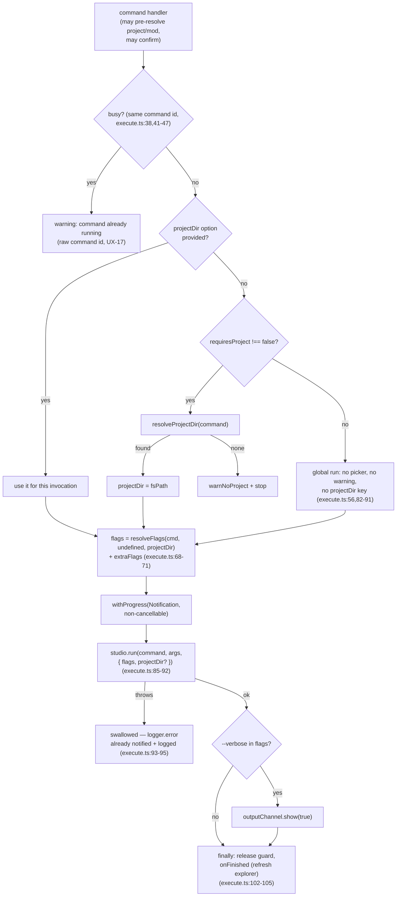
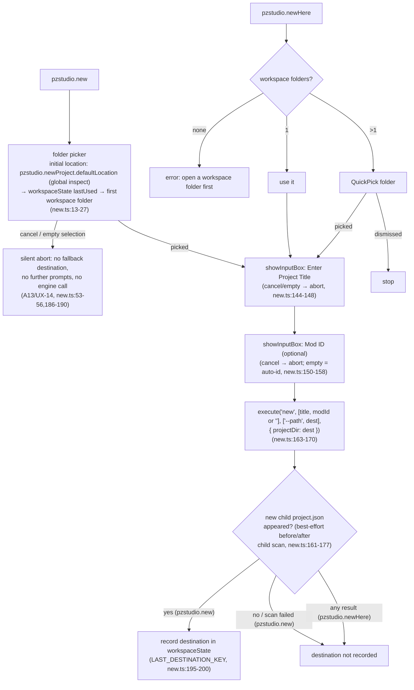
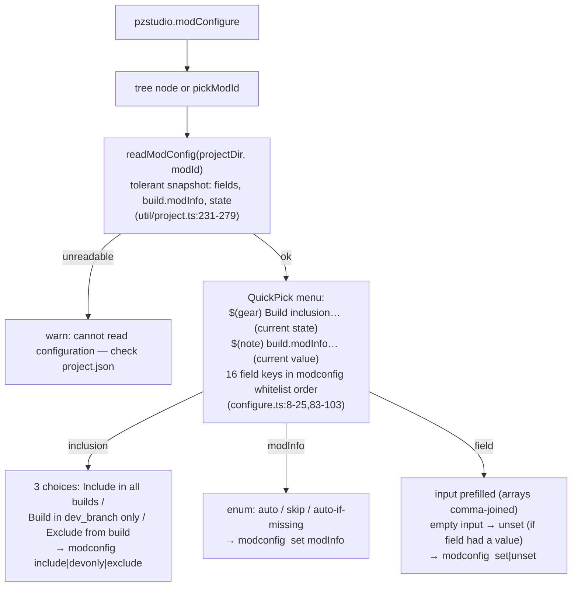

# 04 — Command Flows

Per-command flows from UI entry to embedded CLI call. The shared runner and
its contract are documented in [`02`](02-project-and-mod-resolution.md) and
[`09-embedded-cli-bridge.md`](09-embedded-cli-bridge.md); this file covers the
command-specific decisions. Build/Clean and the task provider have their own
file ([`05`](05-build-clean-and-tasks.md)); watch and doctor too
([`06`](06-development-sync.md), [`07`](07-diagnostics.md)).

## The generic runner path

Every runner-driven command ends in the same sequence
(`util/execute.ts:30-106`):

Notes pinned by code/tests:

- The busy-guard is keyed by **command id** (`util/execute.ts:38,41-47`), so
  a repeat of the same command is refused instead of queued (audit UX-08).
  *Different* commands are not refused by the guard — their overlap is
  serialized by the engine lock inside `studio.run` (runner comment:
  "Cross-command overlap is serialized by the engine lock inside
  studio.run").
- The invocation context is per-run (API v2): a tree-menu `projectDir`
  option is used directly; otherwise the runner resolves the project and
  passes `projectDir` **inside the run options** — the pre-v2 module-state
  `setProjectDir` anchor is gone from the runner path
  (`execute.ts:55-63,85-91`).
- A command declaring `requiresProject: false` runs project-less: no
  picker, no "no project" warning, no `projectDir` key at all — used by
  `update` since the UX-03 fix (`commands/update.ts:11-13`).
- Flags resolve through `resolveFlags(command, undefined, projectDir)`,
  scoped to the operated project's folder resource (UX-05,
  `util/flags.ts:15-23`).
- The progress title is `PZStudio: <command id>` (`execute.ts:77`) — the raw
  id, not the localized title (audit UX-17).
- Errors are **swallowed** in the runner (`execute.ts:93-95`): the CLI
  `logger.error` path already showed a notification and logged to the
  channel. `CliUsageError`s (usage/flag problems, embedded refusals) are
  reported the same way, exit codes are irrelevant in-process.
- The OutputChannel auto-shows **only** when `--verbose` is among the flags
  (`execute.ts:99-101`) — errors do not open the channel (audit UX-16).

## New Project / New Project Here (`commands/new.ts`)

- Cancelling the folder picker aborts silently (A13/UX-14): no fallback
  destination is selected, no later prompt opens, the engine is not invoked
  and nothing is recorded. The resolved default (setting → last used →
  first workspace folder) is only the picker's **initial location** — it is
  never treated as user confirmation.
- Empty mod id is passed as the empty string — the CLI treats it as
  "auto-generate" (pinned by `tests/unit/extCommandsNew.test.ts`); an
  explicit cancel (Esc) of the mod-id prompt aborts the whole flow.
- Anchoring the destination as `projectDir` before any project exists is
  deliberate ("no project exists yet, so the generic resolveProjectDir flow
  must be skipped", `new.ts:166-169`).
- `pzstudio.newProject.defaultLocation` is read via
  `inspect().globalValue` (`new.ts:16-18`) — it is a machine-scoped setting.
- The destination is recorded in `workspaceState` **only after the flow
  completes** and a new `<destination>/<child>/project.json` appeared in
  the before/after child scan (`new.ts:161-177,195-200`) — a best-effort
  convenience heuristic (the runner swallows engine failures, so the
  outcome is verified on disk), not an authoritative engine creation
  receipt. Accepted limitation: a concurrent, unrelated project creation
  under the same destination between the two scans may produce a
  false-positive destination-memory update. Cancelled or failed runs never
  poison the next picker's initial location.
- Recording is **exclusive to `pzstudio.new`** (`new.ts:195-200`);
  `pzstudio.newHere` never updates `LAST_DESTINATION_KEY` — its workspace
  folder (or picked multi-root folder) is not remembered for the next
  picker default (`new.ts:202-206`).

## Add Mod (`commands/add.ts`)

1. Project first (`resolveProjectDir('add a mod to')`) — abort with
   `warnNoProject` when cancelled/none (`add.ts:12-16`).
2. Mod name input — empty or cancelled → abort (`add.ts:18-22`).
3. Optional Mod ID input — three distinct outcomes after D4
   (`add.ts:24-34`): Esc (`undefined`) aborts the whole flow without
   invoking the engine; a confirmed blank input (`''`) is passed through
   so the engine auto-generates the id from the mod name; an explicit id
   is passed unchanged.
4. `execute('add', [modName, modId], undefined, { projectDir })` with the
   picked project anchored (`add.ts:36-38`) — the id is never collapsed
   with a truthiness check.
5. Flags: `--offline` / `--force-update` when the settings say so, resolved
   by the runner for the picked project (`util/flags.ts:30-37`).

## Delete Mod (`commands/delete.ts`)

1. Target: tree node (`asModNode`) → `{ modId, projectDir }`; otherwise
   `pickModId('Select mod to delete', { action: 'delete mods from' })`.
2. **Modal confirm** (non-cancelable buttons: `Yes` only):
   *"Are you sure you want to delete mod '{0}'? This cannot be undone."*
   (`delete.ts:22-30`). Dismissal aborts.
3. `execute('delete', [modId], ['--yes'], { projectDir })` (`delete.ts:34-36`)
   — the modal **is** the confirmation, so the extension forwards the
   explicit `--yes` the embedded API refuses to run without (hardening
   `91620af`; contract pinned by `tests/unit/extUtilExecute`-adjacent
   integration test "renames and deletes a mod through the api with explicit
   --yes (embedded)", `src/test/integration.test.ts:112-149`).

## Rename Mod ID (`commands/rename.ts`)

1. Target via tree node or `pickModId('Select mod to rename')`.
2. Input box for the new id — prompt states it renames **folder + project.json
   key, not the display name** (`rename.ts:22-27`).
3. **Modal confirm** *"Rename mod '{0}' to '{1}'?"* (`rename.ts:30-35`) —
   added with the embedded-consent hardening; before `91620af` rename had
   **no** confirmation.
4. `execute('rename', [modId, newName], ['--yes'], { projectDir })`.

## New Language (`commands/lang.ts`)

1. `pickModId('Select mod', { action: 'add a language to' })`.
2. Free-text language code input ("e.g. EN, FR, PTBR") — no validation in
   the extension; the CLI validates.
3. `execute('lang', [modId, language], undefined, { projectDir })`.

## ModInfo Generate (`commands/modinfo.ts`)

1. Target via tree node or `pickModId`.
2. **Direct host-instance use**: `studio.resolveModInfoTargets(modId,
   projectDir.fsPath)` + node `existsSync` to count existing branch
   `mod.info` files (`modinfo.ts:34-36`) — outside the runner, before any
   engine run, with the explicit project passed per-call and no legacy
   project-anchor write (audit UX-10).
3. If any exist: **modal** *"mod.info already exists in {0} branch folder(s)
   of '{1}'. Overwrite?"* — confirm → `extraFlags = ['--force']`; dismissal
   aborts (`modinfo.ts:34-48`). No existing mod.info → runs without asking.
4. `execute('modinfo', ['generate', modId], extraFlags, { projectDir })`.

## Build-state toggles (`commands/modstate.ts`)

- Tree click: `execute('modconfig', [modId, action], undefined, { projectDir })`
  — immediate, no confirmation (config writes are reversible; the tree
  description updates via the post-command refresh).
- Keyboard-shortcut invocation without tree context falls back to
  `pickModId('Select mod', { action: 'change mod build states in' })`
  (`modstate.ts:49-61`) — same flow as the palette.

## Edit Mod Configuration (`commands/configure.ts`)

- The field menu mirrors the CLI `modconfig` whitelist (`FIELD_KEYS`,
  `configure.ts:8-25`); unknown keys are simply not offered.
- Clearing the input of an already-empty field does nothing
  (`configure.ts:173-176`); dismissal at any stage aborts.
- All writes go through `pzstudio modconfig` — the extension never edits
  `project.json` itself (except via the CLI), keeping validation and
  required-field protection in the CLI.

## Update (`commands/update.ts`)

`execute('update', [], undefined, { requiresProject: false })`
(`update.ts:11-13`) — no project/mod args, no confirmation, generic runner
path. Since the UX-03 fix it runs project-less in any workspace — including
an empty one: no picker, no "no project" warning, and no `projectDir`
handed to the engine (its discovery falls back to cwd,
`execute.ts:14-20,82-91`). Flags: only `--verbose` applies
(`util/flags.ts:26-28`).

## Cancellation map

| Flow | User cancel | Effect |
| :--- | :--- | :--- |
| Project quick-pick (most commands) | `undefined` → `warnNoProject` or silent stop | command does not run |
| Project quick-pick (build/clean) | first cancel **re-prompts**; second cancel → false "no project" warning | UX-02 |
| Mod quick-pick / typed input | silent stop | — |
| Title input (new/add) | silent stop | — |
| Folder picker (new) | silent abort — **no fallback destination**, no further prompts, no engine call | UX-14 remediation (A13); historical fallback was issue #43, test-pinned at the audit baseline |
| Confirm modals (build/clean/delete/rename/modinfo) | dismiss = abort | nothing runs |
| Progress (runner) | not cancellable (`cancellable: false`) | must wait |
| Development Sync | run toggle again to stop | see [`06`](06-development-sync.md) |
