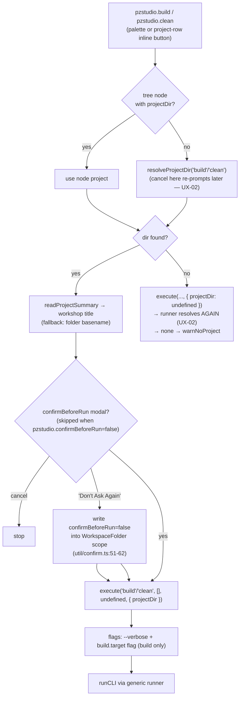

# 05 — Build, Clean and Tasks

The two explicit build/clean **commands** and the `pzstudio` **task
provider** share the same embedded CLI but differ in consent, flags and UX.
This file pins both and the differences.

## Build / Clean commands (palette + project-row inline buttons)

Identical shape (`commands/build.ts:8-37`, `commands/clean.ts:8-37`):



Consent details:

- The modal names the **workshop title** (falling back to the folder
  basename) so a wrong-project pick is visible before anything is written
  (`build.ts:19-25`, `clean.ts:19-25`; messages in `util/confirm.ts:24-33`).
- `pzstudio.confirmBeforeRun` (resource-scoped, default `true`) disables the
  modal entirely (`confirm.ts:16-21`). "Don't Ask Again" persists `false`
  for the **workspace folder** containing the project.
- Clean's modal text states it **deletes the generated workshop output
  folder** (`confirm.ts:30-33`); pinned by `tests/unit/extUtilConfirm.test.ts`.
- These modals are **extension UI consent only** — build/clean are not
  destructive-gated in the embedded CLI (no `--yes` semantics for them);
  only `delete`/`rename` carry the embedded consent contract.

Flag resolution (`util/flags.ts`):

| Setting | Flag(s) | Applies to |
| :--- | :--- | :--- |
| `pzstudio.verbose` | `--verbose` | every command |
| `pzstudio.offline` | `--offline` | `new`, `add` |
| `pzstudio.forceUpdate` | `--force-update` | `new`, `add` |
| `pzstudio.useSymlinks` | `--symlinks` | `new` only (junction shared template folders; not build) |
| `pzstudio.build.target` = production/development/both | `--production` / `--development` / `--both` | `build` only; `default` sends nothing (CLI falls back to `project.json` `build.target`, then main-only) |

Build semantics inside the CLI (target precedence **flag > project.json
build.target > default main-only**, empty-variant skip+warn, `--both`
per-variant isolation) are the CLI's own and documented in
[`docs/cli/04-commands.md`](../cli/04-commands.md); the extension only adds
the flag row above.

## Task provider (`providers/buildTaskProvider.ts`)

Contribution: task type `pzstudio` with required property `target`
(`production|development|both|clean`, `package.json:163-182`).

- **4 provided tasks** (`provideTasks`, `buildTaskProvider.ts:79-86`):
  `pzstudio: build (production)`, `pzstudio: build (development)`,
  `pzstudio: build (both)`, `pzstudio: clean`. Shown in *Terminal → Run
  Task*; usable as a default build task for `Ctrl+Shift+B` after configuring.
- **`resolveTask`** accepts hand-declared tasks in `tasks.json` with a valid
  target and rejects unknown targets (`88-100`).
- **Execution**: `CustomExecution` → `PZTaskTerminal` (a `Pseudoterminal`,
  `21-76`). `open()` starts the run; the terminal shows only three status
  lines — `pzstudio <cmd> started...`, `pzstudio <cmd> completed.` or
  `pzstudio <cmd> failed: <message>` / `... skipped: no PZ project ...`.
- **In-process**: it calls `runCLI` directly after
  `setProjectDir(dir.fsPath)` (`42-49`) — same embedded path as commands,
  same OutputChannel logging for the real output.
- **No confirmation**: tasks never show the `confirmBeforeRun` modal —
  running a task is already explicit intent (contrast with palette/inline
  build, which always confirm while the setting is enabled).
- **No busy-guard**: a task can start while a palette command (or another
  task) is mid-flight; both mutate the same CLI module state (audit UX-08).
- **No explorer refresh** after completion and no OutputChannel auto-show.
- **No cancellation**: closing the terminal does not cancel the run
  (`close()` is a no-op, `33-35`).

### Flag assembly in tasks (audit UX-01, bug)

```ts
const flags = [...resolveFlags(command)];      // may already include the
                                               // pzstudio.build.target flag
if (this.target === 'production') flags.push('--production');
else if (this.target === 'development') flags.push('--development');
else if (this.target === 'both') flags.push('--both');
```

(`buildTaskProvider.ts:51-58`.) When `pzstudio.build.target` is a concrete
target **and differs from the task's target**, the assembled flags conflict
(e.g. setting `production` + task `development` → `['--production',
'--development']`), and the shared CLI validator rejects them
(`packages/cli/src/lib/parser.ts:473-486`; conflicts declared in
`packages/cli/src/lib/commands/build.ts:206-208`): the task fails with
`Conflicting options: --development cannot be combined with --production.`
(equal values merely duplicate a flag and pass). The task should override
the setting, not inherit it.

## Command vs task matrix

| Aspect | `pzstudio.build`/`pzstudio.clean` command | `pzstudio:*` task |
| :--- | :--- | :--- |
| Entry points | Palette, project-row inline button, (keybindings UI) | Run Task, default build task |
| Project resolution | tree node → resolve (active editor → single → picker) | resolve (active editor → single → picker); none → `skipped:` line |
| Confirmation | modal while `pzstudio.confirmBeforeRun=true` | none |
| Target selection | `pzstudio.build.target` setting only (`default` = CLI decides) | task target, but setting flag still leaks in (UX-01) |
| Progress UI | `withProgress` notification | terminal status lines |
| Output detail | `PZ Studio` OutputChannel (data + `[INFO]` progress + `[ERROR]`) | terminal status lines + the same OutputChannel |
| Re-entrancy | per-command-id guard | none |
| Post-run | explorer refreshed | not refreshed |
| Cancellation | not cancellable | terminal close does not cancel |
| Error surfacing | error notification (+ channel) | `failed:` line (the CLI logger also raises an error notification) |
