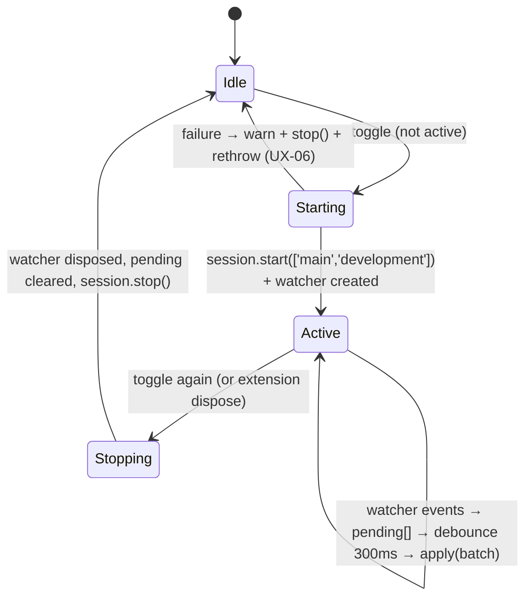

# 06 — Development Sync (watch)

The extension's name for the CLI's `watch`: one persistent sync session
driven by a VS Code `FileSystemWatcher`, exposed as the palette toggle
**PZ Studio: Toggle Development Sync** (`pzstudio.watch`).

## Ownership

- Palette command: `commands/watch.ts:12-38` — registered outside the
  generic runner (no `runCLI`, no `withProgress`, no busy-guard).
- Controller: `util/devsync.ts` — one instance for the whole extension
  (`extension.ts:58`), disposable.
- Engine: `createDevSync(projectDir)` from the api
  (`packages/cli/src/lib/devsync.ts:29-57`) wires a **core `BuildSession`**
  (`@pzstudio/core`) with `NodeFileSystem`, fresh plan input per apply, and
  log forwarding into the bridged logger. The session anchors
  `setProjectDir(projectPath)` globally (`devsync.ts:33`).

## Lifecycle

1. **Toggle on** (`watch.ts:24-35`): resolve project like every command
   (`resolveProjectDir('start the development sync in')`), `controller.start(fsPath)`,
   then an info message naming the project folder:
   *"development sync started for '{0}' — run the command again to stop."*
2. **Start** (`devsync.ts:35-62`): guarded by `active || starting`
   (re-entrant toggles while starting are silently ignored — the controller
   leaves messaging to the command, which has already returned).
   `session.start(['main', 'development'])` runs the **initial full build of
   both outputs** — there is **no progress UI** for this (audit UX-06). Then a
   `FileSystemWatcher` with `RelativePattern(projectDir, '**/*')` observes
   create/change/delete.
3. **Event feed** (`devsync.ts:83-95`): every event is appended to `pending`
   as a `FileDelta`; a single timer flushes after **`WATCH_DEBOUNCE_MS` =
   300 ms** (value re-exported from `packages/cli/src/lib/watch-shared.ts:12`;
   new events during a flush restart the debounce — bursts coalesce into one
   pass).
4. **Apply** (`devsync.ts:97-113`): `session.apply(batch)` never throws; the
   session serializes, coalesces and classifies deltas (core
   `classifyDelta`, `packages/core/src/buildsession.ts:129-219`):
   file edits → incremental per-mod write; `mod.info` or `.pzstudioignore`
   → mod-scoped rebuild; `project.json` → full rebuild with fresh input;
   everything else (dot entries, non-mod paths, excluded mods, folder-level
   events, paths outside the project) → ignored with reason.
   A transient source that vanished before the batch (atomic-save temp
   files) is skipped silently by the core incremental applier (`38d558a`).
5. **Output**: each successful batch prints one summary line into the output
   channel **as a data-style line** (`log('- ' + summary + '.')`,
   `devsync.ts:106-108` — the same wording the CLI watch prints, via
   `summarizeApplyResult`; note: no `[INFO]` prefix, this is the `log`
   channel). Batch errors print as `[WARN] - <message>` (`110-112`).
6. **Toggle off / stop** (`watch.ts:16-22`, `devsync.ts:65-77`): info message
   *"development sync stopped."*; controller disposes the watcher, clears
   pending and the timer, then `session.stop()` drains. `stop()` is safe
   when idle. Extension host teardown stops it via `dispose()`.

## Semantics shared with and different from `pzstudio watch`

| Aspect | CLI `pzstudio watch` | Extension toggle |
| :--- | :--- | :--- |
| Watcher | `@parcel/watcher` native subscription | VS Code `FileSystemWatcher` |
| Variants | both by default; `--production`/`--development`/`--both` restrict | **always both** (`['main', 'development']`) — no flags exposed |
| Pre-filtering | events filtered by `isWatchPathIgnored` before feeding (`packages/cli/src/lib/commands/watch.ts:120`) — outdir + dot segments (except `.pzstudioignore`) | **no pre-filter** — everything is fed to the session, which ignores most noise by classification (audit UX-09) |
| Interruption | SIGINT → exit 130, single "Development sync stopped." | toggle command / dispose |
| Debounce | 300 ms (`WATCH_DEBOUNCE_MS`) | same constant |
| Initial build | yes, both outputs | yes, both outputs |
| Target folder changes | re-synced on `project.json` delta | same (full rebuild classification) |

The two hosts are intentionally **not** identical beyond the engine: the
exported `isWatchPathIgnored` (`api.ts:47-51`) exists so hosts can
pre-filter, but the extension currently does not use it (UX-09).

## Known gaps / sharp edges (details in audit file)

- **Single global session** — starting sync for project B while A is active
  requires toggling off first; the toggle does not say *which* project is
  running (UX-15).
- **No auto-start** — sync never starts on activation; always a manual
  toggle (roadmap backlog item).
- **Failure path double-reports** — `start()` failure logs `[WARN]` and
  rethrows; the uncaught rejection also surfaces as a host error toast
  (UX-06).
- Output written by the session itself is only excluded if the outdir lies
  outside all mod folders (core classification ignores "not a configured
  mod"); a pathological outdir inside a mod folder would feed the engine
  its own writes (UX-09).

## Tests

`tests/unit/extUtilDevSync.test.ts` pins: initial full build for both
variants + watcher creation, batch-per-debounce coalescing, per-batch
summary line, error reporting through the CLI logger without dying,
`stop()` disposes and ignores later events, and `start()` while active is
ignored.
