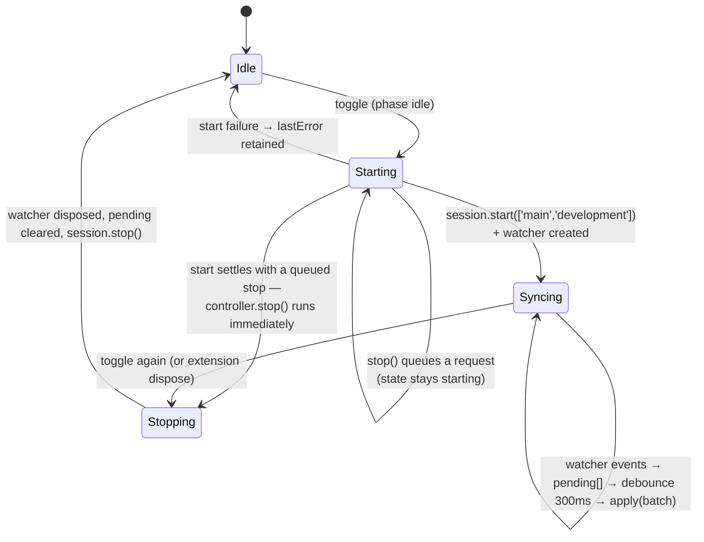

# 06 — Development Sync (watch)

The extension's name for the CLI's `watch`: one persistent sync session
driven by a VS Code `FileSystemWatcher`, exposed as the palette toggle
**PZStudio: Toggle Development Sync** (`pzstudio.watch`). Since UX-15 the
run lives behind a single-writer state machine (`util/devSyncState.ts`)
published to two indicator surfaces: the status-bar item — the source of
truth for started/stopped feedback since the toggle's success popups were
removed — and the PZ Project Explorer badge.

## Ownership

- Palette command + status-bar item: `commands/watch.ts` —
  `registerWatchCommand` (`watch.ts:16-86`) and `registerDevSyncStatusBar`
  (`watch.ts:99-158`). Registered outside the generic runner (no `runCLI`,
  no busy-guard); the start runs inside its own native `withProgress`
  notification.
- State machine: `util/devSyncState.ts` — `DevSyncStateService` (the pure
  single-writer state store) and `DevSyncManager` (the lifecycle wrapper
  that drives the controller and publishes every transition). One pair for
  the whole extension (`extension.ts:158-178`), disposable.
- Controller: `util/devsync.ts` — one instance for the whole extension,
  disposable; its sync logic is untouched by UX-15 — the manager is now its
  only caller.
- Engine: `createDevSync(projectDir)` from the api
  (`packages/cli/src/lib/devsync.ts:29-57`) wires a **core `BuildSession`**
  (`@pzstudio/core`) with `NodeFileSystem`, fresh plan input per apply, and
  log forwarding into the bridged logger. The session anchors
  `setProjectDir(projectPath)` globally (`devsync.ts:33`).

## Lifecycle

The run phases are the `DevSyncPhase` values (`devSyncState.ts:18`) —
`idle | starting | syncing | stopping` — published through the manager's
`onDidChange` (see [the run state](#the-run-state-ux-15)):

1. **Toggle on** (`watch.ts:36-66`): resolve project like every command
   (`resolveProjectDir('start the development sync in')`), then
   `manager.start(fsPath)` inside the native `withProgress` notification
   (*"PZStudio: starting development sync for '{0}'…"*, non-cancellable —
   the window stays up until the initial build settles, UX-06). **No
   success message**: the status-bar item flipping to its spinner is the
   started feedback (UX-15 behavior change).
2. **Start** (`devsync.ts:96-143`): guarded by `active || starting`
   (re-entrant starts are silently ignored — the controller's own guard,
   kept in place as the second line of defense behind the command's
   phase gate). `session.start(['main', 'development'])` runs the **initial
   full build of both outputs** inside the command's progress window. Then
   a `FileSystemWatcher` with `RelativePattern(projectDir, '**/*')`
   observes create/change/delete.
3. **Event feed** (`devsync.ts:167-215`): every event is appended to
   `pending` as a `FileDelta`; a single timer flushes after
   **`WATCH_DEBOUNCE_MS` = 300 ms** (value re-exported from
   `packages/cli/src/lib/watch-shared.ts:12`; new events during a flush
   restart the debounce — bursts coalesce into one pass).
4. **Apply** (`devsync.ts:217-272`): `session.apply(batch)` never throws; the
   session serializes, coalesces and classifies deltas (core
   `classifyDelta`, `packages/core/src/buildsession.ts:129-219`):
   file edits → incremental per-mod write; `mod.info`, `.pzstudioignore` or
   `.gitignore` → mod-scoped rebuild; `project.json` → full rebuild with fresh input;
   everything else (dot entries, non-mod paths, excluded mods, folder-level
   events, paths outside the project) → ignored with reason.
   A transient source that vanished before the batch (atomic-save temp
   files) is skipped silently by the core incremental applier (`38d558a`).
5. **Output**: each successful batch prints one summary line into the output
   channel **as a data-style line** (`log('- ' + summary + '.')`,
   `devsync.ts:244-248` — the same wording the CLI watch prints, via
   `summarizeApplyResult`; note: no `[INFO]` prefix, this is the `log`
   channel). Batch errors print as `[WARN] - <message>` (`249-251`); a
   failed batch additionally reaches the error notification, whose actions
   are covered [below](#error-notifications-ux-15).
6. **Toggle off / stop** (`watch.ts:27-34`, `devSyncState.ts:164-175`): the
   dispatch is **phase-gated** — stop while `syncing` tears the run down
   (beginStopping → `controller.stop()` → idle); stop while `starting`
   only **queues** the request (the state stays `starting` until the build
   settles — the queued-stop protocol below); stop while `stopping` or
   `idle` is a no-op. **No stopped message**: the status-bar item returning
   to its muted off state is the feedback (UX-15). Extension host teardown
   goes through `manager.dispose()` (`devSyncState.ts:183-191`), which
   settles a mid-start run through the same queued stop; the controller's
   `stop()` itself remains safe when idle.

## The run state (UX-15)

`DevSyncStateService` (`devSyncState.ts:28-91`) is the single-writer state
store: the phase plus the run meta (`projectDir`, `projectTitle`,
`startedAt`, `lastError`). Every setter assigns the complete next state and
THEN fires `onDidChange` with it — a listener never observes a half-assigned
state, and state objects are replaced, never mutated (snapshots stay valid).
`DevSyncManager` (`devSyncState.ts:114-221`) is the only writer: it drives
the controller and publishes every transition, deliberately adding exactly
one piece of logic of its own — the **queued-stop protocol** — and no second
start-guard (the controller keeps its own re-entrancy guard).

**Queued-stop protocol** (`devSyncState.ts:164-175,199-220`): the controller
alone cannot survive a stop during its initial build — `controller.start()`
assigns session and watcher only after its await settles, so a `stop()` in
that window would be silently overwritten and the session would survive.
The manager therefore treats a stop while `starting` as a request only (the
state stays `starting`); when the start settles, it runs `controller.stop()`
IMMEDIATELY and lands `idle` — the state path is starting → (start settles)
→ stopping → idle, and the just-published session never outlives the
request. A stop while `syncing` tears down right away; a stop while
`stopping` or `idle` is a no-op. A start failure lands `idle` with the
reason in `lastError` and rethrows so the command can still notify.

The indicator surfaces (all consumers gate on `state.phase`, so a click can
never re-anchor a live run):

| Surface | `idle` | mid-flight (`starting`/`syncing`/`stopping`) |
| :--- | :--- | :--- |
| Status bar | `$(circle-slash) DevSync off`, muted (`descriptionForeground`) | `$(sync~spin) DevSync: <folder>` |
| Status-bar tooltip | *"development sync is off."* — plus *"Last start failed: {0}"* when a run just failed | per phase: *"development sync running for '{0}' — click to stop."* / *"…for '{0}' is starting…"* / *"…for '{0}' is stopping…"* |
| Explorer badge | cleared (idle-with-lastError included) | `{ value: 1, tooltip }` — the counter on the view entry, tooltip per phase |

- **The status bar is the source of truth** (`watch.ts:99-158`): with the
  success popups gone, the item carries the started/stopped feedback the
  popups used to. Clicking it
  executes the existing `pzstudio.watch` palette command — the identical
  phase-gated toggle — so no manifest entry and no second registration
  exist. The rendered folder is the `projectTitle` once the run published
  it, else the project dir's last segment (both separators fold).
- **The explorer badge** (`extension.ts:71-114`) is a state indicator, not
  a meter: the manager publishes no pending count, so the value is always
  1 while any phase of a run is in flight (details in
  [`03`](03-project-explorer.md)).
- **Start-fail toast kept**: the toggle's catch still shows the one
  deliberate error message ("development sync failed to start for '{0}': …
  see the PZ Studio output for details.", `watch.ts:67-82`) — only the
  success popups were removed.
- **Retired l10n keys**: the two popup strings
  ("PZStudio: development sync started for '{0}' — run the command again to
  stop." / "PZStudio: development sync stopped.") remain in the translation
  bundles (`l10n/bundle.l10n.json:59-60`) unused until the next translation
  regen pass — bundles are not hand-edited. The new indicator strings
  (status-bar text, tooltips, badge) are English source strings until that
  same regen pass adds them to the locale bundles: `t()` falls back to the
  key itself, so every display language renders them in English meanwhile.

## Error notifications (UX-15)

Apply errors (`flush()` → `logger.error`, `devsync.ts:252-262`) and a
rejected flush route through the **devsync-owned logger** — the controller
gets its own `createPZLogger` over the shared output channel, constructed
with a consumer-injected `extraErrorActions` factory
(`logger.ts:28-31,66-82`, `extension.ts:39-60`). Its error notifications
offer **'Show Details' AND 'Stop Sync'**; the latter calls
`manager.stop()`, safe to click anytime — a syncing run tears down, a
starting run queues the stop, idle/stopping no-op. The factory returns no
action while `idle`, so a notification that outlives its run (a late click
surface) never offers a dead button.

Every other error surface is unchanged: doctor, the command runner and the
CLI engine keep the plain logger — 'Show Details' only.

## Semantics shared with and different from `pzstudio watch`

| Aspect | CLI `pzstudio watch` | Extension toggle |
| :--- | :--- | :--- |
| Watcher | `@parcel/watcher` native subscription | VS Code `FileSystemWatcher` |
| Variants | both by default; `--production`/`--development`/`--both` restrict | **always both** (`['main', 'development']`) — no flags exposed |
| Pre-filtering | events filtered by `isWatchPathIgnored` before feeding (`packages/cli/src/lib/commands/watch.ts:120`) — outdir + dot segments (except `.pzstudioignore`/`.gitignore`) | **no pre-filter** — everything is fed to the session, which ignores most noise by classification (audit UX-09) |
| Interruption | SIGINT → exit 130, single "Development sync stopped." | toggle command / status-bar click / dispose (phase-gated, no message) |
| Debounce | 300 ms (`WATCH_DEBOUNCE_MS`) | same constant |
| Initial build | yes, both outputs | yes, both outputs |
| Target folder changes | re-synced on `project.json` delta | same (full rebuild classification) |

The two hosts are intentionally **not** identical beyond the engine: the
exported `isWatchPathIgnored` (`api.ts:47-51`) exists so hosts can
pre-filter, but the extension currently does not use it (UX-09).

## Known gaps / sharp edges (details in audit file)

- **Single global session** — starting sync for project B while A is active
  requires toggling off first. UX-15 fixed the visibility half: the
  status-bar item and the explorer badge name the project that is running.
- **No auto-start** — sync never starts on activation; always a manual
  toggle (roadmap backlog item).
- **Start failure is single-reported** — the failure logs `[WARN]` into the
  channel, lands `idle` with `lastError` (shown in the status-bar tooltip)
  and surfaces as the command's one deliberate error toast; the generic
  host toast the raw rethrow used to surface is gone (UX-06/UX-15).
- Output written by the session itself is only excluded if the outdir lies
  outside all mod folders (core classification ignores "not a configured
  mod"); a pathological outdir inside a mod folder would feed the engine
  its own writes (UX-09).

## Tests

`tests/unit/extUtilDevSync.test.ts` pins: initial full build for both
variants + watcher creation, batch-per-debounce coalescing, per-batch
summary line, error reporting through the CLI logger without dying,
`stop()` disposes and ignores later events, and `start()` while active is
ignored — plus the apply-error notification actions (`2031`, UX-15 Task 4:
'Stop Sync' mid-run, none while idle).

`tests/unit/extUtilDevSyncState.test.ts` pins the state machine: the
service's assignment-then-fire ordering and immutable snapshots, lastError
retention on a failed run, and the manager's queued-stop protocol (stop
during `starting` is honored once the start settles — the session never
survives the request — stop during `syncing` tears down, idle/stopping
no-ops, dispose mid-start settles through the queued stop).

`tests/unit/extCommandsWatch.test.ts` pins the phase-gated toggle (startup
progress window, no success popups, the single start-fail toast, queued
second toggle while a start is in flight) and the status-bar rendering
(muted off at registration, spinner + folder mid-flight, stopping keeps the
syncing visual). `tests/unit/projectExplorer.test.ts:1501` pins the
explorer badge (1 + per-phase tooltip mid-flight, cleared when idle).
