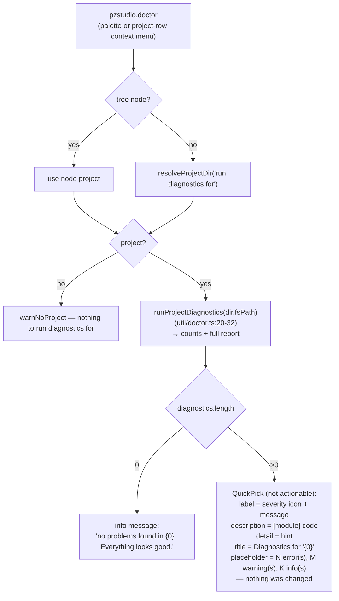

# 07 — Doctor / Diagnostics

The diagnostics engine lives in `@pzstudio/core` (`runDoctor`), the CLI
wraps it for the terminal, and the extension consumes the **same engine**
twice — for the explorer badge and for the `pzstudio.doctor` quick-pick.
There is no duplicated validation logic between hosts (the Bước 3 goal).

## The shared engine (context)

`runDoctor(fs, input)` in `packages/core/src/doctor.ts` is host-blind: it
takes an injected `ProjectFileSystem` and capabilities, and returns a
`DoctorReport` — a flat list of
`Diagnostic { severity: 'error'|'warning'|'info', module, code, message, hint? }`
findings across six modules: `project`, `environment`, `filesystem`,
`templates`, `mods`, `buildTarget`. Findings are **data** — a project with
errors is reported, not thrown.

## Host wiring — `runProjectDoctor`

`packages/cli/src/lib/doctor.ts:32-74` (bundled into the extension through
the api): gathers what only a Node host knows — the effective outdir
(`getOutDir` over the anchored config) and the project template cache probe
(`probeTemplateCacheDir`, no side effects) — then calls the engine with
`NodeFileSystem` + `NODE_CAPABILITIES`.

- **Anchor hygiene**: saves `getExternalProjectDir()`, anchors the project,
  and restores the previous anchor in `finally` (`doctor.ts:40-41,71-73`) —
  a library call must not leak global state into the host (the lesson from
  the e2e anchor-leak bug).
- Invalid `project.json` or unreadable global config never throw — they are
  exactly the findings doctor reports.
- The optional `gameBuild` option (CLI `--game-build`) enables the
  `pzBuildCompatibility` check; **the extension never passes it** (see UX-11),
  so compatibility findings are silently absent from both extension surfaces.

## Extension surface 1 — `pzstudio.doctor` (quick-pick)

`commands/doctor.ts:22-67`, registered outside the generic runner (no
`runCLI`, no progress notification):

- Severity icons: `$(error)` / `$(warning)` / `$(info)`
  (`commands/doctor.ts:10-14`), unknown severities fall back to `$(info)`.
- No findings path is an information message; the quick-pick is skipped.
- If the engine itself throws (e.g. an unexpected gatherer failure), the
  error propagates out of the command handler — the extension host reports
  it as a command error (audit UX-11).
- The command runs the doctor synchronously in the handler with **no
  progress UI** — acceptable for the typical run, but large projects
  (deep mod trees) make the palette appear to hang briefly.

## Extension surface 2 — explorer badge/tooltip

`providers/projectExplorer.ts:289-324` (detailed in
[`03-project-explorer.md`](03-project-explorer.md)):

- `extension.ts:34-37` injects `runProjectDiagnostics` into the provider.
- The provider reduces the report to: badge `✗ <n> ⚠ <n>` (errors and
  warnings only — infos are badge-invisible), and a plain-text tooltip with
  every finding as `<glyph> [<module>] <message>`.
- A clean project shows nothing; a **failing** diagnostics source is
  swallowed and the row renders unannotated (`297-300`).
- `runProjectDiagnostics` (`util/doctor.ts:20-32`) is a thin reducer:
  `runProjectDoctor(projectDir.fsPath)` → counts by severity + the report.

## Which validation lives where

| Layer | Validates |
| :--- | :--- |
| `@pzstudio/core` engine | project parse/version/validation, environment, filesystem/outdir, template cache, mods on disk/branch layout/excludes, build targets, compatibility |
| CLI `pzstudio doctor` | same engine + terminal report + exit code (errors → exit 1) |
| Extension doctor command | same engine + quick-pick rendering only |
| Explorer badge | same engine, reduced to counts/tooltip |
| Everything else in the extension | **none** — reads `project.json` as raw tolerant JSON (no schema/migration), UX-18 |

So the extension's own flows (configure, toggles, explorer rendering) do not
re-validate; they either trust the tolerant reads or route writes through
`pzstudio modconfig`. The doctor is the only place bad config becomes
visible as structured findings.

## Tests

- `tests/unit/extCommandsDoctor.test.ts`: quick-pick rendering with icons
  and counts, clean-project info path, warn-without-project path (rendered
  through a mocked `util/doctor`).
- `tests/unit/projectExplorer.test.ts` ("project diagnostics badge"): badge
  + tooltip composition, clean rows unannotated, no source wired → skipped.
