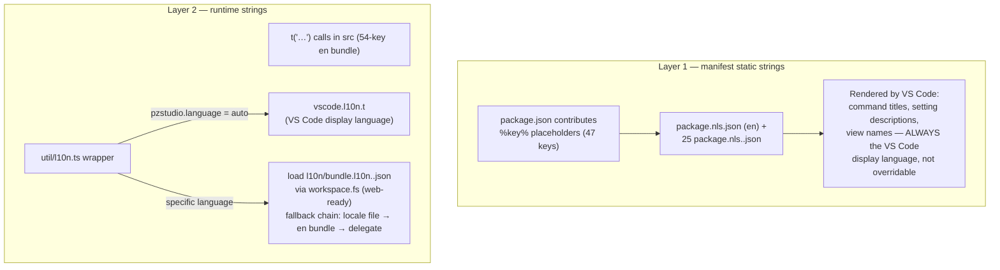

# 08 — Configuration and Localization

All contributed settings, how they reach the CLI, and the two separate
localization layers.

## Settings surface (17 properties)

`package.json:189-334`. Scopes: `resource` = workspace-folder overridable,
`window`, `machine` (user-level only).

| Key | Scope | Default | Consumed by | Path to the CLI |
| :--- | :--- | :--- | :--- | :--- |
| `pzstudio.templates.project.url` | resource | escapepz/pzstudio-template-project.git | CLI template resolution | `setVsCodeSettings` bridge → `getResolvedTemplates` (workspace wins per category, then user, then global config) |
| `pzstudio.templates.project.ref` | resource | `42.17.0` | same | same |
| `pzstudio.templates.mod.url` | resource | …template-mod.git | same | same |
| `pzstudio.templates.mod.ref` | resource | `42.17.0` | same | same |
| `pzstudio.templates.workshop.url` | resource | …template-workshop.git | same | same |
| `pzstudio.templates.workshop.ref` | resource | `42.0` | same | same |
| `pzstudio.templates.language.url` | resource | …template-language.git | same | same |
| `pzstudio.templates.language.ref` | resource | `42.13.1` | same | same |
| `pzstudio.outdir` | resource | `""` | CLI `getOutDir` | `setVsCodeSettings` bridge |
| `pzstudio.useSymlinks` | resource | `true` | CLI scaffold (junction shared folders on `new`) | `setVsCodeSettings` bridge **and** flag `--symlinks` on `new` (`util/flags.ts:23-25`) |
| `pzstudio.verbose` | resource | `false` | flag `--verbose` for every command | `util/flags.ts:7-9`; also makes the runner show the OutputChannel |
| `pzstudio.offline` | resource | `false` | flags `--offline` | `new`, `add` only (`flags.ts:11-14`) |
| `pzstudio.forceUpdate` | resource | `false` | flags `--force-update` | `new`, `add` only (`flags.ts:15-18`) |
| `pzstudio.build.target` | resource | `default` | flag `--production`/`--development`/`--both` | `build` command and (leaking, UX-01) tasks |
| `pzstudio.confirmBeforeRun` | resource | `true` | extension only | modal gate for build/clean; "Don't Ask Again" writes `false` |
| `pzstudio.language` | window | `auto` | extension only | l10n override (below) |
| `pzstudio.newProject.defaultLocation` | machine | `""` | extension only | New Project picker default + cancel fallback |

14 of the 17 reach the CLI: the 8 template keys + `outdir` + `useSymlinks`
through the settings bridge; `verbose`, `offline`, `forceUpdate` and
`build.target` as flags (and `useSymlinks` a second time, as `--symlinks`
on `new`). `confirmBeforeRun`, `language` and `newProject.defaultLocation`
are extension-local and never reach the CLI.

### Settings bridge mechanics and a real limitation

`util/settings.ts:4-36` reads each value through `config.inspect()` and
forwards only **`workspaceValue`** and **`globalValue`**:

- Folder-scoped overrides (`workspaceFolderValue`, e.g.
  `.vscode/settings.json` inside one folder of a multi-root workspace) are
  **silently ignored** even though every bridged setting is
  `resource`-scoped (audit UX-05).
- Flag-read settings (`verbose`, `offline`, `build.target`, …) use
  `config.get()` without a resource — same blind spot.
- The CLI-side merge is per **category** for templates
  (`packages/cli/src/lib/helper.ts:93-113`: workspace template category
  wins wholesale over user over global config — a workspace URL with a user
  ref is not mixed) and per field for outdir/useSymlinks
  (`helper.ts:59-91`).

### Output-directory precedence (effective)

`packages/cli/src/lib/helper.ts:454-480`:

1. `project.json` `outdir` (resolved against the **anchored project dir**),
2. `pzstudio.outdir` workspace value (resolved as given — a relative path
   resolves against the extension host's cwd, not the project),
3. `pzstudio.outdir` user value,
4. `~/.pzstudio/config.json` `outdir` (with `.pzstudio.bak` fallback),
5. built-in default `~/Zomboid/Workshop`.

This matches the README's stated precedence (project > workspace settings >
user settings > global CLI config).

Live updates: any `pzstudio.*` change re-pushes the bridge
(`settings.ts:38-44`); `pzstudio.language` additionally reloads the bundle
and repaints the tree (`extension.ts:74-79`). No setting requires a window
reload.

## Localization

Two independent layers (the standard VS Code l10n split, verified against
the repo state in roadmap section 6):

### Layer 1 — manifest (`%key%` → `package.nls*.json`)

- 47 keys (`package.nls.json`): displayName, view/viewContainer titles, 20
  command titles, ~15 config descriptions/enumDescriptions, task definition
  description.
- Selected by **VS Code** per display language; the extension cannot
  override it per its own setting (limitation stated verbatim in the
  `config.language.description` NLS key and README).
- Key parity across all 25 locales is pinned by
  `tests/unit/projectExplorer.test.ts` ("nls tables share the same key set").

### Layer 2 — runtime (`l10n/bundle.l10n*.json` + wrapper)

- `util/l10n.ts`: `t(message, ...args)`.
  - `auto` (default): bundle stays `undefined`; `t` delegates to
    `vscode.l10n.t` (`l10n.ts:78-80`).
  - Any other language: loads `l10n/bundle.l10n.<locale>.json` (en maps to
    `bundle.l10n.json`) **through `vscode.workspace.fs`** from the extension
    URI — no Node `fs` (`l10n.ts:20-56`), web-ready for Track B.
  - Fallback: missing/unreadable locale file → English bundle → delegate to
    `vscode.l10n` (`l10n.ts:42-51`).
  - Substitution: the wrapper replaces `{0}`/`{1}`… itself when the override
    bundle is active (`l10n.ts:81-85`); missing keys render the English
    source message.
- Applied to all UI produced by code: prompts, notifications, quick-picks,
  tree descriptions, logger error notifications (52 call sites).
- Live switch: the `pzstudio.language` listener re-runs
  `initExtensionL10n` and refreshes the tree (`extension.ts:74-79`); strings
  fetched lazily at render time (state labels, inclusion choices) are
  functions precisely so they re-translate (`projectExplorer.ts:50-57`,
  `configure.ts:30-39`).
- Key parity across the 25 bundles is pinned by the same manifest test
  suite ("l10n bundles share the same key set across every locale").

### Deliberately not localized

Technical placeholders (`my_awesome_mod`), codicon prefixes inside labels,
the output channel name `PZ Studio`, `file:line`-style diagnostics text
coming from the CLI/core (findings are rendered in the engine's language).

### Enum

`pzstudio.language` offers `auto` + 25 locale codes (`package.json:294-327`),
matching the 25 shipped `bundle.l10n*` and `package.nls*` file pairs.
