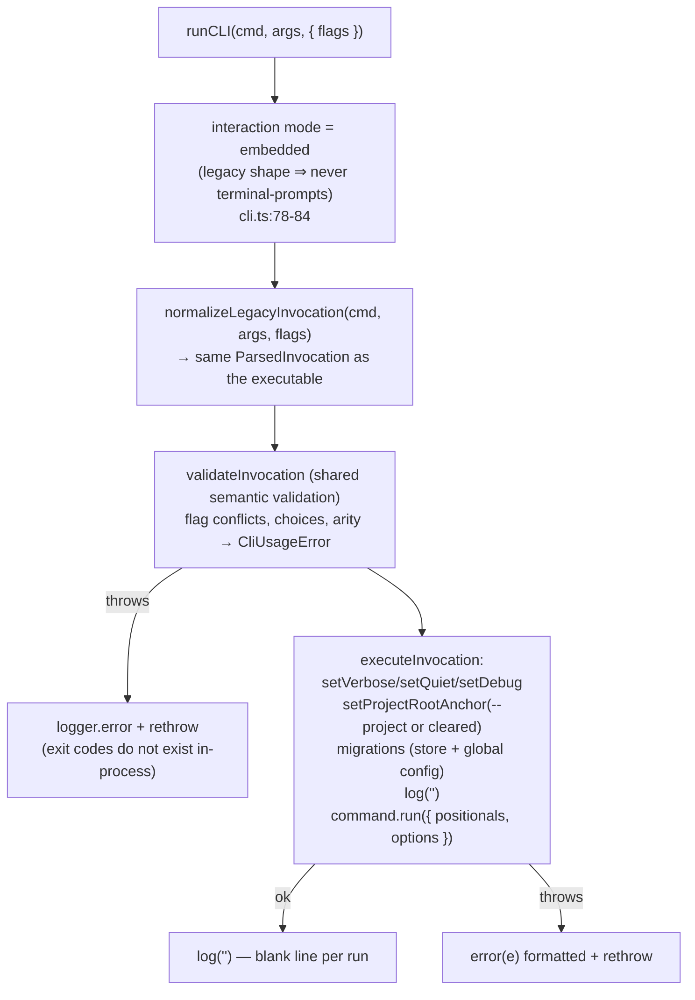

# 09 — Embedded CLI Bridge

The exact contract between the extension and `@pzstudio/cli/api`. The
extension never spawns the CLI binary; `scripts/bundle.js` inlines the api
bundle (`packages/cli/dist/api.js`, built from `packages/cli/src/api.ts`)
into `dist/extension.js`. Two important consequences of the packaging:

- The extension and the `pzstudio` executable are **separate bundles with
  separate module state** — setting the project anchor in one never affects
  the other (`docs/cli/08-mechanics.md` packaging contract).
- The package root is not importable (`ERR_PACKAGE_PATH_NOT_EXPORTED`);
  `@pzstudio/cli/api` is the only supported surface.

## What the extension imports

| Import (`api.ts`) | Used in | Purpose |
| :--- | :--- | :--- |
| `runCLI` | `util/execute.ts`, `providers/buildTaskProvider.ts`, `src/test/integration.test.ts` | run a command in-process |
| `setLogger`, `ILogger` | `extension.ts`, `util/logger.ts` | route CLI output to the OutputChannel |
| `setProjectDir` | runner, task provider, `commands/modinfo.ts`, `deactivate` | global project anchor |
| `setVsCodeSettings` | `util/settings.ts` | settings bridge |
| `resolveModInfoTargets` | `commands/modinfo.ts` | branch targets for the overwrite check |
| `createDevSync` (+ `BuildSession`, `FileDelta` types) | `util/devsync.ts` | Development Sync engine |
| `log`, `warn` | `util/devsync.ts` | direct data/warn lines for sync batches |
| `summarizeApplyResult` | `util/devsync.ts` | per-batch summary wording |
| `WATCH_DEBOUNCE_MS` | `util/devsync.ts` | shared debounce constant |
| `runProjectDoctor`, `DoctorReport` | `util/doctor.ts` | diagnostics |

`isWatchPathIgnored` / `resolveWatchVariants` are exported for hosts
(`api.ts:47-51`) but currently **unused** by the extension (UX-09).

## `runCLI` embedded contract

`packages/cli/src/lib/cli.ts:62-124`:

Pinned behaviors the extension relies on:

- **Never prompts.** Embedded mode is decided from the invocation shape
  (`cli.ts:78-84`); destructive consent is the host's job.
- **Destructive consent** (`91620af`): `delete`/`rename` without `--yes`
  refuse with a `CliUsageError` whose message instructs the host to pass
  `{ flags: ['--yes'] }` once its UI has confirmed. The extension forwards
  `--yes` exactly there ([`04-command-flows.md`](04-command-flows.md)).
- **Flags in, not argv** (C2): `{ flags }` replaces `process.argv`; the
  extension never mutates argv.
- **Errors are thrown**, never `process.exit` (C1): the runner catches and
  swallows because `logger.error` already reported
  (`util/execute.ts:65-70`); the task terminal prints the message
  (`buildTaskProvider.ts:62-66`).
- **Every `runCLI` call without `--project` clears the `-C` anchor**
  (`cli.ts:139-143`) — relevant for hosts mixing flags and anchors.
- Store/global-config migrations run **before** every real command
  (`cli.ts:173-174`); their markers go to stderr (stdout purity, `0414256`)
  — in the extension both streams land in the same channel anyway.

## Stream mapping (the real contract)

`ILogger` (`packages/cli/src/lib/logger.ts:5-12`) is implemented by
`createPZLogger` (`util/logger.ts:16-41`):

| CLI logger call (semantic channel) | Extension rendering |
| :--- | :--- |
| `log(msg)` — **data** (reports, results, `Next:`, sync summaries) | `appendLine(msg)` — plain, **no timestamp/prefix** |
| `info(msg)` — **progress** | `[<timestamp>] [INFO] <msg>` |
| `warn(msg)` — **warning** | `[<timestamp>] [WARN] <msg>` |
| `error(err)` — **failure** | `[<timestamp>] [ERROR] <msg>\n<stack?>` **plus** `showErrorMessage(t('PZStudio Error: {0}', …))` |
| `verbose(msg)` — **debug** | **not implemented** → falls through to the CLI default: `process.stderr` of the extension host — invisible in the channel (UX-04) |
| `clear()` | `outputChannel.clear()` — implemented but currently **dead**: no CLI command calls `clear()` any more (CLI-2 removed it) |

So the single "PZ Studio" OutputChannel interleaves both streams, with the
ext-side `[INFO]/[WARN]/[ERROR]` decoration produced **by the extension
itself** — the extension depends only on the *semantics* of the calls, never
on the CLI's `[INFO]` text formatting (which is TTY-gated presentation,
`0.42200.1` release contract).

The direct `log`/`warn` imports in `util/devsync.ts` bypass nothing — they
are the same module-level functions that check `externalLogger` first.

## Module state inventory (the API-v2 boundary)

| Module state | Who sets it in the extension | Leak profile |
| :--- | :--- | :--- |
| `externalLogger` | once at activate | cleared at deactivate |
| `vscodeWorkspaceSettings` / `vscodeUserSettings` | activate + config changes | cleared at deactivate |
| `externalProjectDir` | runner (per command), task provider, `modinfo.ts:30`, `createDevSync` | **persists after the command**; doctor restores its own; next command re-sets; deactivate clears |
| interaction mode | set per `runCLI` call (always `embedded`) | per invocation |
| `-C` anchor (`projectRootAnchor`) | never set by the ext; cleared by each `runCLI` call without `--project` | — |
| `setInvocationOptions` | set/cleared inside `executeInvocation` (`finally`) | — |

Because all of this is process-global, the runner's busy-guard is the only
thing preventing concurrent corruption, and it only guards same-command
overlap (UX-08). The planned `createPzStudio({ projectDir, logger, settings,
transport })` turns each row above into an instance field — this file is the
checklist of what must be carried over.

## Build and packaging facts

- esbuild externals: `vscode`, `@parcel/watcher` (native binding stays out
  of the bundle; the command that needs it lazy-requires inside a function).
- `minify: true` for production bundles; `sourcemap: true`.
- `.vscodeignore` keeps `dist/extension.js(.map)`, `l10n/`, `package.nls*`,
  `schemas/`, `resources/`, `icon.png`, `.template-legacy/` (offline
  template fallback probed at `<bundleDir>/../.template-legacy`,
  `templateManager.ts:214-226`).
- The CLI **must be built before** the extension (`tsconfig.json:16-18`
  maps `@pzstudio/cli/*` to `../cli/dist/*`; esbuild resolves through the
  workspace symlink + exports map). CI builds in dependency order.
