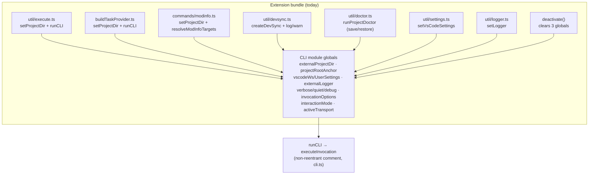
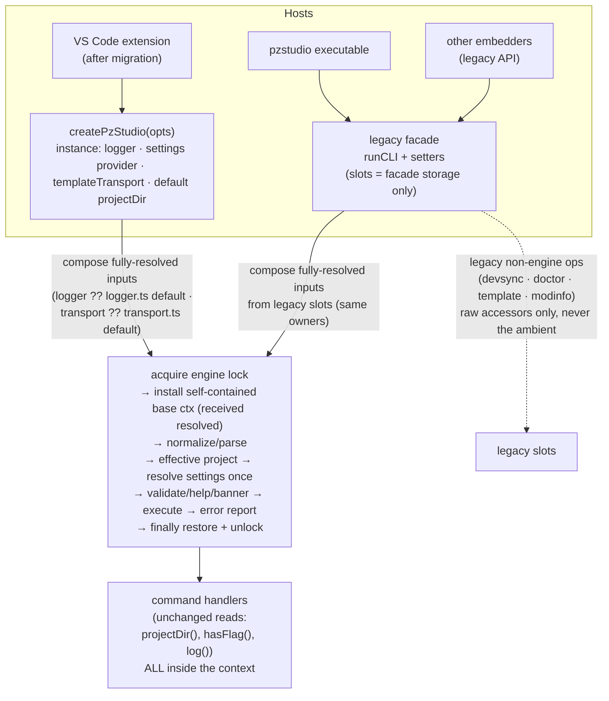
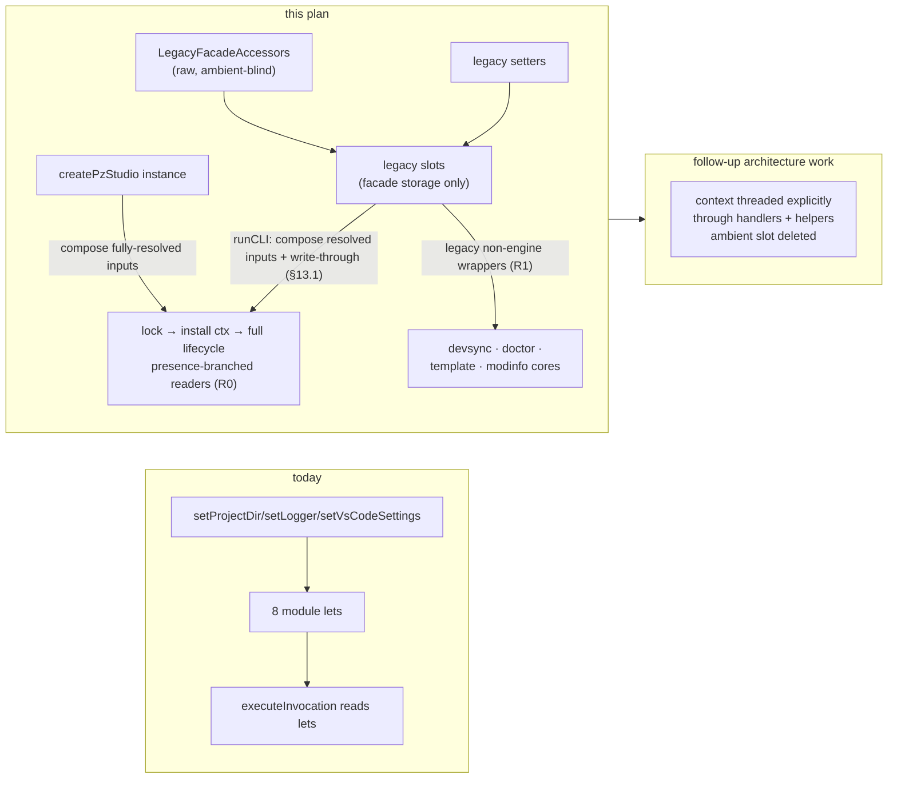

# 11 — API v2 Design and Migration Plan (`createPzStudio`)

> **Implementation status (Commit 12).** This document began as a
> design-only pass (revision 5, verified against the implementation at
> `63d2c9c`); that provenance is retained below. The implementation
> sequence it planned has since been **executed in full**: engine commits
> 1–4, explicit cores 5–6, extension consumer migrations 7–10, and the
> legacy bridge retirement in commit 11 (`e5d4b49`) plus its corrective
> verification (`720da83`). **Commit 12 — `test(cli,ext): isolation
> hardening and API v2 docs` — is the final implementation/acceptance
> commit**: it lands the remaining §16 acceptance matrix (two-instance
> overlap, published-logger raw routing, destructive/hygiene pins, bundle
> gates, the real-host isolation scenario) and rewrites
> [`09-embedded-cli-bridge.md`](09-embedded-cli-bridge.md) for the v2
> architecture. The contracts in §8.0/§8.1/§9 (isolation rules R0/R1,
> invocation lifecycle, engine lock) and §13/§13.1 (legacy facade +
> write-through) are frozen and authoritative for the implemented code;
> the UX findings of §19 remain deferred exactly as recorded. Everything
> below the header keeps its historical tense where it describes the
> design pass and is verified as implemented by the §16 matrix and the
> suites named in it.

**Design-only pass, revision 5.** Written at revision `63d2c9c` (branch
`42.20.0-dev`). No source file has been changed for this document; every
claim below was verified against the implementation at that revision. This
is the plan for moving the extension from module-global CLI API state to an
instance-oriented host API:

```ts
createPzStudio({ projectDir, logger, settings, templateTransport })
```

…**without changing sequential, user-visible product behavior** (one
deliberate, classified exception: concurrency hardening — §3, §9).
Companion reading: [`02-project-and-mod-resolution.md`](02-project-and-mod-resolution.md)
(resolution + global-state tables),
[`09-embedded-cli-bridge.md`](09-embedded-cli-bridge.md) (bridge contract),
[`10-ui-ux-audit-findings.md`](10-ui-ux-audit-findings.md) (UX findings this
plan deliberately does *not* fix).

**Revision 5 notes** (final dependency correction): `invocation.ts` never
constructs the concrete defaults — the **real default engine logger is
owned by `logger.ts`** and the **real host-default `TemplateTransport` is
owned by `transport.ts`**; `cli.ts` (legacy) and `studio.ts` (v2) compose
**fully-resolved `InvocationInputs`** (`logger`/`templateTransport`
required, received via the pure `InvocationDefaults` type), and
`invocation.ts` only receives them — `settings` stays the only dependency
intentionally unresolved at installation time (§8.0–§8.2, §12, §17,
Appendix B).

**Revision 4 notes** (final compatibility corrections): legacy
`resolveModInfoTargets()` keeps its **resolved-project-root** discovery
semantics — the raw legacy boundary gains `legacyProjectDir()` (walk-up +
fail-closed over raw state only), distinct from the raw discovery
*start*; the published `log/info/warn/verbose` exports become **raw-legacy
wrappers** that never consult an active v2 ambient context, while internal
engine logging stays context-aware (§8.0, §12, §13); the conceptual
factory signature uses the normative `templateTransport` name and the
`PzStudioSettingsLayer` wording is corrected (§7).

**Revision 3 notes** (review corrections): the settings provider is
now invoked **after parsing** with the *effective* project — the parsed
`-C/--project` flag included — so a command targeting A can never run with
settings resolved for B (§8.1, §10, §11); isolation is **bidirectional**
(new rule R1: legacy non-engine operations compose dependencies from raw
legacy facade state and never inherit an active v2 ambient context — §8.0,
§13); legacy `runCLI`'s module-state writes are preserved **explicitly**
with a per-field write-through table and post-run state tests (§13.1);
the concurrency claim is corrected — overlapping engine invocations are
possible today (UX-08) and the engine lock is an **intentional structural
hardening** (race → serialization), not a no-op (§3, §5, §9, §17, §18);
minor consistency: Non-goals covers UX-01…UX-18 and the v2 surface names
its settings layer type domain-neutrally (`PzStudioSettingsLayer`, §7).

**Carried from revision 2** (accepted): context-presence branching
replaces per-field nullish fallback (R0, §8.0); the invocation context
covers the full host-visible run lifecycle including parse/validate/help/
error reporting (§8.1/B); legacy exported helpers keep their observable
state side effects — `createDevSync`'s anchor write and doctor's
save/restore included (§13); the settings provider is resource-aware
(`PzStudioSettingsContext`, §10); the A2 logger call-site audit is
resolved — the instance logger is threaded through every v2-reachable
non-engine path, so the extension retires `setLogger` (§12, Appendix C);
Commit 1 is split into four safe engine commits (§17).

---

## 1. Problem statement

The extension drives the CLI **in-process** through `@pzstudio/cli/api`. The
engine's inputs — which project, which logger, which host settings, which
template transport — are process-global module variables:

| Global | Declared | Typical writer |
| :--- | :--- | :--- |
| `externalProjectDir` | `helper.ts:173` | runner per command, task provider, `modinfo.ts:30`, `createDevSync` (`devsync.ts:33`), doctor temporarily |
| `projectRootAnchor` (`-C`) | `helper.ts:174` | every `executeInvocation` (set from `--project`, else cleared, `cli.ts:139-143`) |
| `vscodeWorkspaceSettings` / `vscodeUserSettings` | `helper.ts:56-57` | `setVsCodeSettings` at activate + on config change |
| `externalLogger` | `logger.ts:14` | `setLogger` once at activate |
| `verboseEnabled` / `quietEnabled` / `debugEnabled` | `logger.ts:15-17` | every `executeInvocation` from parsed flags |
| `currentInvocationOptions` | `args.ts:12` | `executeInvocation` (set/cleared in `finally`) |
| `interactionMode` | `interaction.ts:21` | every `runCLI` call |
| `activeTransport` | `transport.ts:409` | `--transport` flag or `setTemplateTransport` (sticky) |

Consequences (all verified in code, see the audit for the user-facing side):

- **Concurrency is unsafe by construction.** Overlapping invocations race on
  the anchor and on every per-invocation field above. The runner's
  busy-guard (`execute.ts:26-37`) only blocks a *repeat of the same command*;
  the task provider has no guard at all (UX-08) — so overlap **happens
  today** and is undefined-behavior territory, not a supported mode (§9).
- **Every call site must remember to re-anchor.** `modinfo.ts:30` pokes the
  global directly (UX-10); doctor needs a save/restore dance
  (`doctor.ts:40-41,71-73`); DevSync leaves the anchor set for its lifetime.
- **Host coupling is structural.** The "VS Code settings bridge" is a
  CLI-module global (`helper.ts:56-65`), so a second host context in one
  process (multi-root correctness, a future web host, tests) cannot exist.
- **Isolation is untestable.** Two consumers in one process necessarily
  share one logger, one settings snapshot, one anchor.

API v2 replaces this with an owned, injectable host context while keeping
the embedded CLI contract (parse/validate semantics, embedded consent,
stream semantics) byte-for-byte.

---

## 2. Current-state ownership map

Full inventory of mutable module/process state reachable from the extension
bundle. "Move" = target classification (A must become per-instance,
B process-global is fine, C invocation-local).

| # | State | Declared where | Written by | Read by | Lifetime | Concurrency risk | Move |
| :-- | :--- | :--- | :--- | :--- | :--- | :--- | :--- |
| 1 | `externalProjectDir` | `helper.ts:173` | `setProjectDir`: runner (per cmd), task provider, `modinfo.ts:30`, `createDevSync` (`devsync.ts:33`), `runProjectDoctor` (temp, restored `doctor.ts:71-73`), `deactivate()` (`extension.ts:85`) | `discoveryStartDir()` → `findProjectDir`/`projectDir()`/`getOutDir`; `getExternalProjectDir()` (doctor) | persists between invocations | **high** — mid-flight re-anchor (UX-08) | **A** (per-call project context; instance default optional) |
| 2 | `projectRootAnchor` | `helper.ts:174` | `executeInvocation` from parsed `--project` or `undefined` (`cli.ts:139-143`) | `discoveryStartDir()` | per invocation (but a *global slot*); **post-run value persists** (§13.1) | medium under overlap | **C** (folds into invocation context; legacy write-through preserved) |
| 3 | `vscodeWorkspaceSettings` / `vscodeUserSettings` | `helper.ts:56-57` | `setVsCodeSettings` (activate + config listener `settings.ts:38-44`; cleared at deactivate) | `getVsCodeSettings` (`templateManager.ts:461,494`), `getResolvedTemplates`, `getResolvedUseSymlinks`, `getOutDir` (`helper.ts:461-467`) | session-long snapshot | low–medium (stale-able, shared by all projects) | **A** (instance settings, provider-called per run) |
| 4 | `externalLogger` | `logger.ts:14` | `setLogger` (activate `extension.ts:29`; cleared `extension.ts:84`) | `log/info/warn/error/verbose` (`logger.ts:83-163`) | session-long | low (one host session) but cross-leaks between would-be instances | **A** (instance logger; legacy slot retained as facade tier only — §12/§13) |
| 5 | `verboseEnabled`/`quietEnabled`/`debugEnabled` | `logger.ts:15-17` | `executeInvocation` (`cli.ts:133-135`); **post-run values persist** (§13.1) | logger emit gating — including the *published* direct `info()`/`verbose()` exports when no external logger is set | semantically per invocation, stored globally | **high** under overlap (one run's `--quiet` silences another's output) | **C** (legacy write-through preserved) |
| 6 | `currentInvocationOptions` | `args.ts:12` | `setInvocationOptions` (`cli.ts:185,195`) | `hasFlag`/`extractFlag` in every command handler | per invocation (net-zero post-run) | **high** under overlap (wrong flags to mid-flight command) | **C** (legacy set/clear preserved) |
| 7 | `interactionMode` | `interaction.ts:21` | `runCLI` per call (`cli.ts:78-84`) | `confirmDestructive` (`interaction.ts:86-95`) — engine-scope only | per invocation (post-run value unobservable: the only reader runs inside the next invocation, which re-sets it — proven from the call graph; preserved anyway, §13.1) | medium | **C** |
| 8 | `activeTransport` | `transport.ts:409` | `setTemplateTransport` (api export); `executeInvocation` when `--transport` present (`cli.ts:144-150`) — **sticky post-run** (observable: subsequent template ops use it) | `getTemplateTransport()` (`transport.ts:425-430`) | sticky session-long | low (extension never sets it; executable is one command per process) | **A** (instance `templateTransport`) + **C** (flag override) |
| 9 | `activeIO` (`CliIO` sink) | `parser.ts:39` | `setCliIO` (test hook only) | `emit`, executable usage printing | test-only | none | **B** |
| 10 | `stdinReader` | `interaction.ts:56` | `setStdinReader` (test hook) | interactive confirm | test-only | none | **B** |
| 11 | command `registry` (`Map`) | `registry.ts:68` | populated once at import of `lib/cli.ts` | parser dispatch | immutable after import | none | **B** |
| 12 | `~/.pzstudio/config.json` (+ store migration, `.pzstudio.bak`) | file on disk (`templateManager.ts:311-433`, `helper.ts:414-445`) | migrations + `outdir` command | config reads, `getOutDir` tier 4 | genuinely process-external | same-file concurrent writes (pre-existing, out of scope) | **B** (real global config, on disk) |
| 13 | `busyCommands` runner guard | `execute.ts:28` (closure) | runner | runner | closure-local | keyed per command id only (UX-08) | stays extension-side; engine adds its own exclusion (§9) |
| 14 | `DevSyncController` fields (`session`, `watcher`, `pending`, `timer`, `starting`) | `util/devsync.ts:20-24` | controller | controller | per sync session | self-serialized via `starting`/`active` + core session | already instance-shaped; becomes **per-project session** fed by an instance |



One sink, many uncoordinated writers, cleared only at deactivate — that is
the whole problem in one picture.

---

## 3. Design goals

1. **Instance-oriented host context**: project context, logger, settings and
   template transport are owned by a `PzStudio` instance created via
   `createPzStudio(...)`, not by module globals.
2. **Hard context isolation, bidirectional**: while a v2 invocation is
   active, *nothing* on the v2 path reads the legacy facade — not even for
   fields the v2 caller left undefined (R0, §8.0); and no legacy
   non-engine operation or published legacy export ever inherits an
   active v2 ambient context (R1, §8.0).
3. **Behavior-preserving, with one classified exception**: all sequential,
   user-visible behavior and every documented legacy state side effect are
   preserved (§5, §13); the single intentional change is **structural
   concurrency hardening** — UX-08's unsafe overlapping engine execution
   (possible today: task provider vs palette runner) is changed from race
   to serialization (§9). UX findings otherwise still reproduce.
4. **Incremental migration**: legacy `runCLI`/setters and v2 instances run
   side-by-side through the same engine; each extension consumer migrates in
   its own commit; no flag day.
5. **Testable isolation**: two instances in one process can be proven not to
   cross-anchor, cross-log, or cross-configure — in both directions
   (§9, §16).
6. **Browser-safe direction**: the v2 *type surface* must stay free of
   `vscode` and Node-specific types; the Node implementation stays behind
   the existing adapters (§15).
7. **Small commits**: each commit compiles, tests, and reverts
   independently (§17, §20 conventions).

## 4. Non-goals

- No UX fix from `10-ui-ux-audit-findings.md` is implemented by this
  migration (UX-01…UX-18; classification in §19 — UX-18's contract-read
  adoption is an enabled follow-up, not folded in here). Where v2 merely
  *enables* a later fix, that is recorded as a dependency, not folded in.
- No typed domain-command surface yet (`studio.build({target})` etc.) —
  CLI-shaped `run` is the MVP contract; typed ops are Track B (§6.2).
- No web host, no `platform-web` implementation, no `vscode-extension-web`
  package, no monorepo restructure.
- No new watcher, no DevSync feature work (single-session UX stays; UX-15
  untouched).
- No change to the CLI executable's user-facing behavior, packaging
  (two-bundle contract), or `pzstudio-cli` version.
- No refactor of `@pzstudio/core` types (the v2 surface adds a
  domain-neutral alias instead — §7).

## 5. Behavioral invariants (pinned)

Each invariant lists the code/tests that pin it today; the migration must
keep all of them. These were re-verified against source at `63d2c9c`.

**Embedded CLI invocation**

- Executable and embedded share parser + semantic validation
  (`normalizeLegacyInvocation` → `validateInvocation`, `cli.ts:85-105`).
- Embedded mode is decided from the invocation shape and never prompts
  (`cli.ts:78-84`, `interaction.ts:86-95`).
- Destructive `delete`/`rename` refuse without `--yes`; the host confirms,
  then forwards `--yes` (`91620af`; pinned by `src/test/integration.test.ts:112-149`).
- Flags travel in invocation options, never `process.argv`
  (`RunCLIOptions.flags`, C2).
- `-C/--project` remains a CLI flag; the extension passes explicit project
  context instead (`projectDir` option), which seeds the same discovery
  start. Discovery semantics unchanged: start dir → walk up to fs root →
  fail closed (`helper.ts:206-259`).
- Errors are thrown from the embedded API, never `process.exit`
  (`cli.ts:109-121`); no SIGINT handler at engine level (CLI-6, `cli.ts:67-71`).
- Store + global-config migrations run before every real command
  (`cli.ts:173-174`); help/banner/help-command stay pure
  (`cli.ts:154-169`).
- `log('\n')` blank-line rhythm: once before a real command
  (`cli.ts:176`), once after the run returns (`cli.ts:123`); help/banner
  paths print no stray blank line.
- Help and banner emit through the **logger** (`log()`), not CliIO:
  `helpCmd` uses `log(buildFullHelp())` / `log(helpText)`
  (`commands/help.ts:22-38`), the banner uses `log()`
  (`cli.ts:218`). Only the executable's `parseArgv` control flow
  (`--version`, Commander usage) prints via CliIO directly — an
  executable-only path, never reachable from embedded/v2 calls.

**Streams/logger**

- Semantic channels only: `log` = data, `info` = progress, `warn` =
  warning, `error` = failure, `verbose` = debug, `clear` = (dead) reset.
  `[INFO]`/timestamps/colors are presentation and never part of the
  contract (`logger.ts:19-24`, doc 09 stream table).
- `verbose()` falls back to stderr when the sink lacks `verbose`
  (`logger.ts:151-163`) — UX-04 keeps reproducing after migration.
- Extension renders decorations itself (`createPZLogger`,
  `util/logger.ts:16-41`), including the error toast; the engine never
  formats for the host.
- `@pzstudio/core` emits **nothing** — no `console.*`, no `process.std*`
  anywhere in core (verified by grep); core reports via return values and
  the injected `host.log` (BuildSession) / `DoctorReport`. All logging is
  host-side (CLI lib or extension).

**Legacy exported side effects and module-state writes (observable
contract — preserved, §13/§13.1)**

- `runCLI` overwrites `projectRootAnchor` every invocation (set from
  `--project`, else cleared) and sets verbose/quiet/debug/interactionMode;
  `currentInvocationOptions` is set and finally-cleared; `--transport`
  writes the sticky `activeTransport`. **Post-run values persist and are
  preserved** (§13.1 table + tests).
- `createDevSync(projectPath)` **leaves `externalProjectDir` anchored at
  `projectPath`** (`devsync.ts:33`) — a subsequent legacy `runCLI` without
  explicit anchoring discovers from it.
- `runProjectDoctor(projectPath)` transiently writes
  `externalProjectDir` and restores the previous value in `finally`
  (`doctor.ts:40-41,71-73`).
- `resolveModInfoTargets(modId, baseDir = projectDir())` is read-only but
  defaults to the implicit anchor.
- `setLogger` / `setProjectDir` / `setVsCodeSettings` /
  `setTemplateTransport` are pure module-slot setters.

**Concurrency (classified exception)**

- All *sequential* legacy behavior is preserved. **Overlapping engine
  invocations are intentionally changed from race to serialization** —
  today the task provider and the palette runner can execute `runCLI`
  concurrently with no guard (UX-08, `execute.ts:26-37`,
  `10-ui-ux-audit-findings.md`); that overlap is not a supported mode (the
  engine's own state — per-invocation options, anchor, verbosity — is
  written concurrently), and the engine lock turns it into FIFO
  queueing. No other concurrency timing changes.

**Extension flows (unchanged)**

- Project/mod picker behavior (`resolveProjectDir`, `pickModId`), command
  palette/menu surface, build/clean `confirmBeforeRun` modals, task
  semantics (4 tasks, no confirm, no guard, no refresh), rename/delete
  modal + forwarded `--yes`, Development Sync lifecycle (single toggle,
  both variants, 300 ms debounce), doctor quick-pick + explorer badge,
  explorer behavior, l10n behavior (two layers, 25 locales).
- Runner user-visible behavior: same-command busy warning, non-cancellable
  progress (`PZStudio: {command}` — UX-17 stays), swallow-after-logger.error,
  channel auto-show only on `--verbose` (UX-16 stays).
- Every UX finding in doc 10 still reproduces after the pure migration,
  with the single exception class above (UX-08's race → serialization).

---

## 6. API alternatives

### 6.1 What does a `PzStudio` instance represent?

| Model | Meaning | Fits the extension? | Verdict |
| :--- | :--- | :--- | :--- |
| **M1 — per-project** | instance bound to one project dir for life | The extension resolves the project **per command** (picker/active editor, `project.ts:323-360`); `new` runs before any project exists (`new.ts:102-104`); `update` is project-less (UX-03); doctor takes temporary contexts. A per-project instance would be created and thrown away per invocation — lifetime carries nothing. Only DevSync is long-lived per project, and it already owns a per-project engine object (`BuildSession`). | rejected |
| **M2 — per-host session, explicit project per call** | instance = one host context (logger + settings + transport defaults); **every project-scoped operation takes an explicit `projectDir`**; optional factory default for single-project embedders | Matches reality: one window = one host context; project varies per call; multi-root needs no extra instances; `new`/`update` simply omit the project; doctor passes its target; DevSync creates a per-project session *through* the host context. Instance lifetime = extension lifetime. | **recommended** |
| **M3 — per-command execution context** | stateless API; every call takes full context | Degenerates into noise (logger/settings repeated per call) and matches nothing the hosts do. | rejected |

Model M2 was chosen against the brief's checklist: multi-root (per-call
project, no per-root instances required), task provider running a *different*
project than a palette command (explicit context per call — exactly the
UX-08 fix), DevSync long-lived project (session object, not studio),
doctor temporary context (explicit argument, no anchor dance), New Project
before the project exists (no project needed), global `update` (no project
needed), future web host (context is data-only, §15).

### 6.2 Run shape

| Shape | Example | Assessment |
| :--- | :--- | :--- |
| **S1 — CLI-shaped, positional (runCLI parity)** | `studio.run('build', [], { flags: ['--development'], projectDir: dir })` | Minimal migration; the parse/validate/embedded-consent contract is reused verbatim; host keeps knowing command names/flags. |
| **S2 — single options object** | `studio.run({ command, positionals, flags, projectDir })` | Marginally nicer call sites; no semantic difference; easy to add later without breaking S1 (overload or wrapper). |
| **S3 — typed domain ops** | `studio.build({ target: 'development' })`, `studio.renameMod({ modId, nextId, confirmed: true })` | Removes argv coupling from hosts — but is a large migration with real behavior-drift risk, and the CLI parser *is* the shared validation surface today. Track B. |

**Recommendation: S1 now** (with a documented path to S2/S3). Rationale:
state ownership (instance, not argv-shaped globals), multi-project behavior
(per-call `projectDir`), testability (identical engine, injectable sinks),
browser portability (types only), compatibility (byte-identical invocation
semantics), migration churn (call sites swap `runCLI` for `studio.run` —
mechanical). S3 is explicitly *not* designed further here per the brief.

---

## 7. Recommended API shape

New module `packages/cli/src/lib/studio.ts`, exported from
`packages/cli/src/api.ts` (location rationale in §13/§22).

```ts
import type { IVsCodeSettings } from '@pzstudio/core';
import type { TemplateTransport } from '@pzstudio/platform';

/** Semantic host logger — structurally identical to the legacy ILogger. */
export interface PzStudioLogger {
    log(message: string): void;                       // data
    info(message: string): void;                      // progress
    warn(message: string): void;                      // warning
    error(error: string | Error): void;               // failure
    verbose?(message: string): void;                  // debug (optional; engine default sink falls back to stderr)
    clear?(): void;                                   // optional; still unused by the engine
}

/**
 * One host settings layer. Domain-neutral alias for the v2 public surface;
 * structurally and semantically identical to `IVsCodeSettings`
 * (`packages/core/src/project.ts:117` — `{ templates?, outdir?, useSymlinks? }`).
 * Compatibility mapping (Option A, minimal): `type PzStudioSettingsLayer =
 * IVsCodeSettings` — the consumer-facing name is domain-neutral, while the
 * generated declaration may still reference the historical core type
 * internally. Core is NOT refactored for this naming concern; the legacy
 * bridge keeps using the core name.
 */
export type PzStudioSettingsLayer = IVsCodeSettings;

/** One host settings snapshot — the same data the CLI merges today
 *  (workspace over user over ~/.pzstudio/config.json). Host-generic:
 *  the names describe layers, not VS Code. */
export interface PzStudioHostSettings {
    workspace?: PzStudioSettingsLayer;
    user?: PzStudioSettingsLayer;
}

/** Resource hint passed to the settings provider. Host-neutral on
 *  purpose — a plain absolute fsPath-like string, never a vscode.Uri. */
export interface PzStudioSettingsContext {
    projectDir?: string;
}

/** Called exactly once per operation, AFTER parsing, with the EFFECTIVE
 *  project the command will target (§8.1/§10) — the parsed `-C/--project`
 *  flag included. */
export type PzStudioSettingsProvider =
    (context: PzStudioSettingsContext) => PzStudioHostSettings | undefined;

export interface PzStudioOptions {
    /** Optional default project discovery start (-C semantics) for calls
     *  that omit projectDir. NOT an anchor: discovery still walks up and
     *  fails closed; project-less commands ignore it. */
    projectDir?: string;
    logger?: PzStudioLogger;                 // default: engine stdout/stderr
    settings?: PzStudioHostSettings | PzStudioSettingsProvider;
    templateTransport?: TemplateTransport;   // default: git if available, else fetch
}

export interface PzRunOptions {
    flags?: string[];                        // same contract as RunCLIOptions.flags
    /** Explicit project discovery start for THIS invocation
     *  (wins over the factory default; loses to a parsed --project flag). */
    projectDir?: string;
}

export interface PzStudio {
    /** Run a CLI command through the shared parse/validate/execute engine.
     *  Same embedded contract as runCLI: never prompts, throws errors,
     *  no process.exit, no argv mutation. */
    run(command: string, args?: string[], options?: PzRunOptions): Promise<void>;

    /** Long-lived per-project sync session; reads settings via the
     *  instance provider (with the session's projectDir) on every plan
     *  input; logs via the instance logger. Touches no legacy state. */
    createDevSync(projectDir: string, options?: DevSyncOptions): BuildSession;

    /** Full diagnostics for one project — explicit context, no anchor
     *  save/restore. Same DoctorReport. */
    runProjectDoctor(projectDir: string, options?: ProjectDoctorOptions): Promise<DoctorReport>;

    /** Branch folders of `modId` under `projectDir` that should carry a
     *  mod.info (the existing helper with the implicit baseDir removed). */
    resolveModInfoTargets(modId: string, projectDir: string): string[];
}

export function createPzStudio(options?: PzStudioOptions): PzStudio;
```

Deliberate choices:

- **`projectDir` is optional at the factory and per call.** It is a
  *discovery start* (exactly `-C/--project` semantics: walk-up still
  applies, so `new --path <dest>` keeps working when the destination has no
  `project.json` yet), not an "instance is one project" claim. Nobody ever
  mutates an anchor between calls again. Normative precedence in §11.
- **`settings` is resource-aware** (`PzStudioSettingsContext`, §10) and
  resolved **post-parse with the effective project** — including a parsed
  `-C/--project` flag (§8.1). The later UX-05 fix is extension-internal
  and needs no API change. The MVP adapter intentionally ignores the
  context.
- **Logger is instance-level only.** No per-call override in MVP — the
  extension has one channel, and per-call loggers would resurrect routing
  puzzles the globals had. Full ownership including non-engine paths:
  §12 / Appendix C (A2 resolution).
- **`templateTransport` replaces the draft's `transport`** — naming review
  in §23 of the brief answered: "transport" alone reads as I/O transport
  for everything; the only transport the CLI has is template acquisition
  (`TemplateTransport`, `transport.ts`, doc 09). Typed, so ambiguity is
  bounded anyway; the rename is cheap now and expensive later.
- **`PzStudioSettingsLayer` instead of exposing `IVsCodeSettings`**: a
  documented type alias (same shape, same identity — zero runtime or core
  change) keeps "VS Code" out of the v2 public surface while the legacy
  bridge and core keep the historical name (§4, §5 of the brief).
- **Errors/return**: `run()` throws like `runCLI`; it does not swallow —
  swallowing is a *runner* decision (`execute.ts:65-70`) and stays there.

---

## 8. State ownership model (target)

| State (from §2) | Target owner |
| :--- | :--- |
| Project context (1, 2) | per-invocation: **normative precedence — parsed `-C/--project` flag > `PzRunOptions.projectDir` > `PzStudioOptions.projectDir` default > `process.cwd()`**. `externalProjectDir` exists **only on the legacy facade path** (between the parsed flag and cwd for legacy runs). Never persisted between invocations on the v2 path |
| Settings (3) | `PzStudioOptions.settings` (object or resource-aware provider), **resolved once per run after parsing, with the effective project** (§8.1/§10); per plan input for DevSync; once per doctor run |
| Logger (4) | `PzStudioOptions.logger` on the instance, threaded through every v2-reachable path (§12, Appendix C); legacy slot remains facade-only |
| Verbose/quiet/debug (5) | per-invocation runtime, derived from parsed flags; **legacy post-run persistence preserved on the facade path** (§13.1) |
| Invocation options (6) | per-invocation runtime; legacy set/clear preserved (§13.1) |
| Interaction mode (7) | per-invocation: v2 `run` is always `embedded` (same rule as legacy shape) |
| Template transport (8) | instance option, **resolved at composition** by `studio.ts` (the host-default transport is owned by `transport.ts`); `--transport` flag overrides for the invocation on the v2 path; **legacy sticky write preserved on the facade path** (§13.1) |
| CliIO / stdinReader (9, 10) | unchanged (test hooks; parser-level raw sink — see §8.1) |
| Registry (11) | unchanged |
| `~/.pzstudio` (12) | unchanged (real on-disk global) |
| Runner guard / DevSync fields (13, 14) | unchanged, now layered over an engine invocation contract (§9) |

### 8.0 The isolation rules (normative)

**R0 — v2 never falls through to legacy (context presence, not nullish
fallback).** All engine state readers branch on *context presence*, never
on per-field nullish checks:

```text
if an active InvocationContext exists:
    read exclusively from that context / its resolved defaults
else:
    read the legacy facade slot / legacy default
```

- A v2 invocation whose `logger`, `settings`, `projectDir` or
  `templateTransport` was intentionally omitted **must never** consume the
  legacy facade's values for that field. "Undefined on the instance" is a
  meaningful state — the instance logger ?? the real default engine
  logger owned by `logger.ts`; no host settings; discover from cwd; the
  instance transport ?? the real host-default transport owned by
  `transport.ts` (resolution happens at **composition**, §8.1) — never a
  fallback trigger.
- To make R0 implementable without per-field `??` chains, resolution
  happens at **composition, before installation** (§8.1): `cli.ts` and
  `studio.ts` compose **fully-resolved `InvocationInputs`** — `logger`
  and `templateTransport` are **required and already resolved** when they
  reach `invocation.ts` (which only *receives* them via the pure
  `InvocationDefaults` type; it never constructs a default — the
  concrete defaults are owned by `logger.ts` and `transport.ts`). The
  installed `InvocationContext` is therefore **self-contained** from the
  first lifecycle step. The fields where "absent" is meaningful
  (`settings` — the only dependency intentionally unresolved at
  installation, resolved post-parse; `projectDir`) stay
  possibly-`undefined` and readers treat that as the meaningful absence.
- The legacy branch is the exact pre-migration read logic (legacy slots,
  sticky transport, cwd fallback), unchanged for the facade path.

**R1 — legacy never inherits a v2 ambient context (bidirectional
isolation).** Explicit operation cores never consult ambient or module
context: they receive **all** project/settings/logger/transport
dependencies explicitly. Every legacy wrapper that delegates to such a
core must obtain its dependencies from **raw legacy facade state** via
dedicated internal accessors — `LegacyFacadeAccessors`
(`legacyLogger()`, `legacySettings()`, `legacyTransport()`,
`legacyDiscoveryStart()`, `legacyProjectDir()`) — which read the legacy
slots **directly** and bypass `activeContext` entirely. **Placement /
import direction (normative, one-way):** `LegacyFacadeAccessors` exists
as a **type-level contract** — the interface lives in `invocation.ts`
beside the other context-pure types — while its **concrete accessors are
exported by the state-owner modules that own the raw state**:
`logger.ts` (`legacyLogger`), `helper.ts` (`legacySettings`,
`legacyDiscoveryStart`, `legacyProjectDir`), `transport.ts`
(`legacyTransport`). The graph stays acyclic: state-owner modules →
`invocation.ts`; legacy wrappers → state-owner modules;
`invocation.ts` imports neither back (no separate `legacyFacade.ts` is
needed — each accessor lives next to the state it reads, and a composer
module would add a hop without adding information). Presence-branched
module functions (`getVsCodeSettings()`, the *internal engine-tier*
`log()/info()/warn()/verbose()`, `getTemplateTransport()`,
`discoveryStartDir()`, `projectDir()`) are
**engine-scope functions**: correct inside an engine invocation, and
identical to the raw accessors when no context is active — but a legacy
non-engine operation must not call them, because a concurrent v2 run's
ambient context would leak into it. (The **published**
`log/info/warn/verbose` are not these functions — see the raw-wrapper
rule below.)

Two concepts the raw boundary keeps **strictly separate** (never
collapsed):

- **Discovery START** — `legacyDiscoveryStart()`: the raw
  `projectRootAnchor ?? externalProjectDir` value, used wherever legacy
  semantics need the starting point of a walk.
- **Resolved PROJECT ROOT** — `legacyProjectDir()`: reproduces the
  existing `projectDir()`/`findProjectRoot` algorithm over raw state only
  (`projectRootAnchor ?? externalProjectDir ?? process.cwd()` → walk
  upward to the nearest `project.json` → **fail-closed** with the same
  structured error). A legacy anchor may point *inside* a project; the
  resolved root is what legacy callers of `projectDir()` actually got,
  so the raw boundary must reproduce the walk, not just the start.

**Published legacy logger exports are raw, not context-aware.** The
published `log` / `info` / `warn` / `verbose` (the names under
`@pzstudio/cli/api`) are **raw-legacy wrappers**: they route by the
legacy slots (`externalLogger` + persisted verbose/quiet/debug flags)
and **never consult `activeContext`**. Internal *engine* logging is a
separate, context-aware layer that reads the active `InvocationContext`
logger (§12). Rule of thumb: **no published legacy API may inherit an
active v2 ambient context unless that behavior already existed before
v2** — before v2 these exports routed to `externalLogger` unconditionally,
so they must keep doing exactly that.

```text
Required behavior:
v2 run A active
+ legacy DevSync/doctor/template operation B
→ v2 uses only A's instance dependencies
→ legacy operation B uses only legacy facade dependencies (raw accessors)
→ no project/settings/logger/transport cross-leak in either direction
```

Classification of published non-engine helpers under R1 (full audit in
§13): the long-lived legacy `createDevSync` **must not hold the engine
lock** — it composes per-apply dependencies from raw accessors; finite
read-only helpers (doctor, template ops, `resolveModInfoTargets`) likewise
use raw accessors and stay lock-free, preserving today's lock-free
concurrency with commands.

Acceptance tests pinned to R0/R1: (a) legacy setters populated + v2
instance with every field omitted → the v2 invocation consumes none of the
legacy values (§16); (b) a v2 `run` active while legacy DevSync/doctor/
template/`resolveModInfoTargets` operations execute concurrently → the
legacy operations use only legacy facade dependencies, the v2 run only its
instance's (§16).

### 8.1 The invocation lifecycle (normative)

The engine lock and the `InvocationContext` cover the **entire
host-visible run lifecycle** — and settings resolution happens **after
parsing**, so the provider sees the effective project the command will
target:

```text
compose fully-resolved InvocationInputs   (v2, in studio.ts: instance logger ??
   BEFORE any engine call                    logger.ts's real default engine logger;
                                             instance templateTransport ?? transport.ts's
                                             real host-default transport — invocation.ts
                                             only RECEIVES these values, never constructs
                                             them; the settings provider stays unresolved;
                                          legacy, in cli.ts: raw legacy logger + raw
                                             legacy sticky-transport semantics → resolved
                                             via logger.ts / transport.ts owners)
→ acquire engine invocation lock     (FIFO promise chain, process-wide)
→ install base InvocationContext     (SELF-CONTAINED: logger and templateTransport
                                      arrive already resolved — invocation.ts only
                                      receives them;
                                      settings NOT yet resolved — the only
                                      intentionally-unresolved dependency)
→ normalize / parse                  (legacy shape | executable argv — pure)
→ compute effective project          parsed --project
                                       > per-call PzRunOptions.projectDir
                                       > PzStudioOptions.projectDir default
                                       > process.cwd()
→ resolve settings exactly once      v2: invoke the provider with
                                       { projectDir: <effective project> }
                                       and store the result on the active
                                       context (undefined = no host layer);
                                     legacy: settings = legacy facade slots
                                       (no provider call)
→ validate                           (pure; throws CliUsageError)
→ help / banner / dispatch           (emits via context logger)
→ execute                            (runtime fields from parsed options:
                                      verbose/quiet/debug/invocationOptions/
                                      anchor; migrations; command.run)
→ error reporting                    (catch → context logger → rethrow)
→ finally: restore previous ambient + release lock
```

Properties:

- **The provider receives the same effective target the command uses.** A
  run with `--project A`, per-call `C`, factory default `B` targets **A**
  and resolves settings for **A** — never for B or C (test in §16).
  Settings are resolved after parse (per the required semantic) and before
  validate; help/banner-producing runs therefore also trigger exactly one
  provider call — a harmless pure read, documented.
- **No path that emits through the logger may execute outside an installed
  context.** Validation failures (`CliUsageError`), help text, the banner,
  and runCLI's error-reporting catch all route through the instance logger
  on the v2 path (today they route through `externalLogger` for legacy —
  preserved there because the legacy context is built *from* the legacy
  slots).
- **Internal engine logging vs published legacy exports are two layers**
  (§12): everything inside this lifecycle (handlers, helpers, help, banner,
  error reports) logs through the context-aware internal layer; the
  published `log`/`info`/`warn`/`verbose` exports are raw-legacy wrappers
  that ignore the ambient entirely (R1) — a consumer calling them while a
  v2 run is active still routes by the legacy slots.
- Parsing/normalization stay logically pure; the executable's
  `parseArgv` control-flow output (`--version`, Commander usage) prints
  via **CliIO**, which remains a parser-level raw sink with test hooks
  (§2 row 9) — it is the executable's terminal surface, not the semantic
  logger contract, and is never reachable from embedded/v2 calls
  (`normalizeLegacyInvocation` + `validateInvocation` report exclusively
  through the logger, `cli.ts:109-121`).
- The runtime fields (`verbose`, `quiet`, `debug`, `invocationOptions`,
  `anchor`) are filled from parsed options *inside* the same context
  object after parse — exactly where `cli.ts:133-150` seeds globals
  today. On the **legacy** path the same values are **additionally
  written through to the legacy slots** (§13.1); on the **v2** path they
  live on the context only. The blank-line rhythm (`log('\n')` before a
  real command at `cli.ts:176`, after the run at `cli.ts:123`) moves
  inside the installed scope with output order preserved.
- `executeInvocation(valid, ctx)` dispatches from the context; it no
  longer touches any module let on the v2 path.

### 8.2 The mechanism — why this is not a wrapper over globals

The load-bearing design decision (brief §7). Five properties, together:

1. **Instance-owned inputs.** `createPzStudio(...)` returns an instance
   holding only its inputs. Its `run()` **composes fully-resolved
   `InvocationInputs`** — instance `logger` ?? the real default engine
   logger owned by `logger.ts`; instance `templateTransport` ?? the real
   host-default transport owned by `transport.ts` — and hands them to the
   engine, which only **receives** `InvocationDefaults` and never
   constructs a default itself. Legacy `runCLI()` composes the same
   shape from the legacy slots via the same owners. One engine, two front
   doors; the canonical v2 path never reads or writes a legacy slot (R0,
   proven by spy tests).
2. **Invocation-scoped ambient.** Command handlers still read through
   module functions (`projectDir()`, `hasFlag()`, `log()` — ~15 command
   files, `templateManager`, `transport`). Threading an explicit context
   through all of them is real churn with zero behavior payoff by itself,
   so the plan bounds this migration to: instance-owned inputs + an
   ambient context that is **installed for exactly one run lifecycle
   (§8.1), restore-guaranteed, and lock-protected**. Nothing is sticky
   across invocations, nothing is caller-writable, and overlapping
   invocations cannot interleave.
3. **Presence-branched readers.** Every reader in §2 rows 1–8 becomes
   `activeContext ? <context value> : <exact legacy logic>` (R0). The
   legacy lets survive only as facade storage.
4. **Raw legacy routing for non-engine legacy operations** (R1): the
   `LegacyFacadeAccessors` boundary keeps legacy DevSync/doctor/template
   operations correct even while a v2 ambient exists.
5. **Phase 2 removes the ambient.** Explicit context threading through
   command handlers/helpers is documented follow-up architecture work;
   it also lifts the process-wide serialization (§9).



### Legacy adapter path



---

## 9. Concurrency model

Honest answers (the brief forbids assuming "instance API = thread-safe"):

- **Overlapping engine invocations change from race to serialization —
  intentionally.** Today the extension's task provider and the palette
  runner **can** execute `runCLI` concurrently (UX-08: the busy-guard is
  per-command-id only, `execute.ts:26-37`; the task provider has none),
  while the engine's own per-invocation state (invocation options, anchor,
  verbosity, interaction mode) is written concurrently — overlap was
  possible but undefined-behavior territory; no source or contract ever
  documented concurrent `runCLI` as supported (the non-reentrancy record
  is the guard comment itself, `execute.ts:26-27` "runCLI is not reentrant
  (shared global state…)", doc 09's module-state table, and audit
  UX-08). The engine invocation lock (FIFO promise chain spanning the
  full §8.1 lifecycle, process-wide) makes overlapping `run`s **queue**
  instead of racing. This is the one intentional behavioral change of the
  migration: *all sequential/user-visible behavior is preserved; UX-08's
  unsafe overlapping engine execution is intentionally changed from race
  to serialization.* User-visible strings/UX are unchanged (the task
  terminal still shows `started...` first; the palette busy-guard still
  refuses same-command repeats with its existing message).
- **Two `PzStudio` instances in one process**: engine invocations (`run`)
  serialize through the same lock. Non-engine operations (DevSync apply,
  doctor, `resolveModInfoTargets`, template helpers) do **not** take the
  lock and run genuinely in parallel — R1 keeps them correct next to an
  active v2 run (§8.0). Full engine parallelism is a phase-2 outcome
  (explicit context through handlers); it is *not* claimed for this
  migration.
- **Two calls on the same instance**: same lock — they queue.
- **DevSync and a command on the same project**: today they can overlap
  *and* share the anchor/settings globals (the UX-08 corruption window).
  After migration they overlap without shared engine state: the sync
  session resolves its plan input from its own explicit project dir +
  instance settings + instance logger; a command run carries its own
  context. What can still collide is **filesystem-level** (two writers to
  the same outdir) — true today, unchanged, and out of scope.
- **Remaining non-reentrant resource**: none in process state; the on-disk
  template cache and `~/.pzstudio/config.json` remain shared (pre-existing,
  same-file write races out of scope).

**Acceptance tests (the isolation proofs, §16)**: (a) instance A (project
A, logger A) and instance B (project B, logger B); `run` overlapping on
both; assert: executions do not interleave (lock), each command's discovery
resolves its own project, each message lands in its own logger, and
neither instance's settings affect the other's flags. (b) **R0
legacy-blindness**: with all four legacy setters populated and a v2
instance with everything omitted, the v2 run consumes none of the legacy
values. (c) **R1 bidirectional overlap**: a v2 `run` active while legacy
non-engine operations execute — no cross-leak in either direction.

---

## 10. Settings model

- `VS Code configuration API ≠ PZ Studio domain configuration`. The CLI
  only ever consumed a *resolved, layered snapshot*: workspace layer over
  user layer over `~/.pzstudio/config.json` (`helper.ts:56-113`,
  `getOutDir` tiers at `helper.ts:454-480`). API v2 types exactly that
  resolved shape (`PzStudioHostSettings`, layer type
  `PzStudioSettingsLayer`) and never a `WorkspaceConfiguration`.
- **Resource-aware, and resolved with the effective project.** The
  provider takes `PzStudioSettingsContext { projectDir?: string }` —
  host-neutral, no `vscode.Uri` crosses into `@pzstudio/cli/api`. It is
  invoked **exactly once per run, after parsing**, with the **effective
  project** computed through the normative precedence (§8.1, §11) — a
  parsed `-C/--project` flag is therefore visible to the provider, and a
  command targeting A can never run with settings resolved for B. This
  removes the structural blocker for UX-05 *in this migration*: a later
  per-folder fix is adapter-internal, zero API change.

  Specified calls:

  | Operation | Provider call | Context |
  | :--- | :--- | :--- |
  | Normal `run` | **once, after parsing** (before validate/help/dispatch) | `{ projectDir: <effective project> }` = parsed `--project` ?? `PzRunOptions.projectDir` ?? `PzStudioOptions.projectDir` ?? `process.cwd()` — always a defined string |
  | DevSync plan input | once **per apply** (preserves today's freshness) | `{ projectDir: <session projectDir> }` |
  | Doctor | once per run | `{ projectDir: <doctor projectDir> }` |
  | Project-less / global op (`update`) | once, after parsing | `{ projectDir: <effective project> }` — with no project layers set this is `process.cwd()` (the effective discovery start) |

  The context type keeps `projectDir?` optional for future host operations
  with no filesystem notion; every call site specified above passes a
  defined value. Help/banner-producing runs also trigger the single
  post-parse provider call (harmless pure read; they consume no settings).
- A plain `PzStudioHostSettings` object is still accepted and internally
  wrapped as a context-ignoring provider.
- **MVP VS Code adapter intentionally ignores `projectDir`** and returns
  the same workspace/user layers it reads today
  (`inspect().workspaceValue/globalValue`, `settings.ts:6-7,26-34`) —
  UX-05's blind spot is preserved bit-for-bit by this migration. The later
  UX-05 fix switches the adapter to resolve folder-scoped settings from
  the provided `projectDir`; the engine already resolves settings per
  effective project.
- Extension wiring after migration: `updateVsCodeSettings()` +
  `onDidChangeConfiguration` push pair (`util/settings.ts`) collapses into
  one pure reader (now taking the context) passed to the factory; the push
  listener for CLI-facing settings is deleted. The `pzstudio.language`
  listener stays (l10n is extension-local).

## 11. Project-context model

**Normative precedence (identical in every table, sketch and test):**

```text
parsed -C/--project flag
  > per-call PzRunOptions.projectDir
  > PzStudioOptions.projectDir (factory default)
  > process.cwd()
```

`externalProjectDir` participates **only on the legacy facade path**
(between the parsed flag and cwd for legacy runs — which is exactly
today's `discoveryStartDir()` chain, `helper.ts:206-208`). On the v2 path
the legacy slot is never consulted (R0).

- Every project-scoped operation takes an explicit `projectDir` (string
  fsPath, as everywhere in the CLI today). The factory's `projectDir` is a
  convenience default, not an anchor and not a lifetime bond.
- **The same precedence computes the settings provider's context** (§10):
  the provider is invoked after parsing with the effective project, so
  `--project A` + per-call `C` + factory `B` targets A *and* resolves
  settings for A.
- The parsed `--project` value is `path.resolve`d exactly as today
  (`cli.ts:141`); per-call and factory values are used as given (hosts
  pass absolute fsPaths, as the runner does today with `dir.fsPath`).
- Discovery semantics unchanged for all layers: start dir → walk up to fs
  root → fail closed (`helper.ts:217-259`).
- Per-case mapping:
  - *Multi-root / task provider running a different project*: explicit
    per-call context — the exact property UX-08 needs.
  - *DevSync*: `createDevSync(projectDir)` — the session keeps its own
    explicit project path; the instance is not involved per apply.
  - *Doctor*: `studio.runProjectDoctor(projectDir)` — explicit; the
    save/set/restore anchor hygiene is removed **from the v2 path only**
    (the legacy export keeps it, §13).
  - *New Project*: `run('new', [title, modId], { flags: ['--path', dest], projectDir: dest })`
    — same as today's `{ projectDir: dest }` option (`new.ts:98-105`);
    discovery walks up and simply doesn't find a project, which `new`
    tolerates (`cli.ts:178-180` non-throwing discovery).
  - *Global `update`*: callable without any project context
    (`run('update')`); the extension's current runner still resolves one
    (behavior preserved, UX-03 stays) — the API just no longer *requires*
    it.
  - *modinfo*: `studio.resolveModInfoTargets(modId, projectDir)` — the
    helper already accepts an explicit `baseDir` (`helper.ts:646-655`);
    the extension simply never passed it (`modinfo.ts:31`). Web-safe fs
    conversion of the probe stays Track B (§14/§15).

## 12. Logger / transport model

**Logger.** Interface = today's `ILogger` (renamed `PzStudioLogger` in the
v2 surface; `ILogger` stays exported for the facade). Semantic channels
unchanged. Ownership: **fully instance-level after this migration** — the
A2 audit (Appendix C) traced every logger call reachable from the v2
non-engine paths and the count is small enough to thread the logger
explicitly in this migration:

- Engine invocations: ambient context logger (§8.1) — covers handlers,
  help, banner, error reporting.
- DevSync (`studio.createDevSync`): session host `log` forwarding wires
  the instance logger (`devsync.ts:48-54` rewired), and the plan-input
  path (`resolveProjectConfigFor` → `readProjectConfig`/`getOutDir`/
  `readGlobalConfig`, `resolveTemplateDir` → `cloneRemoteTemplate` →
  transport) receives the instance logger through an explicit io scope —
  see the complete call-site inventory in Appendix C.
- Doctor (`studio.runProjectDoctor`): same io scope threading
  (`readProjectConfig`, `getOutDir`, `readGlobalConfig`;
  `probeTemplateCacheDir` emits nothing).
- Transport classes gain an **optional constructor sink**
  (`new GitTransport(io?)` / `new FetchTransport(io?)`). The **default**
  sink is the **raw legacy logger** (R1 — ambient-blind), so legacy
  behavior is bit-identical and a legacy transport used next to an active
  v2 run never leaks into the v2 instance's sink; the instance default
  transports are constructed with the instance logger, and a
  host-provided `templateTransport` owns its own routing (documented).
- **Internal engine logging vs published legacy exports (R1, §8.0)**: the
  logger module keeps two layers. The internal engine functions (what
  command handlers, helpers and this lifecycle call) are **context-aware**
  — the active `InvocationContext` logger while a run is installed, else
  the raw legacy tier. The **published** `log` / `info` / `warn` /
  `verbose` exports become **raw-legacy wrappers under the historical
  names** (implementation naming is free — e.g. context-aware internals
  plus raw wrappers re-exported from `api.ts`): they read only
  `externalLogger` and the persisted verbose/quiet/debug flags, exactly
  as before v2, and **never consult `activeContext`**. An external
  consumer with `setLogger(B)` and a concurrently-running v2 instance
  (logger A) gets every published call in B and none in A (mandatory
  overlap test, §16). The quiet/verbose gating of the published wrappers
  uses the persisted legacy flags (§13.1), never the invocation context.
- Per-call logger override: not in MVP (§7).

Consequence: **the extension retires `setLogger` in commit 11** — no v2-
reachable emission depends on `externalLogger` anymore. The legacy slot
and the raw accessors remain for the facade (§13).

**Transport.** `templateTransport?: TemplateTransport` on the instance.
`studio.ts` resolves it at **composition** (§8.1): instance value ??
the **real host-default `TemplateTransport`, owned by `transport.ts`**
(git-when-available else fetch, `transport.ts:425-430`) — `invocation.ts`
only receives the resolved value. By symmetry, the **real default engine
logger is owned by `logger.ts`** and `studio.ts` resolves the instance
logger against it the same way. The `--transport` flag
overrides for the invocation on the v2 path. One documented
micro-deviation there: today a `--transport` flag **persists** into later
invocations of the same process (`cli.ts:144-150` writes the module let
unconditionally when present). The executable is one command per process
(unaffected), and the extension never passes `--transport` (unaffected);
v2 makes the override invocation-scoped. The legacy facade keeps the
sticky write (§13.1) so legacy embedders see no change.

## 13. Legacy compatibility strategy

- **Everything exported from `@pzstudio/cli/api` today keeps its exact
  signature and observable behavior** — including state side effects.
  Observable-contract audit (the rule: an external consumer of the
  published package may rely on any of these; "no in-repo consumer
  observes it" is not an argument):

  **Engine path**

  | Legacy export | Observable state behavior | Disposition |
  | :--- | :--- | :--- |
  | `runCLI` | overwrites `projectRootAnchor` per invocation (set from `--project`, else cleared); sets verbose/quiet/debug/interactionMode; set/clear `currentInvocationOptions`; sticky `--transport`; runs store/config migrations | facade path — unchanged; **write-through preserved per §13.1** (context built *from* the slots, runtime values written back) |

  **Non-engine helpers (R1 classification — complete audit)**

  | Legacy export | Kind | Dependency source after migration |
  | :--- | :--- | :--- |
  | `createDevSync(projectPath)` | **long-lived session** | wrapper: keeps the `setProjectDir(projectPath)` anchor write (legacy slot), then delegates to `createDevSyncCore` composing **raw legacy deps per apply** via `LegacyFacadeAccessors` (settings, logger, transport). **Never holds the engine lock** (it must not block or queue behind commands — today it doesn't) |
  | `runProjectDoctor(projectPath)` | finite, read-only | wrapper: keeps save/set/restore of `externalProjectDir` (`doctor.ts:40-41,71-73`), delegates to `runProjectDoctorCore` with **raw legacy deps**; lock-free (preserves today's ability to run next to a command — the save/restore exists precisely for that) |
  | `resolveModInfoTargets(modId, baseDir?)` | read-only, **resolved-project-root semantics** | unchanged signature; the implicit default `baseDir = projectDir()` becomes `LegacyFacadeAccessors.legacyProjectDir()` — the same **walk-up + fail-closed** algorithm over raw legacy state (`projectRootAnchor ?? externalProjectDir ?? cwd` → nearest `project.json`), never the bare discovery start and never the presence-branched `projectDir()`. A legacy anchor pointing *inside* a project still resolves to the project's real root, identical to today |
  | `resolveTemplateDir` / `cloneRemoteTemplate` / `refreshCachedTemplate` / `probeTemplateCacheDir` / `scaffoldProject` | finite template ops | unchanged signatures; the **omitted io scope means raw legacy routing** (raw settings accessor + raw legacy logger sink) — never "whichever ambient context currently exists"; lock-free |
  | `GitTransport` / `FetchTransport` | template acquisition | optional constructor sink; **default = raw legacy logger** (R1); host-provided transports own their routing |
  | `log` / `info` / `warn` / `verbose` (published) | raw legacy logger functions | **raw-legacy wrappers under the historical names** (§8.0 R1, §12): read only `externalLogger` + the persisted verbose/quiet/debug flags; **never consult `activeContext`** — a call while a v2 run is active still routes by the legacy slots, exactly as before v2. Internal engine logging is a separate context-aware layer (§12); non-engine legacy code uses the raw legacy sink/accessors directly (in-repo enforcement in commits 5/6/9) |
  | `setLogger` / `setProjectDir` / `setVsCodeSettings` / `setTemplateTransport` | pure module-slot writes | unchanged |
  | `summarizeApplyResult`, `WATCH_DEBOUNCE_MS`, `isWatchPathIgnored`, `resolveWatchVariants`, all `@pzstudio/core` re-exports | pure | unchanged |

  The **v2** methods (`studio.createDevSync`, `studio.runProjectDoctor`,
  `studio.resolveModInfoTargets`) use the explicit cores with instance
  deps and touch no legacy state — that is the point of the instance API;
  the legacy *exports* keep their side effects.

### 13.1 Legacy `runCLI` module-state write-through (normative table)

Rule: **v2 = context-only, never writes legacy slots; legacy `runCLI` =
preserves every observable legacy write/clear/sticky side effect.**
Observability is proven from exports/call graph per field; where a field
is not observable between runs it is *still* written through (zero-risk
faithfulness).

| Field | Current legacy timing/lifetime | After migration — legacy `runCLI` | After migration — v2 `studio.run` |
| :--- | :--- | :--- | :--- |
| `projectRootAnchor` | written by every `executeInvocation` (`cli.ts:139-143`): `resolve(--project)` or `undefined`; **persists post-run** | write-through preserved — set or cleared per run; post-run value = last run's (observable: a subsequent legacy `resolveModInfoTargets(modId)` without `baseDir`, or a DevSync plan input, discovers from it) | never written; the anchor lives on the invocation context only |
| `verboseEnabled` | set from parsed options every run (`cli.ts:133`); **persists post-run** | write-through preserved (observable: with no external logger, a direct published `verbose()` call after a `--verbose` run emits) | never written; `ctx.verbose` |
| `quietEnabled` | set every run (`cli.ts:134`); **persists post-run** | write-through preserved (observable: with no external logger, a direct published `info()` call after a `--quiet` run is suppressed) | never written; `ctx.quiet` |
| `debugEnabled` | set every run (`cli.ts:135`); **persists post-run** | write-through preserved (gates stack-trace detail of a subsequent legacy run's unexpected-error report) | never written; `ctx.debug` |
| `interactionMode` | set per `runCLI` call (`cli.ts:78-84`); persists post-run but **unobservable between runs** — the only reader (`confirmDestructive`, `interaction.ts:86`) executes inside the next invocation, which re-sets it (call-graph proof) | write-through preserved anyway | never written; context-only, always `'embedded'` |
| `activeTransport` | written **only** when `--transport` is present (`cli.ts:144-150`); **sticky post-run** | write-through preserved — sticky on the legacy path (observable: subsequent legacy template ops clone/refresh with it) | never written; `--transport` overrides the context transport for that invocation only |
| `currentInvocationOptions` | set before dispatch (`cli.ts:185`), cleared in `finally` (`cli.ts:195`) — net-zero post-run; during the run it holds the parsed options | set/clear rhythm preserved | never written; `ctx.invocationOptions` |

(`externalProjectDir` is intentionally absent: `runCLI` never writes it —
only the published setters and the legacy non-engine wrappers do, §13.)

Tests for **post-run state**, not just captured output: after legacy
`runCLI` with `--transport fetch`, internal `getTemplateTransport()`
resolves the fetch transport; after legacy `runCLI` with `--project A`, a
`resolveModInfoTargets(modId)` default-arg call resolves from A; after
legacy `runCLI` with `--verbose` (no logger), a direct `verbose('x')`
emits. Mirror: after a v2 `studio.run` with the same flags, **none** of
the seven fields changed (asserted on the internals; tests import them
through the vitest source aliases).

- **Implementation, not duplication**: after the engine commits the legacy
  setters write the legacy slots (unchanged), and legacy `runCLI` composes
  fully-resolved invocation inputs from those slots via the owner
  defaults (§8.1) and enters the same lifecycle the
  v2 instance uses — plus the §13.1 write-throughs. The facade owns no
  logic of its own.
- **Domain cores migrate first, legacy signatures unchanged** (commit 5):
  `createDevSyncCore(projectPath, {settings, logger, templateTransport})`
  and `runProjectDoctorCore(projectPath, {settings, logger, gameBuild})`
  are the explicit implementations; the exported legacy functions become
  thin wrappers that add their legacy side effects on top of **raw legacy
  deps** (R1).
- **Timeline**: new v2 exports land (commit 4) → extension consumers
  migrate one commit each (commits 7–10) → `setLogger`,
  `setProjectDir`, `setVsCodeSettings` stop being called by the extension
  and get `@deprecated` JSDoc (commit 11) → actual *removal* only in a
  major version after phase 2, and only for exports with zero remaining
  consumers (OPEN QUESTION A1 re: external consumers of the published
  package — removal candidates must be re-verified against npm usage or
  assumed eternal).
- **Extension migration is incremental, not atomic**: legacy and v2
  callers coexist because both feed the same engine through the same
  contract. Per-consumer commits 7–10 are independently revertible.
- **Executable protection**: `tests/real-env/bin-contract-gate.test.ts`
  and the e2e suites pin executable behavior; commits 1–3 (the engine
  commits) must keep them green unchanged.

## 14. Migration map by consumer

| Current consumer | Current API/state use | Target v2 use | Behavior risk | Commit |
| :--- | :--- | :--- | :--- | :--- |
| `extension.ts` activate | `setLogger`, `updateVsCodeSettings()` → `setVsCodeSettings`; creates runner/controller | create one `PzStudio` via `createPzStudio({ logger, settings: provider })`; hand to runner/devsync/doctor factories | low — same objects, new owner | 7 (create) |
| `extension.ts` deactivate | clears logger/anchor/settings globals | nothing left to clear (all instance-owned); `setLogger` call removed in 11 | none | 11 |
| `util/execute.ts` runner | busy guard; `resolveProjectDir`; `setProjectDir`; `resolveFlags`; `withProgress`; `runCLI` | same shape; `studio.run(command, args, { flags, projectDir })`; guard and UX strings unchanged | low; engine lock adds serialization under the guard | 7 |
| `providers/buildTaskProvider.ts` | `resolveProjectDir`; `setProjectDir`; `resolveFlags` + target flag; `runCLI`; no guard | `studio.run(...)` with explicit `projectDir`; no guard (unchanged UX); queues on engine lock | low (timing: queues instead of races — the §9 classified exception) | 8 |
| `util/devsync.ts` controller | `createDevSync(dir)` (anchors globally); direct `log`/`warn` api imports; `WATCH_DEBOUNCE_MS`; `summarizeApplyResult` | `studio.createDevSync(dir)` — instance logger routed through the session host **and** the plan-input io scope (Appendix C); summary line via instance logger; imports of `log`/`warn` dropped | **medium** — log routing + per-apply settings freshness must be preserved exactly (tests pin both) | 9 |
| `util/doctor.ts` | `runProjectDoctor(dir.fsPath)` (global save/restore inside) | `studio.runProjectDoctor(dir.fsPath)` — explicit context, no anchor juggling; same `DoctorReport` → same badge/quick-pick | low | 10 |
| `commands/modinfo.ts` | `setProjectDir(dir)`; `resolveModInfoTargets(modId)` (implicit anchor); Node `existsSync` probe | `studio.resolveModInfoTargets(modId, dir)`; drop `setProjectDir`; Node probe unchanged (Track B for web fs) | low (signature already supports explicit baseDir) | 10 |
| `util/settings.ts` | `updateVsCodeSettings()` pushes `inspect()` layers; config listener re-pushes | pure context-aware reader `readPzStudioHostSettings(ctx): PzStudioHostSettings` passed as provider at factory; push/listener pair RETAINED as the transitional compatibility bridge (R1: legacy consumers read only the slots — see commit 7 correction) until removed at 11; language listener untouched | **medium** — must read the identical `workspaceValue`/`globalValue` layers (UX-05 blind spot preserved bit-for-bit) | 7 (+11 cleanup) |
| `util/logger.ts` | `createPZLogger(channel)` → `setLogger` | unchanged implementation; handed to factory instead of `setLogger`; `setLogger` call removed at 11 | none | 7, 11 |
| `commands/*` (all runner-driven) | call `execute(...)` only | untouched | none | — |
| `commands/watch.ts`, `commands/doctor.ts` | controller / diagnostics (bypass runner) | untouched signatures; internals arrive via 9 / 10 | none | 9, 10 |
| `providers/projectExplorer.ts` | tolerant reads + injected `runProjectDiagnostics` | untouched (UX-18 stays) | none | — |
| tests (`extUtilExecute`, `extUtilDevSync`, `buildTaskProvider`) | `vi.mock('@pzstudio/cli/api', …)` with the legacy export list | mocks gain `createPzStudio`; assertions updated per migrated consumer | low | with each commit |
| `src/test/integration.test.ts`, `extBundleActivation.test.ts` | real engine + registration smoke | unchanged (legacy path still present); isolation cases added in 12 | low | 12 |

Consumers that **must** migrate together: none — every row above is a leaf
(the runner, task provider, devsync controller, doctor util and modinfo
handler are independent entry points). The only ordering constraint is that
commits 1–4 (engine) precede the rest, and commit 5 (cores) precedes 9–10.

**Transitional window (commits 7→9), documented:** after commit 7 the
extension's runner is on v2 while the DevSync controller still imports the
published `log`/`warn` (until commit 9). Those published exports are
**raw-legacy wrappers** (§13), so even while a v2 command is mid-run the
sync summaries route by the legacy slots — `externalLogger`, i.e. the same
OutputChannel as always — and never into the v2 instance's logger. The
window is therefore purely import hygiene (the direct api imports should
become instance calls), closed at commit 9; no routing caveat remains.
**Settings window (commits 7→11), corrected:** the push/listener pair
(`util/settings.ts`) is retained through the same window — task provider,
DevSync and doctor read only the raw legacy settings slots until their
migration commits (8–10), and the push is their sole settings source. The
v2 runner never consumes the slots (R0), so the two tiers coexist without
cross-feed; the push dies with the bridge retirement at commit 11.

## 15. Browser / Node boundary implications

- Import graph today: extension → `@pzstudio/cli/api` → `helper.ts` (Node
  `fs`/`os`/`path`), `@pzstudio/platform-node` (doctor, devsync), core
  (browser-safe). `@parcel/watcher` stays lazy inside `watchCmd` (never in
  the extension bundle — permanent rule from `dc15821`).
- **v2 type surface is data-only**: `PzStudioLogger`,
  `PzStudioHostSettings`/`PzStudioSettingsLayer`,
  `PzStudioSettingsContext` (a plain optional string — no `vscode.Uri`),
  `TemplateTransport` (`@pzstudio/platform`), strings in / reports out. No
  `vscode` type, no Node type crosses the API. A future web host can
  implement every field of `PzStudioOptions`.
- **v2 implementation stays Node** (engine `fs` in `helper.ts`,
  `NodeFileSystem` in doctor/devsync). That is fine: the boundary that must
  not *harden against* the web is the context/ownership seam, and it
  doesn't. Track B swaps engine internals for `ProjectFileSystem` +
  injected capabilities; the instance API does not change shape for that.
- Target layering (documentation of direction, no new packages now):
  `browser-safe domain/context types` (core/platform + v2 types) →
  `Node host adapter` (cli lib) → `VS Code host adapter` (extension) →
  `CLI executable adapter` (`src/index.ts`). No `platform-web`, no
  `vscode-extension-web`, no monorepo restructure (brief §16).

## 16. Test matrix

Existing suites stay green in every commit unless a consumer's mocks are
deliberately updated in that same commit.

**CLI / API unit (new `tests/unit/cliStudio*.test.ts`)**

- Factory defaults (resolved by the front door at composition, §8.1):
  no logger → the real default engine logger owned by `logger.ts`; no
  settings → CLI global config only; no transport → the real host-default
  transport owned by `transport.ts`; no projectDir → cwd discovery.
- **Settings/effective-project matrix (normative, §10/§11)**: factory
  default = project B, per-call = project C, `--project = A` (passed via
  `flags`) → the command targets **A** *and* the settings provider
  receives **A**. Pinned without `--project`: per-call only → provider
  receives C; per-call + factory → C; factory only → B; none →
  `process.cwd()`. Exactly one provider call per run, made after parsing.
- **R0 legacy-blindness (acceptance test)**: populate every legacy setter
  with non-empty values (`setProjectDir(A)`, `setLogger(L1)`,
  `setVsCodeSettings(S1)`, `setTemplateTransport(T1)`) and create a v2
  instance with **all fields omitted** → a v2 `run` must (a) emit through
  the default engine logger resolved by `studio.ts` from `logger.ts`'s
  owner default, not `L1`; (b) resolve settings without the
  `S1` layers (assert flag/config behavior differs from what `S1` would
  produce); (c) discover from cwd, not `A`; (d) use the host-default
  transport resolved by `studio.ts` from `transport.ts`'s owner default,
  not `T1`. Mirror case: a fully-populated instance must not
  read the slots either (spy on the facade module — zero reads).
- **R1 bidirectional overlap (acceptance test)**: with a v2 `run` actively
  executing (lock held, ambient installed): (i) a legacy DevSync apply
  (plan input) concurrently resolves config/settings/logger/transport
  exclusively from the raw legacy facade values; (ii) a legacy doctor run
  does the same; (iii) a legacy `resolveTemplateDir()` with omitted io
  scope routes raw-legacy; (iv) the v2 run concurrently uses only its
  instance's deps. Assert no cross-leak in either direction (captured
  sinks per side + config fingerprints).
- **R1 resolved-root discovery (mandatory)**: legacy anchor = a directory
  nested **below** a project root; a v2 `run` for another project is
  active; legacy `resolveModInfoTargets(modId)` is called **without**
  `baseDir` → it walks up from the raw anchor (`legacyProjectDir()`) and
  resolves the **legacy project's real root** — identical to today's
  `projectDir()` walk-up, fail-closed — and never uses the v2 project or
  the bare anchor directory. Explicit-`baseDir` calls are unchanged.
- **Published logger raw routing (mandatory)**: legacy logger = B; a v2
  run active with instance logger = A; the published
  `log`/`info`/`warn`/`verbose` are invoked → every message routes **only
  to B**; A receives none of them. Pinned alongside: the published
  wrappers' quiet/verbose gating uses the **persisted legacy flags**
  (after a legacy `--quiet` run, a published `info()` with no external
  logger is suppressed; after a legacy `--verbose` run, a published
  `verbose()` emits) — never the v2 invocation's flags.
- Two instances, two project dirs, sequential runs → each resolves its own
  project (discovery verbose line / report output).
- Two instances, **overlapping** `run` → serialized (no interleave), each
  with its own project/logger/settings; logs captured per instance show no
  cross-leak; settings of A never alter B's flags.
- One instance cannot affect another's project: run A with project A while
  B holds project B (post-lock order exercised both ways).
- Settings provider called **exactly once per run, post-parse**, with the
  normative context; changed return value applies to the next run
  (freshness parity with the push bridge); DevSync provider called per
  apply with the session projectDir; doctor provider called once.
- Project precedence matrix: `--project` flag > per-call `projectDir` >
  factory default > cwd (asserted via resolved discovery for each
  combination).
- **Lifecycle isolation (not only successful commands)**: v2 `run` with
  invalid flags → `CliUsageError` message emitted through the **instance**
  logger (captured), rethrown; v2 `run('help')` and banner-producing runs
  emit through the instance logger (and trigger exactly one post-parse
  provider call); error-reporting path (throwing command) routes the
  `error()` report through the instance logger. Legacy equivalents
  unchanged.
- Legacy equivalence: `runCLI(cmd, args, {flags})` ≡ `studio.run(...)`
  for identical inputs (same captured output, same result tree) —
  including the usage-error and help paths.
- **Legacy post-run state (§13.1)**: after legacy `runCLI` with
  `--transport fetch` → internal transport resolves fetch; after legacy
  `runCLI` with `--project A` → default-arg `resolveModInfoTargets`
  discovers from A; after legacy `runCLI` with `--verbose` (no logger) →
  direct published `verbose()` emits; after legacy `runCLI` →
  `currentInvocationOptions` net-zero. **v2 mirror**: after a v2 `run`
  with the same flags, none of the seven §13.1 fields changed.
- Destructive contract unchanged on v2: `delete`/`rename` without `--yes`
  refuse with the embedded usage error; with `--yes` proceed.
- Invocation validation unchanged (conflicts/choices/arity → `CliUsageError`).
- No `process.exit` called (assert on exit stub); no `process.argv`
  mutation (freeze/compare).
- `--transport` via v2 `run` is invocation-scoped (next run uses the
  default) — pins the documented deviation; via legacy `runCLI` it stays
  sticky (§13.1).
- Legacy facade equivalence: setters still work exactly as before
  (anchor → runCLI → correct project; deactivate-style clearing;
  `createDevSync` still leaves the anchor set — §13 audit row).

**DevSync (extends `tests/unit/extUtilDevSync.test.ts` + new engine-side)**

- Session owns its explicit project: plan input resolved from
  `projectDir` argument, not from any ambient/legacy anchor (R0 + R1
  spies, both directions).
- A command run concurrent with a sync apply does not change the sync's
  resolved config (settings isolation, both v2 and legacy sessions).
- Summary/warn lines route to the instance logger (captured), with the
  exact current wording (`summarizeApplyResult`); **plan-input emissions
  too** — a migration `[MIGRATION]` warning and a cold-cache clone info
  from the template path land in the instance logger, not on stdout
  (Appendix C inventory is the checklist).
- `stop()`/dispose isolation unchanged (existing pins keep passing).
- Settings provider re-evaluated per plan input with the session's
  `projectDir` context (freshness + resource hint).

**Doctor**

- Explicit project context: report identical to the legacy call's on the
  same fixture (golden compare of `DoctorReport`).
- No global-state restoration on the v2 path (no
  `getExternalProjectDir` touch — assert via module spy) and
  concurrent/sequential doctor runs do not leak project context into
  subsequent `runCLI` discovery.
- **Legacy export keeps its save/restore** (§13 row): spy asserts the
  transient anchor write + restore still happen on the legacy call.
- Doctor emissions (migration warn, outdir default verbose) land in the
  instance logger.

**Extension unit**

- Runner uses the injected instance (mock `createPzStudio`): `run` called
  with `{ flags, projectDir }`, busy-guard UX strings unchanged,
  swallow-on-throw unchanged, channel-show on `--verbose` unchanged.
- Task provider uses the instance with explicit project; flag assembly
  unchanged (UX-01 still reproduces).
- Settings provider reads the same `inspect()` layers as before and
  ignores the context (snapshot-shape unit test against the vscode mock).
- modinfo: `resolveModInfoTargets` called with the explicit project; no
  `setProjectDir` import remains (lint/assert).
- Watch/doctor commands unchanged (existing suites).

**Extension integration (real host)**

- Keep all current scenarios: activation, command registration, task
  definitions, a real build, embedded `--yes` rename/delete, existing UI
  behavior (`src/test/integration.test.ts`).
- Add: one isolation case — run a command via the migrated runner while a
  second instance (test-created, other project/logger) runs; assert both
  outputs land in their respective sinks.

**Bundle / runtime gates**

- `extBundleActivation.test.ts` activation smoke stays (every commit that
  touches the `@pzstudio/cli/api` graph).
- esbuild externals unchanged; no native top-level import enters the
  bundle (existing gate + grep for `@parcel/watcher` in
  `dist/extension.js`).
- CLI built before extension (dependency order unchanged).

## 17. Commit-by-commit implementation plan

Conventions per repo rules: one part = one commit; each commit typechecks
independently (package `tsconfig.build.json` via direct `tsc`, not the root
tsconfig), reverts independently, English message, no unrelated cleanup;
`pnpm build` dependency order respected (CLI before extension); activation
smoke kept green whenever the `@pzstudio/cli/api` graph changes.

**Minimum safe decomposition of the engine work** (review item 7): the
original single "engine context" commit is split into four commits, chosen
so every intermediate state preserves behavior exactly:

- Commit 1 introduces the abstraction as **dead code** — nothing calls it,
  so behavior is trivially unchanged.
- Commit 2 rewires readers to branch on context presence — but **no
  installer exists yet**, so every read takes the legacy branch, which is
  byte-identical to today's logic. The diff is mechanical and reviewable
  reader-by-reader.
- Commit 3 adds the installer + lock — and the only installer is the
  **legacy** `runCLI` path, whose context is built *from* the legacy slots,
  with the §13.1 write-throughs preserving every post-run side effect.
  Sequential behavior is preserved by construction; the lock's effect on
  *overlapping* invocations is the §9 classified exception (queueing
  instead of racing) and lands with explicit tests, not silently.
- Commit 4 adds the v2 factory — dead code until commit 7.

Splitting further is not safe: readers (commit 2) are meaningless without
the types (commit 1), the lifecycle (commit 3) is meaningless without the
readers, and the factory (commit 4) without the lifecycle would install
contexts too late (the §8.1 bug earlier revisions fixed). Merging 1+2 or
3+4 would be possible but weakens review isolation for no compile benefit.

---

### Commit 1 — `feat(cli): internal InvocationContext abstraction (no behavior change)`

- **Goal**: introduce `lib/invocation.ts` — the `InvocationInputs` /
  `InvocationContext` types and the pure `InvocationDefaults` type
  (`logger: PzStudioLogger; templateTransport: TemplateTransport`) that
  `InvocationInputs` extends: `logger` and `templateTransport` are
  **required and received fully resolved** — `invocation.ts` **never
  constructs a default** (the real default engine logger is owned by
  `logger.ts`, the real host-default transport by `transport.ts`; both
  land with commit 2's owner modules and are consumed by the front doors
  in commits 3/4; `settings`/`projectDir` stay possibly-undefined by
  meaning), the install/restore helper, the
  engine lock primitive, the **context-related pure types**
  (`PzStudioLogger`, `PzStudioHostSettings`/`PzStudioSettingsLayer`,
  `PzStudioSettingsContext` — defined here; `studio.ts` re-exports them
  publicly in commit 4), and the `LegacyFacadeAccessors` **interface**
  (type-level contract only). **Import direction is normative from this
  commit on: `invocation.ts` imports only `@pzstudio/core` and
  `@pzstudio/platform` — never the state-owner modules
  (`helper.ts`/`logger.ts`/`transport.ts`) — so commit 2's readers can
  import `invocation.ts` without creating a cycle.** The concrete raw
  accessors are *not* part of this commit; they land with their state
  owners in commit 2. **Nothing calls any of it yet.**
- **Files**: `packages/cli/src/lib/invocation.ts` (new — the only file;
  no additional internal module is needed because the raw accessors live
  in their state-owner modules).
- **Behavior contract**: none (dead code); exports internal to the package.
- **Tests**: existing suites green unchanged.
- **Compile gate**: `tsc -p packages/cli/tsconfig.build.json --noEmit`;
  real-env executable gate green.
- **Risks**: none.
- **NOT changed**: every reader, `cli.ts`, api surface, extension.

### Commit 2 — `refactor(cli): engine state readers branch on context presence; published logger exports become raw wrappers`

- **Goal**: every §2 row-1–8 reader becomes
  `activeContext ? <context value, already resolved> : <exact legacy logic>`
  (rule R0, §8.0). The logger module gains its **two-layer split**
  (§12): a raw tier that is today's implementation verbatim (legacy slots
  only), and an internal context-aware engine tier (ambient logger when
  installed, else the raw tier). `api.ts` re-exports the published
  `log`/`info`/`warn`/`verbose` as **raw-legacy wrappers under the
  historical names** (R1 — never ambient-aware). **No installer exists
  yet** → every read takes the legacy branch and the engine tier
  degenerates to the raw tier → zero behavior change.
- **Files**: `helper.ts` (`getVsCodeSettings`,
  `getResolvedTemplates`, `getResolvedUseSymlinks`, `getOutDir`,
  `discoveryStartDir`, `findProjectDir`, `projectDir`,
  `readProjectConfig`), `logger.ts` (raw tier + engine tier split),
  `api.ts` (published logger wrappers), `args.ts`
  (`hasFlag`/`extractFlag`), `interaction.ts`
  (`getInteractionMode`, `confirmDestructive`), `transport.ts`
  (`getTemplateTransport` read tier only).
- **Dependency direction (normative, one-way)**: these state-owner
  modules import `invocation.ts` (pure types, install/restore,
  active-context access) and each additionally **exports its raw legacy
  accessors** — `logger.ts`: `legacyLogger()` (raw sink over
  `externalLogger`); `helper.ts`: `legacySettings()`,
  `legacyDiscoveryStart()`, `legacyProjectDir()` (walk-up + fail-closed
  over raw state, reusing the module's own `findProjectRoot`);
  `transport.ts`: `legacyTransport()`. The same owner modules own the
  **concrete defaults**: `logger.ts` owns/creates the real default
  engine logger and `transport.ts` owns/creates the real host-default
  `TemplateTransport` (`getTemplateTransport`) — `invocation.ts` never
  constructs either; the front doors (`cli.ts` in commit 3, `studio.ts`
  in commit 4) compose fully-resolved `InvocationInputs` from these
  owners. `invocation.ts` imports nothing
  back from them — `invocation.ts ✕→ state-owner modules` — so the graph
  stays acyclic (`invocation.ts ← state-owner modules ← wrappers/cli.ts`).
- **Behavior contract**: byte-identical (legacy branch = today's code;
  published wrappers = today's routing since no ambient can exist yet).
- **Tests**: full CLI+ext unit suites green **unchanged**.
- **Compile gate**: CLI tsc; real-env executable gate.
- **Risks**: a reader missed or subtly restructured — mitigated by the §2
  inventory, the `^let` grep sweep, and the requirement that the legacy
  branch is a verbatim move.
- **NOT changed**: `cli.ts` (no installer yet), command files,
  `templateManager` internals, extension.

### Commit 3 — `refactor(cli): full invocation lifecycle under context + engine lock`

- **Goal**: `runCLI` composes fully-resolved legacy `InvocationInputs`
  from the raw legacy slots via the owner defaults (`logger.ts` /
  `transport.ts`, §8.1) → acquires the lock →
  installs the self-contained base context (logger and transport arrive
  resolved; only `settings` is intentionally unresolved at install) →
  **normalize → parse → effective
  project → settings (legacy: slots; no provider) → validate → help/banner
  → dispatch → execute → error reporting** → finally restore + unlock.
  Runtime fields fill the context (verbose/quiet/debug/invocationOptions/
  anchor from parsed options) **and are written through to the legacy
  slots per §13.1** (anchor set/cleared, verbosity flags, sticky
  transport, interaction mode, options set/clear). `executeInvocation`
  dispatches from the context. Blank-line rhythm and output order
  preserved (§8.1).
- **Files**: `cli.ts`, `invocation.ts` (installer used), `logger.ts`
  (legacy setters unchanged; module fns already presence-branched).
- **Behavior contract**: sequential legacy behavior byte-identical — the
  context is built from the legacy slots and every post-run side effect
  (§13.1) is written back, so banner/help/usage-error/command output/error
  reports land where they landed before and post-run state matches. The
  published logger wrappers (commit 2) are untouched by the lifecycle —
  they stay raw-legacy; only the internal engine tier becomes
  ambient-aware. The lock changes **overlap** timing: concurrent `runCLI`
  calls (possible today only via the extension's unguarded task provider
  vs runner — UX-08) now queue instead of racing — the §9 classified
  intentional hardening, asserted by the new serialization test, not
  claimed as a no-op.
- **Tests**: existing suites green unchanged; new: legacy logger-capture
  across banner/help/command/usage-error paths; **legacy post-run state
  suite** (§13.1 rows: anchor, verbosity stickiness via direct published
  calls, sticky transport, options net-zero); two overlapping legacy
  `runCLI` calls serialize.
- **Compile gate**: CLI tsc; full unit suite; real-env executable gate
  (`bin-contract-gate`); extension activation smoke (api bundle rebuilt).
- **Risks**: output-order drift around `log('\n')`/banner; a missed
  write-through — both pinned by the capture + post-run state tests
  **before** anything else changes.
- **NOT changed**: command files, api surface (no new exports), extension.

### Commit 4 — `feat(cli): add createPzStudio instance API (canonical v2 path)`

- **Goal**: `lib/studio.ts` with the §7 types; `PzStudio.run` composes
  fully-resolved v2 `InvocationInputs` from the instance inputs (+
  `PzRunOptions`): instance logger ?? `logger.ts`'s real default engine
  logger; instance templateTransport ?? `transport.ts`'s real
  host-default transport — `invocation.ts` only receives them → same
  locked lifecycle, with
  settings resolved **post-parse from the effective project** (provider
  invoked exactly once; §8.1/§10); factory + types exported from `api.ts`.
  Dead code for consumers until commit 7.
- **Files**: `lib/studio.ts` (new), `api.ts` (exports + type exports).
- **Behavior contract**: v2 `run` ≡ legacy `runCLI` for identical inputs
  (golden test over success, usage-error, help and throwing-command
  paths); **R0 holds**: with instance fields omitted, no legacy slot is
  read (facade-module spy); **v2 writes nothing to the legacy slots**
  (§13.1 mirror test); settings provider receives the effective project
  (matrix test: `--project A` > per-call C > factory B > cwd); precedence
  per §11; `--transport` invocation-scoped.
- **Tests**: `tests/unit/cliStudio.test.ts` — R0 acceptance test, golden
  equivalence, provider/effective-project matrix, precedence matrix,
  lifecycle isolation tests, v2-writes-nothing mirror.
- **Compile gate**: CLI tsc; full unit suite; real-env executable gate;
  activation smoke.
- **Risks**: none runtime (unused export).
- **NOT changed**: anything else.

### Commit 5 — `refactor(cli): explicit-context devsync/doctor/modinfo cores over LegacyFacadeAccessors; legacy exports keep side effects`

- **Goal**: `createDevSyncCore(projectPath, {settings, logger,
  templateTransport})` and `runProjectDoctorCore(projectPath, {settings,
  logger, gameBuild})` — explicit-parameter implementations with **no
  global anchor or ambient interaction** (R1); `resolveProjectConfigFor(dir,
  settings)`, `getOutDir(config, {projectDir, settings})`,
  `probeTemplateCacheDir(cat, {settings})`,
  `resolveTemplateDir(cat, {isOffline?, forceUpdate?, settings?})` as
  additive optional-scope cores. The **legacy exports preserve their
  observable side effects and compose raw legacy deps** (§13): legacy
  `createDevSync` keeps `setProjectDir(projectPath)` then delegates with
  per-apply **raw legacy** settings/logger/transport (never the lock);
  legacy `runProjectDoctor` keeps save/set/restore then delegates with raw
  legacy deps (lock-free); legacy `resolveModInfoTargets`' implicit
  default becomes `LegacyFacadeAccessors.legacyProjectDir()` — the raw
  **walk-up + fail-closed project-root** resolution (§8.0), preserving the
  anchor-inside-project semantics exactly (never the bare discovery
  start). The raw-accessor audit also pins the start-vs-root distinction
  everywhere: `legacyDiscoveryStart()` is used only where legacy
  semantics need the walk's starting point; every `projectDir()`-shaped
  consumer gets `legacyProjectDir()`.
- **Files**: `helper.ts`, `templateManager.ts`, `devsync.ts`, `doctor.ts`.
  The wrappers **consume the per-module raw accessors exported since
  commit 2** (`helper.ts`'s `legacySettings`/`legacyDiscoveryStart`/
  `legacyProjectDir`, `logger.ts`'s `legacyLogger`, `transport.ts`'s
  `legacyTransport` — the concrete implementations of the
  `LegacyFacadeAccessors` contract); `invocation.ts` is untouched here.
- **Behavior contract**: legacy exports byte-identical (side effects
  included) — and correct while a v2 run is active (R1). Outdir tier order
  (project > ws > user > global > default) replicated exactly — dedicated
  test.
- **Tests**: golden `DoctorReport` old-vs-new on fixtures (both legacy and
  core paths); devsync plan-input equivalence; legacy-side-effect spy
  tests (anchor write survives on `createDevSync`; save/restore survives
  on `runProjectDoctor`); resolved-root equivalence (legacy
  `resolveModInfoTargets` with an anchor nested below a project root
  resolves the same root as today, with and without an active v2 run);
  first R1 overlap cases (legacy ops next to an active v2 run use raw
  legacy deps).
- **Compile gate**: CLI tsc; full unit suite; real-env gate; activation
  smoke.
- **Risks**: tier-order replication error — pinned by the dedicated
  outdir test; side-effect omission — pinned by the spy tests.
- **NOT changed**: extension call sites (still legacy signatures), api
  surface beyond nothing.

### Commit 6 — `feat(cli): thread the logger through v2-reachable non-engine paths (A2); raw-legacy default routing`

- **Goal**: resolve A2 in this migration (Appendix C): an explicit io
  scope (`{ logger }`) threaded through `readProjectConfig` (migration
  warn + defaults verbose), `applyProjectDefaults` (already
  parameterized), `getOutDir` (default-path verbose), `readGlobalConfig`
  (config-read verbose + corrupt-config warns), `resolveTemplateDir`
  (~8 sites), `cloneRemoteTemplate`/`refreshCachedTemplate`, and the two
  transport classes via an **optional constructor sink** whose default is
  the **raw legacy logger** (R1 — ambient-blind, legacy bit-identical).
  `studio.createDevSync` / `studio.runProjectDoctor` construct their
  defaults with the instance logger; legacy wrappers pass the raw legacy
  sink. After this commit **no v2-reachable emission depends on
  `externalLogger`**, and no legacy non-engine emission can inherit a v2
  ambient.
- **Files**: `helper.ts`, `templateManager.ts`, `devsync.ts`, `doctor.ts`,
  `transport.ts`, `studio.ts`.
- **Behavior contract**: legacy paths unchanged (io scope optional,
  default = raw legacy routing — same output, ambient-blind); v2 paths
  fully instance-logged.
- **Tests**: captured-instance-logger assertions for: cold-cache clone
  during a DevSync plan input, community-template warning, outdir-default
  verbose, `[MIGRATION]` warning, corrupt global config warn; legacy
  default-sink equivalence; **R1 check**: with a v2 run active, a legacy
  template op's emissions still land in the legacy sink.
- **Compile gate**: CLI tsc; full unit suite; real-env gate; activation
  smoke.
- **Risks**: a template/transport emit site missed — Appendix C is the
  checklist; the capture tests assert the inventory, not just samples.
- **NOT changed**: extension, api surface beyond nothing.

### Commit 7 — `refactor(ext): host instance for the generic runner and settings bridge`

- **Goal**: extension creates one `PzStudio` at activate
  (`logger`, `settings: (ctx) => readPzStudioHostSettings(ctx)` — context
  ignored in MVP); runner calls `studio.run(command, args, { flags,
  projectDir })`; `setProjectDir` leaves the runner; settings become a
  context-aware pure provider. *Corrected during implementation (rev 3.1
  sequencing): the CLI-facing push/listener pair is RETAINED through this
  commit as the transitional compatibility bridge — the still-legacy
  consumers (task provider, DevSync, doctor) read only the raw legacy
  settings slots (R1: `legacySettings()` / the legacy facade resolve), so
  deleting the push here would silently strip their workspace/global
  settings until their own migration commits. The push feeds the slots and
  never the v2 path (R0: the instance consumes only its provider); it is
  deleted with the last legacy consumer's migration (commit 11), which is
  also where the extension stops calling `setVsCodeSettings`.*
- **Files**: `extension.ts`, `util/execute.ts`, `util/settings.ts`,
  `util/logger.ts` (unchanged impl, new wiring), unit test mocks.
- **Behavior contract**: runner UX strings, guard, progress, swallow,
  verbose-show all identical; settings snapshot layers identical
  (`workspaceValue`/`globalValue` only — UX-05 preserved); provider called
  post-parse with the runner's resolved project.
- **Tests**: `extUtilExecute.test.ts` updated to mock `createPzStudio`;
  settings-shape test (context-ignoring asserted); integration suite
  green.
- **Compile gate**: CLI then extension tsc; activation smoke.
- **Risks**: settings read timing (provider post-parse vs pushed snapshot)
  — equivalent by construction (both read current config at run time);
  pinned by test.
- **NOT changed**: task provider, devsync, doctor, modinfo (still legacy
  callers — coexist by design), `setLogger` at activate (removed only in
  commit 11), deactivate.

### Commit 8 — `refactor(ext): task provider runs through the host instance`

- **Goal**: `PZTaskTerminal.run` uses `studio.run(...)` with explicit
  project; `setProjectDir` import dropped. Terminal status lines, no
  confirm, no guard — unchanged; engine lock queues overlaps (§9).
- **Files**: `providers/buildTaskProvider.ts`, `extension.ts` (pass
  instance), `tests/unit/buildTaskProvider.test.ts`.
- **Behavior contract**: identical outputs and status lines; UX-01 flag
  assembly untouched.
- **Tests**: updated unit suite (instance mocked); integration task
  definitions green.
- **Compile gate**: extension tsc + activation smoke.
- **Risks**: task start now waits for an in-flight command (the §9
  classified exception) — assert no deadlock with a queued-task test.
- **NOT changed**: task definitions/manifest, flags resolution.

### Commit 9 — `refactor(ext): Development Sync via the host instance`

- **Goal**: `DevSyncController.start` calls `studio.createDevSync(dir)`;
  batch summaries/warnings route through the instance logger; direct
  `log`/`warn` api imports removed; plan-input emissions (migration warn,
  template clone) land in the channel via commit 6's threading. Closes the
  §14 transitional window.
- **Files**: `util/devsync.ts`, `extension.ts` (pass instance),
  `tests/unit/extUtilDevSync.test.ts`.
- **Behavior contract**: same lifecycle, debounce, summary wording, error
  path (`warn` + rethrow + stop), per-apply settings freshness with the
  session projectDir context.
- **Tests**: existing pins updated to the instance logger capture;
  settings-freshness-per-apply pin; plan-input emission capture.
- **Compile gate**: extension tsc + activation smoke.
- **Risks**: log routing regression — captured-logger assertions are the
  gate; the extension still has no `setLogger` dependency change until 11.
- **NOT changed**: watcher setup, UX-06/UX-09/UX-15 behavior.

### Commit 10 — `refactor(ext): doctor and modinfo on explicit project context`

- **Goal**: `util/doctor.ts` → `studio.runProjectDoctor(fsPath)` (anchor
  juggling gone on the v2 path by construction); `commands/modinfo.ts` →
  `studio.resolveModInfoTargets(modId, projectDir)` + drop
  `setProjectDir`; Node `existsSync` probe unchanged (Track B).
- **Files**: `util/doctor.ts`, `commands/modinfo.ts`, `extension.ts`
  (instance into doctor command factory if needed), related tests.
- **Behavior contract**: badge/tooltip and quick-pick identical; modinfo
  overwrite modal flow identical.
- **Tests**: doctor unit suites; modinfo suite (no-anchor assertion).
- **Compile gate**: extension tsc + activation smoke.
- **Risks**: low — pure call-target swap over already-explicit cores.
- **NOT changed**: doctor UX-11 gaps, explorer reads (UX-18).

### Commit 11 — `chore(ext): retire extension legacy bridge calls; deprecate facade setters`

- **Goal**: extension stops calling `setLogger`, `setProjectDir` and
  `setVsCodeSettings` anywhere (activate + deactivate) — enabled by
  commit 6's logger threading (Appendix C); those three get `@deprecated`
  JSDoc in `api.ts`; extension-level comment documents the one instance
  and its owner.
- **Files**: `extension.ts`, `packages/cli/src/api.ts` (JSDoc only).
- **Behavior contract**: none observable — deactivate has nothing left to
  clear (instance dies with the extension context; DevSync stops via
  disposal as today).
- **Tests**: grep-guard test (no `setLogger`/`setProjectDir`/
  `setVsCodeSettings` imports in `packages/vscode-extension/src`);
  activation smoke (proves no residual dependency); full suites.
- **Compile gate**: both packages.
- **Risks**: a non-engine emission missed by commit 6 would surface here
  as lost channel output — the activation smoke + DevSync captures from
  commit 9 are the detectors; if any surfaces, the `@deprecated` JSDoc is
  split out and the emission fixed first (rollback = revert commit 11
  alone).
- **NOT changed**: actual export removal (major-version decision; OPEN
  QUESTION A1).

### Commit 12 — `test(cli,ext): isolation hardening and API v2 docs`

- **Goal**: the §16 acceptance matrix not already pinned per-commit:
  two-instance overlap proof, R1 bidirectional overlap matrix (including
  the resolved-root discovery and published-logger mandatory cases), R0
  legacy-blindness (if not fully pinned in 4), legacy equivalence
  goldens, engine-lock FIFO, legacy post-run state suite (if not fully
  pinned in 3), bundle grep gate; update
  `docs/vscode-extension/09-embedded-cli-bridge.md` + this file's status
  header (implementation revision).
- **Files**: `tests/unit/*`, `tests/real-env/*` (if the executable
  contract needs an explicit case), docs 09/11.
- **Behavior contract**: tests only.
- **Tests**: all.
- **Compile gate**: full `pnpm test`.
- **Risks**: flaky overlap timing — keep assertions ordering-based
  (lock FIFO), not wall-clock.
- **NOT changed**: source behavior.

---

## 18. Risks / rollback strategy

| # | Risk | Mitigation | Rollback |
| :-- | :--- | :--- | :--- |
| R1-risk | A module read misses the presence branch (commit 2) or silently reads a legacy slot on the v2 path | §2 inventory + `^let` grep sweep in review; R0 spy tests (commit 4); legacy branch is a verbatim move | revert commit 2 (no installer exists yet — behavior-neutral) |
| R2-risk | Output-order drift (`log('\n')` rhythm, banner/help/usage-error routing) | capture tests across banner/help/command/usage-error paths land in commit 3 **before** the v2 path exists | commit-scoped revert |
| R3-risk | Settings resolved for the wrong project (provider/effective-project wiring) | post-parse resolution is normative (§8.1); the provider/effective-project matrix test (commit 4) pins `--project` > per-call > factory > cwd | commit-scoped revert |
| R4-risk | DevSync/plan-input log routing regression (lines to stdout instead of channel) | Appendix C inventory + capture tests in commits 6/9; commit 11 (retire `setLogger`) is gated on them | revert commit 11 restores the legacy logger bridge |
| R5-risk | Engine lock changes overlap timing for callers that overlap today (task provider vs runner — UX-08) | classified intentional hardening (§9); queued-task test (commit 8); user-facing strings unchanged; sequential behavior untouched | the lock is part of commit 3; reverting it restores the (unsafe) old race — a conscious trade |
| R6-risk | Legacy side-effect or post-run state regression (`createDevSync` anchor, doctor save/restore, §13.1 fields) breaking an external consumer | §13/§13.1 audit tables + spy/post-run-state tests pinning them (commits 3/5) | revert the offending commit |
| R7-risk | R1 gap: a legacy non-engine path still calling presence-branched functions inherits an active v2 ambient | §13 classification covers every published non-engine helper; raw accessor composition is enforced in commits 5/6; bidirectional overlap tests (commit 12) | revert commits 5/6 |
| R8-risk | Stale `@pzstudio/core`/CLI `dist` fakes errors during verification | build dependency order (CLI → ext) per repo convention; direct `tsc` per package | n/a (process) |

Rollback principle: commits 7–11 are per-consumer and independent; the
engine chain 1→2→3→4 and the cores 5→6 are each individually revertible
from the tip downward; commit 12 is tests/docs only.

## 19. Deferred UX findings / follow-ups

| Finding | Relationship to API v2 |
| :--- | :--- |
| UX-08 (concurrency) | **Solved structurally by this migration** (explicit contexts for non-engine ops + engine invocation lock); full per-call parallelism = phase 2 |
| UX-10 (modinfo anchor + Node fs) | **Anchor half solved structurally** (commit 10); web-safe fs probe = Track B follow-up |
| UX-05 (folder settings) | **Enabled now, fix separate**: the provider receives the effective `projectDir` post-parse (`PzStudioSettingsContext`) — the later fix is adapter-internal, zero API change |
| UX-15 (sync indicator / multi-project sync) | **Enabled**: sessions are per-project objects fed by an instance; controller-level UX work is independent |
| UX-18 (project contract reads) | **Enabled, not prerequisite**: an instance-exposed validated snapshot is a natural v2 follow-up; tolerant reads stay |
| UX-09 (watch pre-filter) | Independent (uses exported `isWatchPathIgnored`); marginally easier after 9 because outdir is at hand in the controller |
| UX-01, UX-02, UX-03, UX-04, UX-06, UX-07, UX-11, UX-12, UX-13, UX-14, UX-16, UX-17 | **Independent UX fixes** — untouched by this plan, unchanged after it |
| Phase-2 architecture backlog | explicit context through command handlers/helpers (ambient slot removal, lock becomes per-context); typed domain ops (S3) |

## 20. Definition of Done

For this design pass (satisfied by this document):

- all module/global state inventoried from source (§2, verified at
  `63d2c9c`);
- concrete, type-level v2 recommendation (§7) with ownership of
  project/logger/settings/transport decided (§10–§12);
- **isolation rules R0 + R1** and the **full-lifecycle invocation
  boundary** (settings resolved post-parse with the effective project)
  normative (§8.0/§8.1/§10) with matching acceptance tests (§16);
- legacy compatibility strategy including the observable-side-effect
  audit (§13) and the **write-through table for every legacy module-state
  field with post-run tests** (§13.1);
- concurrency change classified honestly: sequential behavior preserved;
  UX-08's overlapping engine execution intentionally changed from race to
  serialization (§3, §5, §9);
- full consumer migration map (§14) including the documented transitional
  window;
- special cases designed: DevSync (§11), doctor (§11), modinfo (§11);
- concurrency model explicit, including honest limits (§9);
- A2 logger audit resolved with a decision, not deferred (§12, Appendix C);
- browser-safe direction preserved (§15);
- test matrix proving bidirectional isolation + behavior preservation
  (§16);
- commit sequence with a justified minimum safe decomposition, each commit
  independently compilable/revertible, with gates (§17);
- UX findings classified prerequisite / enabled / independent (§19);
- zero product source lines changed.

For the *implementation* to be accepted later: every §5 invariant re-pinned
by tests (with the single classified concurrency exception), §16 matrix
green, §17 commits landed in order with their gates, and the repo
conventions (compile gates, worktree junction discipline, activation
smoke, native lazy-load constraint) followed.

---

## Appendix A — Required design questions

1. **Instance ownership — per-project or per-host?** Per-host session
   (model M2, §6.1). Per-project fails on `new`/`update`/picker-driven
   resolution and gives the instance no lifetime; per-command loses shared
   host config.
2. **`projectDir` at factory or invocation?** Both, with normative
   precedence: parsed `-C` flag > per-call option > factory default > cwd
   (§11). The same precedence feeds the settings provider (§10).
   Semantics = discovery start, never a sticky anchor.
3. **Global/project-less commands under the instance model?** `run('update')`
   with no project context — discovery from cwd; the settings provider is
   still called once post-parse, with the effective project (= cwd when no
   project layer is set) (§10). The extension's current pre-resolution is
   preserved by its runner (UX-03 stays) until that independent fix.
4. **New Project before a project exists?** Explicit
   `run('new', …, { projectDir: dest })`; walk-up discovery tolerates the
   missing `project.json` (`cli.ts:178-180`, `new.ts:102-104`).
5. **Settings snapshot or provider?** Resource-aware **provider**
   `(context: { projectDir?: string }) => PzStudioHostSettings | undefined`
   — invoked exactly once per operation **after parsing, with the
   effective project** (parsed `--project` included); plain object
   accepted. Preserves freshness parity with the push bridge and makes the
   later UX-05 fix adapter-internal (§10).
6. **Logger instance-level or per-call?** Instance-level only, and **fully
   threaded** — the A2 audit (Appendix C) routes every v2-reachable
   emission through the instance logger, so `setLogger` is retired in
   commit 11. No per-call override in MVP. The published
   `log/info/warn/verbose` exports stay raw-legacy wrappers under the
   historical names (R1, §12) — retiring `setLogger` changes nothing about
   their routing.
7. **What is `transport` really?** The template-acquisition transport
   (`TemplateTransport`: git vs fetch). Renamed `templateTransport`;
   instance default, resolved at composition by `studio.ts` against the
   real host-default transport owned by `transport.ts` (§8.1/§12) +
   invocation-scoped
   flag override on the v2 path; legacy stickiness preserved on the facade
   path (§12, §13.1).
8. **Is CLI-parser-shaped API still the canonical host API?** Yes for MVP
   (S1, §6.2): it *is* the shared validation surface. Typed domain ops are
   Track B with a documented path.
9. **How do legacy `runCLI`/setters migrate?** They become a facade:
   setters keep writing legacy slots; `runCLI` composes fully-resolved
   invocation inputs from them (§8.1) and enters the same locked lifecycle
   **with every
   §13.1 write-through preserved** (post-run state included). No signature
   changes, no observable side-effect changes.
10. **Can the extension migrate incrementally?** Yes — per-consumer
    commits 7–10 coexist because both doors feed one engine (§13, §14).
11. **When does `setProjectDir` leave the extension?** Runner: commit 7;
    task provider: 8; modinfo: 10; `setLogger`/`setVsCodeSettings` +
    `@deprecated` JSDoc: commit 11. Removal from the package: major
    version, after phase 2 and subject to OPEN QUESTION A1.
12. **DevSync lifetime → instance?** The *session* is the long-lived
    per-project object (`BuildSession`); the studio instance is the host
    context it borrows (logger/settings) at creation and per plan input.
    One project = one sync session — unchanged single-session UX (§9, §11).
    Legacy sessions never hold the engine lock (R1); v2 sessions likewise.
13. **Does doctor still need a temporary anchor?** Not on the v2 path —
    explicit-context call (`studio.runProjectDoctor(projectDir)`); the
    save/restore block is deleted from the core. The **legacy export
    keeps** its save/restore (observable contract, §13) and stays
    lock-free.
14. **ModInfo helper's new signature?** `studio.resolveModInfoTargets(modId,
    projectDir)` — the existing helper already takes `baseDir`
    (`helper.ts:646-655`); the extension simply never passed it. The legacy
    export's implicit default resolves via `legacyProjectDir()` (R1) — the
    raw **walk-up + fail-closed project-root** algorithm, preserving
    today's semantics when a legacy anchor points inside a project; the
    bare discovery start is never used for it. Node probe stays until
    Track B.
15. **Which state remains process-global on purpose?** Command registry
    (immutable after import), `CliIO`/stdin test hooks, `~/.pzstudio`
    config (on-disk truth), template cache on disk, and — for the facade
    path — the legacy slots themselves with their §13.1 write-through
    semantics (§2 category B).
16. **Do two instances have real isolation?** Yes for inputs (logger/
    settings/project) and for non-engine ops (R1 keeps legacy operations
    correct next to an active v2 run); engine `run`s serialize
    process-wide in this migration — the classified §9 exception — lifted
    in phase 2. R0 guarantees neither instance nor a v2 run ever consumes
    legacy facade values; R1 guarantees the reverse direction.
17. **Does this accidentally block a web host?** No — v2 types are
    data-only (`PzStudioSettingsContext` is a plain optional string, no
    `vscode.Uri`; `PzStudioSettingsLayer` is a domain-neutral alias of the
    core shape); Node stays behind adapters (§15).
18. **Which phase fixes UX-08 structurally?** This migration: instance-
    owned contexts + engine lock remove the shared-anchor race and
    serialize overlaps (the classified exception). Phase 2 removes the
    ambient slot entirely.
19. **UX-05 / UX-18 — prerequisite or follow-up?** Follow-ups enabled by
    v2 (effective-project-aware settings provider; validated project
    snapshot); neither is a prerequisite for the migration (§19).
20. **Smallest first commit adding v2 with zero behavior change?**
    Commit 1 (dead-code abstraction), then 2 (always-legacy readers) and
    3 (legacy-fed lifecycle with §13.1 write-throughs) — none adds
    exports; commit 4 adds the factory still unused. Sequential behavior
    changes begin only at the extension commits, one consumer at a time;
    the only engine-level change is the classified overlap hardening
    (§9).

**OPEN QUESTION A1** — are there consumers of the published
`pzstudio-cli` `api` surface outside this repo? Not decidable from the
repository. Affects only the *removal* timeline for deprecated exports
(never for the design); resolve via npm dependents / download telemetry
before any removal commit.

*(Former OPEN QUESTION A2 — DevSync/template logger call sites — is
resolved: see §12 and Appendix C.)*

## Appendix B — Invocation context mechanics (normative sketch)

```ts
// packages/cli/src/lib/invocation.ts  (internal, not exported from api)

/** Pure defaults carrier — invocation.ts only RECEIVES these values,
 *  it never constructs them. The real default engine logger is owned by
 *  logger.ts; the real host-default TemplateTransport is owned by
 *  transport.ts; the front doors (cli.ts / studio.ts) compose fully-
 *  resolved InvocationInputs from instance/call values ?? those owners
 *  (§8.1). */
export interface InvocationDefaults {
    logger: PzStudioLogger;                  // received fully resolved
    templateTransport: TemplateTransport;    // received fully resolved
}

/** What a caller (v2 instance or legacy facade) brings to one run.
 *  logger and templateTransport arrive ALREADY RESOLVED (composition in
 *  cli.ts / studio.ts — §8.1); the settings PROVIDER travels unresolved;
 *  it is invoked after parsing with the effective project (§8.1). */
export interface InvocationInputs extends InvocationDefaults {
    settingsProvider?: PzStudioSettingsProvider | PzStudioHostSettings;
                                             // unresolved at install time
    projectDir?: string;                     // undefined → tier falls to cwd
    interactionMode: InteractionMode;        // 'embedded' for both v2 and legacy shapes
}

/** Installed BEFORE parse (base), completed after parse (settings +
 *  runtime fields). Rule R0 (§8.0): the installed context is
 *  self-contained — logger/transport were resolved at composition and
 *  are received, never defaulted here; readers NEVER fall through
 *  per-field to legacy slots; they branch on context presence only. */
export interface InvocationContext {
    logger: PzStudioLogger;                  // always present (received resolved)
    settings: PzStudioHostSettings | undefined;   // resolved post-parse; undefined = no host layer
    templateTransport: TemplateTransport;    // always present (received resolved)
    projectDir: string | undefined;          // per-call ?? factory default (input tier)
    interactionMode: InteractionMode;
    // runtime fields, filled from parsed options inside the lifecycle:
    verbose: boolean; quiet: boolean; debug: boolean;
    invocationOptions: Record<string, string | boolean | undefined>;
    anchor: string | undefined;              // parsed --project ?? projectDir
    // effectiveProject = anchor ?? process.cwd()  → the settings provider's context
}

// Lifecycle (normative, §8.1):
//   compose fully-resolved inputs (front door: v2 instance ?? owner
//     defaults from logger.ts / transport.ts; legacy: raw slots → same
//     owners) → acquire lock → install self-contained base ctx (save
//     previous)
//   → normalize/parse
//   → effective project (parsed -C > per-call > factory > cwd)
//   → resolve settings EXACTLY ONCE (provider(effectiveProject)) → store on ctx
//   → validate → help/banner/dispatch → execute (runtime fields on ctx)
//   → error reporting
//   → finally: restore previous ambient + release lock
// The engine lock is a FIFO promise chain spanning that entire block.
// LEGACY ONLY: the same runtime values are additionally written through
// to the legacy slots per §13.1 (anchor, verbosity, sticky transport,
// interaction mode, options set/clear). v2 never writes the slots.

// Reader rule (normative):
//   activeContext ? <context value / its resolved defaults>
//                 : <exact legacy logic — legacy slots, sticky transport, cwd>
// NO `ambient?.x ?? legacy.x` chains anywhere.

/** Rule R1 (§8.0): raw, ambient-blind accessors for legacy non-engine
 *  wrappers. They read the legacy slots DIRECTLY and bypass
 *  activeContext — a legacy DevSync apply, doctor run, template op or
 *  modinfo default-arg next to an active v2 run composes exclusively
 *  from these. Discovery START and resolved PROJECT ROOT are two
 *  distinct operations and are never collapsed. */
export interface LegacyFacadeAccessors {
    legacyLogger(): PzStudioLogger;          // externalLogger ?? raw stdout/stderr sink
    legacySettings(): PzStudioHostSettings | undefined;   // the two vscode slots, raw
    legacyTransport(): TemplateTransport;    // activeTransport ?? host default
    legacyDiscoveryStart(): string | undefined;  // projectRootAnchor ?? externalProjectDir
    legacyProjectDir(): string;              // the existing projectDir() algorithm over
                                             // raw state ONLY: legacyDiscoveryStart()
                                             // → walk upward to the nearest project.json
                                             // → fail-closed with the same structured
                                             // error. NEVER activeContext.
}

// PLACEMENT / IMPORT DIRECTION (normative, one-way — §8.0, commit 1/2):
//   invocation.ts
//     owns: InvocationDefaults / InvocationInputs / InvocationContext,
//           active-context storage, install / restore, engine lock,
//           context-pure types
//           (PzStudioLogger, PzStudioHostSettings/PzStudioSettingsLayer,
//           PzStudioSettingsContext) and THIS interface as a type only.
//     receives: fully-resolved logger + templateTransport via
//           InvocationDefaults — NEVER constructs a default.
//     imports: @pzstudio/core + @pzstudio/platform ONLY.
//   state-owner modules (helper.ts / logger.ts / transport.ts / args.ts /
//           interaction.ts)
//     own raw legacy access and export the concrete accessors:
//           logger.ts → legacyLogger(); helper.ts → legacySettings(),
//           legacyDiscoveryStart(), legacyProjectDir();
//           transport.ts → legacyTransport()
//     own the concrete defaults:
//           logger.ts → creation/resolution of the REAL default engine
//           logger; transport.ts → creation/resolution of the REAL
//           host-default TemplateTransport (getTemplateTransport)
//     imports: invocation.ts (types + context access).
//   front doors / composers
//     cli.ts (legacy runCLI) and studio.ts (v2 PzStudio.run) import
//           logger.ts + transport.ts + invocation.ts and compose
//           fully-resolved InvocationInputs before acquiring the lock.
//   legacy facade / wrappers (devsync.ts, doctor.ts, templateManager
//           default io scope, commands)
//     compose those raw accessors; import state-owner modules.
//   invocation.ts ✕→ state-owner modules — no cycle, no separate
//   legacyFacade.ts (a composer would add a hop without adding
//   information; each accessor lives next to the state it reads).

// Logger module structure (§12, commit 2):
//   raw tier   = today's implementation verbatim — reads ONLY the legacy
//                slots (externalLogger + persisted verbose/quiet/debug);
//   engine tier= context-aware: active InvocationContext logger (with
//                ctx.verbose/quiet/debug) while a run is installed, else
//                delegates to the raw tier. Internal/engine callers only.
// api.ts published exports log/info/warn/verbose = RAW TIER wrappers under
//   the historical names — never ambient-aware (R1). error() stays
//   engine-internal (it is not part of the published surface).
// Mandatory overlap property: setLogger(B) + v2 run (logger A) active →
//   published calls land in B only; A receives none.

// Legacy branch of every presence-branched reader = today's code, verbatim:
//   discovery:  projectRootAnchor ?? externalProjectDir ?? process.cwd()
//   settings:   legacy vscodeWorkspaceSettings/userSettings
//   logger:     externalLogger (+ verboseEnabled/quietEnabled/debugEnabled gates)
//   flags:      currentInvocationOptions
//   mode:       legacy interactionMode
//   transport:  activeTransport ?? host default
```

Readers that become presence-branched across commits 2–3 (complete list,
from §2): `getVsCodeSettings`, `getResolvedTemplates`,
`getResolvedUseSymlinks`, `getOutDir`, `discoveryStartDir`,
`findProjectDir`, `projectDir`, `readProjectConfig` (via `projectDir`),
the five logger functions' sink/verbosity gating, `hasFlag`/
`extractFlag`, `getInteractionMode` + `confirmDestructive`'s mode check,
`getTemplateTransport`. Writers that remain legacy-only:
`setLogger`, `setProjectDir`, `setVsCodeSettings`, `setVerbose/Quiet/
Debug`, `setProjectRootAnchor`, `setTemplateTransport`,
`setInvocationOptions`, `setInteractionMode` — all unexported from the v2
surface and untouched in behavior; the legacy `runCLI` lifecycle performs
the §13.1 write-throughs, the v2 lifecycle never does.

## Appendix C — A2 resolution: logger call-site audit (v2-reachable, non-engine)

Scope: every logger emission reachable from `studio.createDevSync` and
`studio.runProjectDoctor` — the operations that run **outside** an engine
invocation (no ambient context), where the instance logger must be
threaded explicitly. Verified at `63d2c9c`; core emits nothing (§5).
Default-routing rule (R1): an **omitted explicit io scope on a legacy core
wrapper means raw legacy routing** — the raw legacy logger sink and raw
legacy settings — never "whichever ambient context currently exists."
(The published `log/info/warn/verbose` exports are themselves raw-legacy
wrappers — §12 — and are not part of this threading; they never consult
the ambient at any time.)

| Reachable path | Emission sites (file:line) | Threading in commit 6 |
| :--- | :--- | :--- |
| DevSync session host log (`BuildSession` reports) | `devsync.ts:48-54` (forwards warn/verbose/info) | constructed with the instance logger (v2) / raw legacy sink (legacy wrapper) |
| Plan input: project config read + defaults | `helper.ts:293` (`[MIGRATION]` warn), `helper.ts:318-320` (`applyProjectDefaults` — the verbose fn is already a parameter) | `readProjectConfig(path, validate?, io?)`; pass `io.logger.verbose` |
| Plan input: outdir resolution | `helper.ts:478` (default-outdir verbose) | `getOutDir(project, config?, scope?)` |
| Plan input: global config read (outdir tier 4 / template config) | `templateManager.ts:314` (read verbose, unconditional), `:347`/`:359`/`:362` (validate-branch verbose/warn — only with `validate=true`, not hit by devsync/doctor but threaded for uniformity) | `readGlobalConfig(validate?, io?)` |
| Plan input: template resolution | `templateManager.ts:506-507` (cache/legacy verbose), `:515` (offline warn), `:531`/`:538` (invalid-cache warns), `:544` (community-template warn), `:556` (clone-fail warn), `:561` (legacy-fallback warn) | `resolveTemplateDir(category, scope?)` |
| Template clone / refresh | `templateManager.ts:290` (clone-fail warn in `cloneRemoteTemplate`); transport: `transport.ts:123` (git clone info), `:159` (refresh info), `:169`/`:175` (refresh warns), `:198` (refreshed info), `:205` (reset-fail warn), `:278` (fetch verbose), `:280` (downloaded info), `:309`/`:319` (fetch warns) | io scope into `cloneRemoteTemplate`/`refreshCachedTemplate`; **optional transport constructor sink** (`new GitTransport(io?)` / `new FetchTransport(io?)`, **default = raw legacy logger** — ambient-blind, legacy bit-identical); instance default transports constructed with the instance logger |
| Doctor: project config + outdir | same rows as plan input (`readProjectConfig`, `getOutDir`, `readGlobalConfig`) | same io scope |
| Doctor: template probe | `probeTemplateCacheDir` — **emits nothing** (verified) | io scope accepted for uniformity, unused |
| Doctor engine / DevSync engine (core) | **none** — core has zero `console.*` / `process.std*` (verified) | n/a (findings/`host.log` are data) |
| NOT reachable from v2 non-engine paths | `migrateStoreDirIfNeeded` (`helper.ts:436-438`), `migrateGlobalConfigIfNeeded` (`templateManager.ts:397-420`), `scaffoldProject`/`new`-path emissions (`templateManager.ts:593-652`), engine-only `setVerbose` gating | engine invocations carry the ambient context already |

**Decision (preferred option, adopted):** the inventory is ~26 emission
sites across 9 function signatures in 4 files + 2 transport constructors —
disproportionately large it is not. The instance logger/context is
threaded through every row above **in this migration (commit 6)**, so
`studio.createDevSync()` and `studio.runProjectDoctor()` are genuinely
isolated, and the extension retires `setLogger` as part of this migration
(commit 11). Narrowed-isolation fallback (keep the legacy logger bridge,
name the non-isolated operations, make removal a named milestone) is
therefore **not exercised** — but remains the documented fallback if
commit 6's capture tests surface an emission site this audit missed; in
that case commit 11 is split and the residual bridge becomes a named
milestone instead of an interim state.
